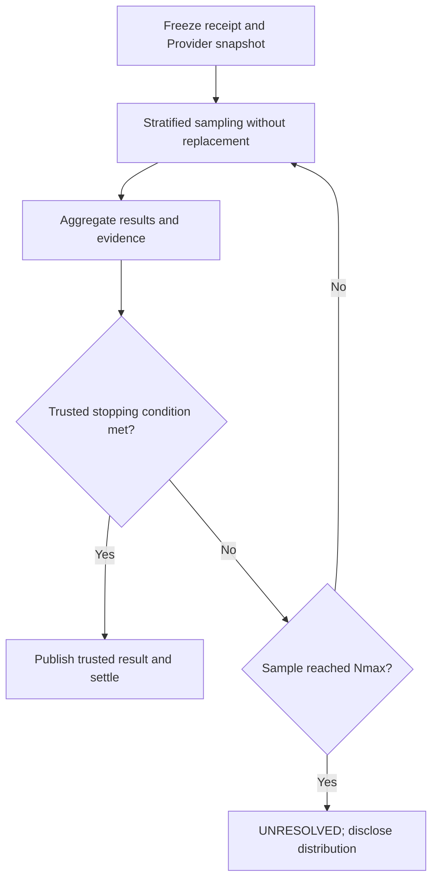

# RUDCP Public Argument Chain, Proof Obligations, and Project Structure v0.3

> Date: 2026-08-16  
> Status: Internal collaboration baseline / auditable design record  
> Language: English  
> Chinese counterpart: `RUDCP_公开论证链与项目结构_v0.3_中文.md`

## 0. Purpose and evidence discipline

This document reconstructs the project founder's **publicly auditable argument chain, decision rationale, proof obligations, and falsification conditions**. It does not claim to expose anyone's private internal chain of thought, and it does not present intuitions as theorems.

| Tag | Meaning | Permitted wording |
|---|---|---|
| `DECIDED` | An accepted design decision | “The first version will…” |
| `DERIVED` | A design consequence under explicit premises | “Given A and B, C follows” |
| `INVARIANT` | A safety property no implementation may violate | “Every execution must satisfy…” |
| `ASSUMPTION` | A model premise currently relied upon but not proved | “The model currently assumes…” |
| `HYPOTHESIS` | An empirical claim requiring simulation or experiment | “We must test whether…” |
| `OPEN` | An unresolved decision | “A choice remains between…” |
| `REJECTED` | An excluded design or claim | “The first version will not…” |

**Rigor rule.** An argument becomes an auditable proof obligation only when it states its premises, mechanism, conclusion, scope, falsifier, and verification method. Economic incentives can support a rational-agent model; they cannot replace proofs of identity independence, cryptographic security, or distributed consistency.

## 1. Top-level proposition

### 1.1 Objective

RUDCP aims to be a fully open-source distributed-computing system for heterogeneous idle devices. It should allow a Requester to submit a resource-bounded general computation and, despite unstable Providers, unreliable networks, and partially untrusted participants, obtain:

1. auditable task partitioning and assignment records;
2. a result accepted under a predeclared verification policy, or an explicit `UNRESOLVED` outcome;
3. final settlement no more than once and within the applicable receipt budget;
4. bounded recovery after node departure rather than indefinite limbo;
5. zero-upfront-capital entry for ordinary Providers.

### 1.2 What may and may not currently be claimed

**Supported claim:** the project has a coherent design skeleton that can be specified, simulated, tested, and falsified. Node-departure recovery, stake-free reputation, receipt immutability, staged verification, and minimal governance all have explicit directions.

**Unsupported claims:** system robustness has been proved; 51% of Providers is necessarily an independent majority; reputation necessarily converges; arbitrary general computation is cheaply verifiable; issuance makes verification costless; or the centralized control plane is already fault tolerant.

## 2. Roles, trust boundaries, and openness

### 2.1 Decided roles

| Role | Core responsibility | Role combination | Current trust boundary |
|---|---|---|---|
| `Requester` | Submit task, inputs, budget, deadline, and verification requirements; receive a result or `UNRESOLVED` | May also act as Broker or Provider | Has no final audit-decision authority |
| `Broker` | Partition a task into valid Assignments and allocate them to Providers | May be the Requester or a third party | Partition and allocation must be publicly auditable |
| `Provider` | Accept an Assignment, execute it, and submit a result; qualified Providers may also verify | A node may hold other roles | Ordinary Providers are untrusted, may leave, and may submit erroneous results |
| `Protocol / Control Plane` | Register receipts, issue leases, maintain events, apply verification and settlement rules | Centralized in the first version | Logic is provisionally trusted but crashable and constrained by versioned rules and audit |
| `Foundation / Maintainers` | Maintain open-source rules, versions, tests, evidence, and releases | Subject to conflict-of-interest recusals | May not change report weights or outcomes case by case |

### 2.2 Open-source and auditability argument

| ID | Premise / observation | Derivation | Current conclusion | Status |
|---|---|---|---|---|
| A1 | A Broker can affect partitioning and allocation | If Assignment rules are hidden, optimization cannot be distinguished from bias or manipulation | Valid Assignment format, partitioning rules, and allocation events must be public | `DERIVED` |
| A2 | The first partitioner does not seek a global optimum | Claiming optimality would create an unmet proof obligation | Use the simplest greedy method subject only to resource, dependency, deadline, verification, and budget boundaries | `DECIDED` |
| A3 | Nodes may hold several roles | A role label cannot be treated as an independent controlling principal | The identity model must distinguish role, account, device, Provider instance, and ultimate controller | `DERIVED` / `OPEN` |
| A4 | Maintainers control releases | Open code can still be bypassed through discretionary case-specific governance | Rule changes must be versioned, publicly reviewed, traceable, and non-retroactive | `DECIDED` |

## 3. Public argument chains from problem to mechanism

### 3.1 Chain B: Why computation receipts are immutable

**Problem.** If the program, input, verification rule, budget, or deadline can change during execution, the Provider's obligation, the Requester's purchase, and the verifier's subject cease to be the same object.

**Premise.** Enforceable settlement requires all parties to refer to one task version.

**Mechanism.** Register every task unit as:

\[
C_j=(ID,P,I,E,R,V,S,D,B,A,\Pi)
\]

`P/I/E` bind program, input, and environment; `R` binds resource limits; `V/S` bind verification and success conditions; `D` binds lease and final deadlines; `B` binds execution, verification, and platform budgets; `A` binds attempt limits; and `Π` binds partition, checkpoint, retry, and merge rules.

**Derivation.** Any material-field change creates a new ReceiptID; execution appends events without mutating the receipt body.

**Conclusion.** The ReceiptID can be the common referent for leases, results, verification, reputation, and settlement.

**Proof obligations.** Canonical serialization, hash-field coverage, migration rules, signature/digest rules, and persistence of content-addressed objects.

**Falsifier.** The chain fails if semantically different receipts can share an ID or critical fields can be silently rewritten under one ID.

### 3.2 Chain C: Why ordinary Providers can enter without collateral

**Constraint.** Ordinary Providers never contribute upfront capital, a deposit, or property collateral.

**Problem.** Without slashing, how can the system constrain lease hoarding, abandonment, score farming, and repeated new identities?

**Mechanism bundle.**

1. A Provider incurs a performance record only after accepting a lease; pre-acceptance rejection is neutral.
2. Abandonment, timeout, or failed verification after acceptance appends a `ReputationEvent`.
3. New nodes begin with low concurrency, low-risk access, and low receipt-weight limits.
4. Per-node, per-receipt, and global attempt limits are enforced.
5. High-value work requires performance evidence and sufficiently low rating uncertainty.
6. The constrained assets are future opportunity, concurrency, and risk exposure rather than confiscable property.

**Limited conclusion.** Zero-collateral entry and history-based risk control can coexist.

**What does not follow.** Sybil attacks do not disappear, and attack cost is not automatically above attack benefit.

**Proof obligation.** Quantify the maximum delay, retry cost, false-acceptance probability, and repeatable gain available to a fresh identity.

### 3.3 Chain D: Why reputation is task-family-specific and uncertain

**Observation.** CPU, GPU, memory-intensive, deadline-sensitive, and verification skills differ; old evidence can become stale.

**Rejected model.** One permanent scalar score transfers ability incorrectly and amplifies early advantage.

**Candidate model.**

\[
\mathbf r_i=(r_i^{CPU},r_i^{GPU},r_i^{Memory},r_i^{Reliability},r_i^{Deadline},r_i^{Validation})
\]

Within a task family:

\[
p_{ij}=\sigma\left(\frac{r_i-d_j}{\tau}\right),\qquad
r_i'=r_i+K w_j(y_{ij}-p_{ij})
\]

Maintain uncertainty as well:

\[
r_i\sim\mathcal N(\mu_i,\sigma_i^2),\qquad
r_i^{safe}=\mu_i-z\sigma_i
\]

**Derivation.** Repeating work far below estimated ability yields little gain; unexpectedly completing difficult work yields more; dormancy or hardware change expands uncertainty rather than erasing all history.

**Anti-lock-in requirement.** Scheduling must reserve exploration capacity and promotion challenges, or new nodes cannot generate evidence.

**Status.** The formula is a `HYPOTHESIS`; the interface, multidimensionality, and uncertainty principles are `DECIDED`. `K, τ, z, w_j` remain uncalibrated.

### 3.4 Chain E: Why leases, epochs, and bounded retries are required

**Problem.** Providers may crash, disconnect, leave voluntarily, or hold work indefinitely.

**Mechanism.** The Broker/control plane issues a time-bounded Lease; every reassignment strictly increments the epoch; heartbeats inform progress and timeout decisions; an old-epoch result cannot overwrite a newer epoch or terminal state; attempts and final time are bounded.

**Safety conclusion.** Under a correct implementation, an obsolete lease cannot regain current economic rights, and a late result cannot roll state back or trigger duplicate payment.

**Conditional-liveness conclusion.** Only if the control plane eventually recovers, the network eventually delivers, a qualified finisher exists, the receipt is unexpired, and verification is available must the work settle successfully. Otherwise it must reach `FAILED`, `EXPIRED`, or `UNRESOLVED` within a finite bound.

**Proof obligations.** State machines, idempotent APIs, clock assumptions, model checking, and duplicate/out-of-order/partition/crash-recovery tests.

### 3.5 Chain F: Stratified, without-replacement, progressively expanded verification

#### 3.5.1 Decided procedure

1. Freeze the receipt, candidate-result set, and eligible-Provider snapshot.
2. Draw verification Providers without replacement under a predeclared stratification rule.
3. Collect result reports, evidence, and control-relationship disclosures for the round.
4. Stop immediately if a candidate meets the predefined trusted stopping condition.
5. Otherwise expand the sample and run another round.
6. If the cumulative sample reaches `Nmax = 51% × eligible-Provider snapshot` without a trusted candidate, terminate as `UNRESOLVED`.
7. Inform the Requester of candidates and their distribution, but do not give the Requester final audit authority. The Requester may independently use an `UNRESOLVED` candidate without protocol endorsement.
8. Neither trusted termination nor `UNRESOLVED` is refunded because execution and verification services have occurred. Verification is funded by protocol issuance.

#### 3.5.2 What this process can actually establish

The sampling process yields calculable statistical evidence only if the sampling frame is not manipulated, each Provider is counted once, strata are fixed ex ante, classification is fixed, the stopping rule is not changed after observing data, and inter-sample dependence is modeled or sufficiently small.

It does **not by itself establish** that Providers have independent controllers, the majority result is true, 51% is a safe threshold, Alice cannot own several Providers, or external attack benefit is zero.

#### 3.5.3 Economic trust and its strict boundary

The current economic intuition is:

\[
C_{Rank}+C_{Verification}+C_{Coordination}>G_{attack}^{protocol}
\]

which would discourage a rational attacker seeking only protocol-internal gain and would bound the damage available through each receipt and verification policy.

A rigorous version must instead state:

\[
C_{attack}>G_{protocol}+G_{external}+V_{disruption}-P_{detection}
\]

and account for repeated attacks, identity rental, collusion subsidies, external positions, competitive sabotage, nonfinancial objectives, and cost recovery. Only proved lower bounds on cost and upper bounds on gain justify the narrow claim that a specified attack is economically dominated under specified parameters.

**Logical gap that cannot be skipped:** “the attack is uneconomic” does not imply “the sample is independent.” Approximate independence needs separate evidence about identity, control, resource origin, sampling design, or correlation discounts. Economic security is therefore an `ASSUMPTION/HYPOTHESIS`, not a theorem.

### 3.6 Chain G: Why trusted stopping, Nmax, and no refund can coexist

**Service distinction.** The Requester buys the predeclared computation-and-verification process, not an unconditional guarantee of a correct answer.

**Derivation.** If the protocol performs computation, sampling, verification, round expansion, and evidence production as declared, it has delivered a process service even when the terminal output is `UNRESOLVED`.

**Decision.** Neither terminal path is refunded; verification is not financed through upfront Provider capital but by protocol issuance.

**Unclosed obligations.** The delivery definition must be disclosed before receipt creation; execution budget, Provider reward, verification budget, platform fee, and issuance must be separated; issuance caps, incidence, and dilution/inflation effects must be defined; infinite verification must not permit infinite issuance.

### 3.7 Chain H: Why the Foundation must have minimal authority

**Problem.** A Foundation that maintains rules, publishes analysis, reviews disclosures, and changes case-specific weights creates an unauditable conflict of interest.

**Decided boundary.** Maintainers preserve open-source code, rule versions, tests, releases, and evidence. Analysts and ethical disclosers may contribute evidence but may not use maintenance authority to change the weight or outcome of the same matter.

**Derived controls.** Least privilege, two-person review, public ADRs, versioned rules, conflict disclosure, recusal, no retroactive rule changes, reproducible builds, and append-only audit logs.

**Open issues.** When a legal Foundation becomes necessary; maintainer appointment/removal; emergency-patch authority; key rotation; revocation; and appeal.

### 3.8 Chain I: How to decide whether administrative cost is worthwhile

Administration is a risk control, not an objective. Use:

\[
NV_{gov}=E[L_{without}-L_{with}]+V_{audit}+V_{compliance}+V_{trust}-C_{total}
\]

where:

\[
C_{total}=C_{maintenance}+C_{verification}+C_{review}+C_{delay}+C_{infra}+C_{legal}+C_{opportunity}+C_{issuance}
\]

Administrative capacity should be retained or expanded only if `NV_gov > 0` under conservative assumptions and no cheaper automated control provides equivalent risk reduction. Phase 0 defines the maintenance role and rules without presupposing a large legal entity or committee.

## 4. Detailed structure of determined progress

### 4.1 Project boundaries

| ID | Determined item | Status | Remaining artifact |
|---|---|---|---|
| SCOPE-01 | Entire system is fully open source | `DECIDED` | License, contribution, and release policy |
| SCOPE-02 | Core roles are Requester, Broker, Provider; nodes may combine roles | `DECIDED` | Controller and conflict model |
| SCOPE-03 | The Requester or a third party may act as Broker | `DECIDED` | Broker API, audit events, responsibility boundary |
| SCOPE-04 | Simplest greedy partitioning subject to validity boundaries; no optimality claim | `DECIDED` | Assignment validity specification and baseline algorithm |
| SCOPE-05 | Centralized control plane in the first version | `DECIDED` | Recovery, consistency, and audit specifications |
| SCOPE-06 | No blockchain dependency, no tradable token, and no default task Internet access in v1 | `DECIDED` | Threat model and execution policy |

### 4.2 Core data objects

| Object | Determined fields / responsibility | Incomplete specification |
|---|---|---|
| `ComputeReceipt` | Immutable program, input, environment, resource, verification, deadline, budget, attempt, and partition rules | JSON Schema, canonical encoding, signature, version |
| `Assignment` | Publicly auditable, valid task unit produced by the Broker | Greedy algorithm, boundary checks, dependency graph, failure semantics |
| `NodeIdentity` | Account, device, Provider instance, and key linkage | Ultimate controller, rotation, revocation, Sybil risk |
| `CapabilityProfile` | Task-family capability, resource claim, environment | Measurement trust, drift, benchmarks |
| `Lease` | Receipt/Assignment, Provider, epoch, deadline, conditional economic right | Atomic issue, renewal, concurrency, clock model |
| `Attempt` | Start, progress, termination, and reason for one execution | Deduplication, replay, late handling |
| `Checkpoint` | Recoverable execution state | Integrity, compatibility, persistence, pricing |
| `ResultSubmission` | Result, digest, epoch, evidence, idempotency key | Format, size, duplicates, retention |
| `VerificationPolicy` | Strata, sampling, rounds, trusted stop, Nmax, budget | Confidence model, dependence, eligibility snapshot, undecidable path |
| `VerificationDecision` | Trusted result or `UNRESOLVED` plus evidence chain | Decision schema, appeal, finality, disclosure |
| `ReputationEvent` | Task family, difficulty, weight, outcome, time, evidence | Attribution, parameters, decay, correction |
| `Settlement` | At-most-once post-verification payment and budget conservation | Transaction boundary, unique key, recovery, issuance accounting |

### 4.3 Determined safety invariants

1. `INV-01 Receipt immutability`: critical fields for one ReceiptID never change.
2. `INV-02 Epoch monotonicity`: every replacement lease has a strictly greater epoch.
3. `INV-03 Single terminal state`: a receipt cannot occupy several terminal states.
4. `INV-04 At-most-once settlement`: one economic entitlement is paid at most once.
5. `INV-05 Budget conservation`: payments and committed verification expenditure stay within the applicable budget/issuance cap.
6. `INV-06 Verify before settle`: no success settlement without a valid VerificationDecision.
7. `INV-07 Late-result isolation`: an old-epoch result cannot overwrite a newer epoch or terminal state.
8. `INV-08 Bounded attempts`: consumed attempts do not exceed the receipt limit.
9. `INV-09 Auditable transitions`: every state transition maps to one traceable event.
10. `INV-10 Exposure limit`: a node cannot exceed current concurrency and risk limits.
11. `INV-11 Sampling without replacement`: one Provider is not counted twice in the same verification sequence.
12. `INV-12 No case-specific weight mutation`: maintainers cannot retroactively change weight rules for a particular report.

### 4.4 Determined state-machine skeletons

| Machine | Minimum states | Required exceptional paths |
|---|---|---|
| Receipt | `DRAFT → REGISTERED → ASSIGNED/RUNNING → VERIFYING → SETTLED/FAILED/EXPIRED/UNRESOLVED` | Duplicate registration, rule-version change, expiry, cancellation |
| Lease | `OFFERED → ACCEPTED → ACTIVE → COMPLETED/ABANDONED/TIMED_OUT/SUPERSEDED` | Duplicate accept, reordered heartbeat, epoch race |
| Attempt | `CREATED → RUNNING → SUBMITTED/FAILED/TIMED_OUT` | Crash recovery, duplicate result, late result |
| Verification | `SNAPSHOT → ROUND_n → TRUSTED/EXPAND/UNRESOLVED` | Provider loss, insufficient sample, disclosed correlation, evidence conflict |
| Settlement | `PENDING → AUTHORIZED → COMMITTED` or `FAILED_RETRYABLE/FAILED_FINAL` | Replay, concurrency, partial write, recovery |
| Reputation | `ACTIVE / DORMANT / RESTRICTED / REVOKED` | Device change, dormancy, uncertainty expansion, appeal |

### 4.5 Verification and experimentation system

| Method | Property / failure sought | Phase |
|---|---|---|
| Unit and property tests | Schemas, transitions, budgets, idempotency | G0-G2 |
| TLA+/PlusCal or equivalent model checking | Epochs, one terminal state, one settlement, partitions, replay | G0-G2 |
| Discrete-event simulation | Calibration, exploration, Nmax, attack gain, cost, concentration | G1 |
| Fault injection | Process, network, database, object-store, verifier faults | G2-G4 |
| Adversarial-strategy testing | Sybil, collusion, farming, hoarding, external gains, governance abuse | G1/G5 |
| Real-node experiments | Performance drift, reconnection, heterogeneity, execution environment | G3-G6 |

## 5. Structure of unresolved problems

### 5.1 P0: blockers for G0

#### P0-A Identity, control, and approximate independence

- What is the minimum eligibility criterion for a Provider?
- Is the Nmax denominator based on accounts, devices, Provider instances, controlling principals, or verifiable resources?
- When is the snapshot frozen, and how are joins, exits, and revocations handled?
- How are conflicts disclosed when one node holds several roles?
- How are common ownership, funding, networking, or coordinated action deduplicated or discounted?
- What measurable criterion defines “approximately independent,” and what maximum dependence is allowed?

#### P0-B Trusted stopping

- Does “trusted” mean deterministic verification, an error bound, posterior probability, confidence interval, or weighted plurality?
- How are candidate results clustered and floating-point tolerances handled?
- Progressive observation creates optional-stopping risk; how is it corrected?
- How are strata and weights frozen ex ante?
- When does a defective verifier, rather than Provider disagreement, cause `UNRESOLVED`?

#### P0-C Security meaning of `Nmax = 51%`

- 51% is currently a process cap, not a proved Byzantine threshold. What risk target does it serve?
- What happens if the eligible population is small, concentrated, or cannot reach 51%?
- Should the cap vary with task value, verification cost, and dependence?
- How are two close candidates disclosed after Nmax?

#### P0-D Settlement, budgets, and issuance

- How are execution budget, verification budget, platform fee, and protocol issuance accounted separately?
- What do Providers, verifiers, and the Broker receive under `UNRESOLVED`?
- How does the Requester knowingly accept the no-refund rule before receipt creation?
- What are the global issuance cap, per-verification issuance rate, and emergency stop?
- How is at-most-once settlement preserved across duplicate, reordered, concurrent, and crash-recovery paths?

#### P0-E Control-plane and storage failures

- What are the database consistency level, leadership transition, and lease-clock assumptions?
- Which side of a network partition may renew leases, verify, or settle?
- What replication, RPO, and RTO apply to event logs, object storage, and checkpoints?
- How does the system recover from software and rule-version mismatch?

### 5.2 P1: parameterized simulation questions

#### P1-A Economic attack model

- How are protocol gain, external position, disruption value, collusion subsidy, and repeated attack bounded?
- Can Rank-acquisition cost be transferred, rented, bought, or recovered through self-generated tasks?
- What is the detection probability, and is the consequence only reputation loss?
- How are irrational, political, or competitive attacks stress-tested?

#### P1-B Reputation, fairness, and concentration

- How are `K, τ, z`, and task weights calibrated?
- How is exploration balanced against failure of high-value work?
- What concentration limit applies to the top 1%, 5%, and 10% of Providers?
- How fast does uncertainty expand after dormancy, hardware change, or drift?
- Should abandonment, timeout, bad result, and platform-caused failure receive different weights?

#### P1-C Partitioning and heterogeneous normalization

- What are the order, tie-breaking, and determinism rules for the simplest greedy partitioner?
- Can partitioning break verifiability, dependencies, checkpoints, or result merging?
- How are CPU/GPU/memory/network costs normalized within a task family?
- What evidence permits cross-family reputation transfer? The default is no transfer.

#### P1-D Foundation and administrative cost

- How are maintainers appointed, removed, recused, and granted emergency authority?
- How are ethical disclosers, analysts, and maintainers separated?
- Which controls require humans, and which should be automated through tests, signatures, and logs?
- What measurable benefit justifies a legal Foundation or dedicated administration?

### 5.3 P2: later research

- Interactive verification, verifiable computation, zero-knowledge proofs, or trusted execution;
- complex nondeterministic tasks and machine-learning training verification;
- GPU, cross-region, cross-architecture, and large-input workloads;
- public external-node pilots, regulation, and cross-border payment;
- further federation or decentralization of the control plane.

## 6. Phases and completion gates

| Gate | Objective | Required evidence |
|---|---|---|
| G0 | System specification and robustness baseline | Charter, glossary, participants, threat model, schemas, state machines, invariants, draft verification policy, simulation plan, ADRs |
| G1 | Discrete-event simulation | Baselines, sensitivity, false acceptance, completion, tail latency, concentration, attack loss, real cost |
| G2 | Single-host control-plane prototype | No double payment or split state after crash, replay, duplication, or concurrency; full traceability |
| G3 | LAN MVP | Safety invariants and initial SLOs under real-node departure, disconnection, and recovery |
| G4 | Persistence and disaster recovery | Data loss within RPO, service within RTO, backups proven by restore exercise |
| G5 | Adversarial verification and governance testing | Quantified loss/detection for Sybil, collusion, farming, external gain, verifier fault, governance abuse |
| G6 | Heterogeneous expansion and external pilot | New hardware and task types preserve invariants; reputation does not migrate incorrectly |

## 7. Recommended collaboration split for G0

| Workstream | Owner A | Owner B | Cross-acceptance criterion |
|---|---|---|---|
| Charter, roles, economics, governance | Draft | Adversarial review | Every `ASSUMPTION` is visible |
| Threat Model | Review | Draft | Covers external gains and control relationships |
| ComputeReceipt / Assignment | Draft schemas | Write negative and attack cases | Canonical encoding and versions are unambiguous |
| Lease / Settlement | Write state machines | Write replay, order, and crash tests | Establishes `INV-02/03/04/05/07` |
| VerificationPolicy | Write procedure | Write statistical and Sybil counterexamples | Separates procedural correctness, statistical confidence, and identity independence |
| Reputation simulation | Define assumptions and metrics | Implement simulation | Compare random, fixed-quota, Beta/UCB baselines |

## 8. Required ADRs

1. `ADR-001`: Open-source scope, license, and release governance;
2. `ADR-002`: Requester/Broker/Provider role combinations and controlling principals;
3. `ADR-003`: Simplest greedy partitioner and valid Assignment;
4. `ADR-004`: Immutable receipt fields and ReceiptID;
5. `ADR-005`: Zero-collateral entry, concurrency, and exposure;
6. `ADR-006`: Multidimensional reputation, uncertainty, and exploration;
7. `ADR-007`: Stratified sampling without replacement and progressive expansion;
8. `ADR-008`: Trusted stop, Nmax=51%, and `UNRESOLVED`;
9. `ADR-009`: Requester information rights and lack of audit-decision authority;
10. `ADR-010`: No refund, verification issuance, and budget caps;
11. `ADR-011`: Foundation least privilege, recusal, and rule changes;
12. `ADR-012`: Administrative-cost metrics and governance-expansion threshold.

## 9. References and contribution boundary

1. David P. Anderson, [An Incentive System for Volunteer Computing](https://boinc.berkeley.edu/boinc_papers/credit/text.php).
2. David P. Anderson, [BOINC: A System for Public-Resource Computing and Storage](https://boinc.berkeley.edu/grid_paper_04.pdf).
3. D. P. Anderson et al., [High-Performance Task Distribution for Volunteer Computing](https://boinc.berkeley.edu/boinc_papers/server_perf/server_perf.pdf).
4. Mark E. Glickman, [Glicko and Glicko-2 Rating Systems](https://www.glicko.net/glicko.html).
5. Roslan Ismail and Audun Jøsang, [The Beta Reputation System](https://aisel.aisnet.org/bled2002/41/).
6. T. L. Lai and Herbert Robbins, [Asymptotically Efficient Adaptive Allocation Rules](https://doi.org/10.1016/0196-8858(85)90002-8).
7. Peter Auer, Nicolò Cesa-Bianchi and Paul Fischer, [Finite-time Analysis of the Multiarmed Bandit Problem](https://doi.org/10.1023/A:1013689704352).
8. Kevin Jamieson et al., [lil’ UCB](https://proceedings.mlr.press/v35/jamieson14.html).
9. H. G. Rice, [Classes of Recursively Enumerable Sets and Their Decision Problems](https://www.jstor.org/stable/1990888).
10. Open Container Initiative, [OCI Image Format Specification](https://github.com/opencontainers/image-spec).
11. Leslie Lamport, Robert Shostak and Marshall Pease, [The Byzantine Generals Problem](https://lamport.azurewebsites.net/pubs/the-byz-generals.pdf).
12. Michael J. Fischer, Nancy A. Lynch and Michael S. Paterson, [Impossibility of Distributed Consensus with One Faulty Process](https://dl.acm.org/doi/10.1145/3149.214121).
13. MLCommons, [MLPerf Benchmarks](https://mlcommons.org/benchmarks/).
14. Golem Network, [Provider Documentation](https://docs.golem.network/docs/providers/provider-installation).
15. John R. Douceur, [The Sybil Attack](https://www.microsoft.com/en-us/research/publication/the-sybil-attack/).
16. M. Babaioff et al., [On Bitcoin and Red Balloons](https://www.microsoft.com/en-us/research/wp-content/uploads/2012/06/bitcoin.pdf).
17. NIST, [SP 800-30 Rev. 1: Guide for Conducting Risk Assessments](https://csrc.nist.gov/pubs/sp/800/30/r1/final).
18. NIST, [Cybersecurity Framework 2.0](https://nvlpubs.nist.gov/nistpubs/CSWP/NIST.CSWP.29.pdf).

These sources establish relevant theoretical limits, engineering precedents, and analytical methods. They do not prove RUDCP's combined mechanism. RUDCP's computation receipts, zero-collateral reputation, staged stratified verification, Nmax/UNRESOLVED rule, issuance-funded verification, and Foundation boundary are project-specific combinations and unvalidated contributions. External writing must say “based on,” “inspired by,” “extended,” or “candidate mechanism,” not “proved by the literature.”

