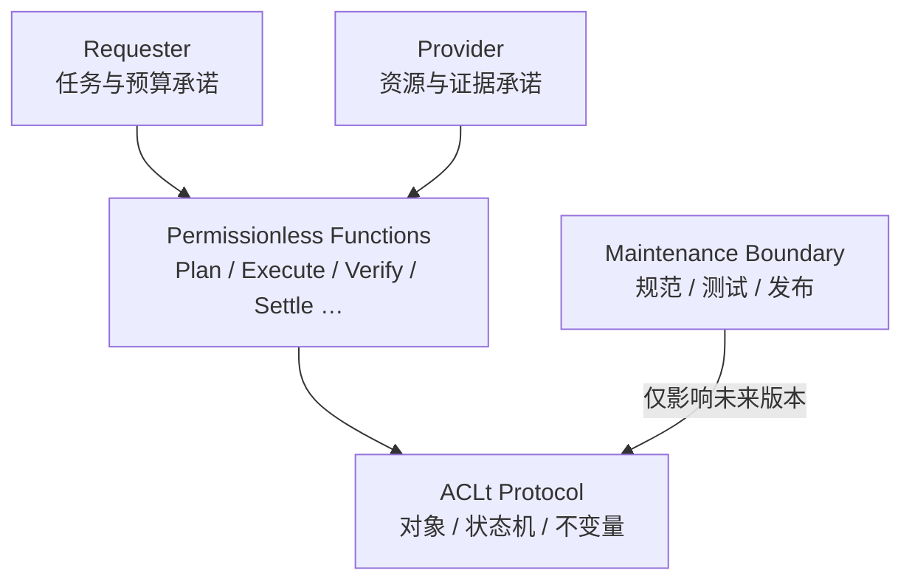

# ACLt Protocol

**ACLt Protocol** — an open, implementation-neutral protocol for heterogeneous, permissionless distributed computation.

> **状态：G0——协议规格化**  
> **当前语义基线：v0.5**  
> **首个工程目标：V1 Conformance Target（RIR + Rust Profile + RPR）**<br>
> **文档性质：Living repository；随证明、仿真、实现和攻击测试持续修订**  
> **最后更新：2026-11-17**
>
> **成熟度：draft / research baseline。** v0.5 是研究与规范基线；当前没有可部署的软件、节点或服务，也不是生产系统或主网系统。

ACLt Protocol 是一套面向异构、无许可分布式计算的开放、实现中立协议。`ACLt` 是受 *accurate* 启发形成的臆造名称，不是首字母缩写。

协议定义任务如何被不可变地承诺、规划、领取、执行、恢复、验证和结算，以及历史履约证据如何转化为未来的能力估计与有界风险暴露。它不是区块链、计算平台、市场、基金会或单一软件产品。

## 当前结论

ACLt Protocol 已形成一套完整的候选协议架构，但**尚未证明整体鲁棒性**。这一结论有明确边界（[#101](https://github.com/ZeroMatrixTech/ACLt/issues/101)，仍为 `OPEN`）：“无许可”是设计目标，不是当前已实现的属性。现有实验使用固定协调器、固定角色与固定对端地址；同宿主多 VM 证据只支持来宾级结论；物理故障域分离、无许可协调与统计独立性尚未建立。下文关于已实现能力和证据的表述都限于这一范围。

当前可以支持的严格表述是：

- 系统只保留 `Requester` 与 `Provider` 两类不可再约减的 Principal；
- Planner、Verifier、Scheduler 等职能被压缩为 permissionless functions；
- `ComputeReceipt` 固定任务、验证、期限、预算和结算语义；
- ACLt Abstract Machine 以版本化 Logical Object、合法事件、状态转换和终态组织多 Provider 计算；Provider 之间不存在共享机器地址空间；
- V1 以 `RIR` 作为机器/网络层的规范执行表示；Rust Profile 是参考前端而不是协议语义来源；
- RPR 是实现冻结 RIR runtime/effects/resource 语义的可替换边界；Host OS 隐藏状态不得进入任务结果；
- `Compile = Lowering + Decomposition + Packing`；该流水线是可审计函数，不是新的 Broker 或编译权威；
- 未来 C++23 等前端只有在降级到同一 RIR 并通过 conformance tests 后，才可声明兼容；
- Provider 可零前置抵押参与，但暴露、并发、价值、Lease、尝试和损失必须有界；
- 履约历史只允许形成 `PerformanceEvidence → CapabilityEstimate ± Uncertainty → ExposureDecision`；
- 履约能力不得授予验证票权、真理权、最终审计权或治理权；
- 验证使用 DIRECT/PROOF/REEXEC_BOUNDED/AUDIT_ONLY Profile；有限总体 e-process 的条件数学内核已闭合，Bayesian 只用于效率；
- Sybil 分析不假定标识独立，先以相关集群和硬损失上限控制风险；
- V1 不追求证明每个身份背后是不同自然人；官方主网用版本化 assurance、组件允许集合、工程审计和绝对损失预算限域启用能力；
- 多原因失效保存完整 `CauseSet` 并派生唯一 verdict；Dispatch/RPR 多点检查 active Lease capability，但不建立第三份 scope 权威；
- `UNRESOLVED`、`FAILED`、`EXPIRED` 和 `FUNDING_EXHAUSTED` 是合法安全终态；
- 资金来自预声明 `FundingPolicy`；发行只是可选来源，不是默认机制；
- 数据库、签名日志、联盟账本或公共区块链均可实现同一协议语义。
- SemanticStatus 与 V1 VersionDisposition 分别存储；`CORE` 不代表相应证明或实现已经完成。
- 结构/算法必须确定；日志忠实性、运行环境和部署事实可以使用限域、可撤销的工程证据，不必伪装成形式证明。

<a id="非目标与禁止主张"></a>

## 当前适用范围

当前安全主张的适用范围如下：

- 任意计算的廉价或绝对正确验证尚未建立；
- Provider 数量不表示独立控制实体的数量；
- ACLt Protocol 没有默认的 51% 安全阈值；
- Rank、信誉或历史表现不表示真理；
- 攻击不划算不等同于攻击不可能；
- 临时发行不会使验证免费；
- 使用区块链不会自动带来协议安全或分布式容错；
- 中心化参考实现尚不具备公共网络鲁棒性；
- 使用 Rust、RIR 或某个编译器不会自动保证结果正确、确定性、资源计量一致或分布式安全；
- V1 尚未支持或验证 unsafe Rust、完整 `std`/宿主 OS effects、原生执行、GPU/专用加速器或非确定性任务。

## 最小本体



图中的 Protocol 是规则，不是行为者；函数输出只有通过版本、签名、前置状态与不变量检查后才生效。

## 核心设计原则

1. **如无必要勿增实体**：公开、确定且可验证的职能优先写成协议函数；
2. **先承诺，后观察**：任务、验证、抽样、资金和结算政策先冻结；
3. **先限制损失，再讨论激励**：硬上限优先于“攻击成本大于收益”；
4. **不确定性必须显式化**：无法背书时返回 `UNRESOLVED`；
5. **证据不等于权威**：能力估计只影响有界暴露；
6. **不假定身份独立**：原始标识数不等于有效样本量；
7. **协议与实现分离**：底层基础设施可替换，语义不可漂移；
8. **维护最小权限**：维护者不得裁决运行中个案。
9. **前端不定义协议语义**：协议绑定 RIR、版本与执行 Profile；源语言只负责产生候选 RIR。
10. **成熟度与版本范围分离**：语义状态不与 `CORE/DEFERRED/REJECTED` 合并存储。
11. **工程事实分层闭合**：接口与算法必须唯一；来源与部署用版本化工程证据、fail-closed 和损失上限管理。

完整原则见 [`docs/00-overview/design-principles.md`](docs/00-overview/design-principles.md)。

## 文档阅读顺序

| 顺序 | 文档 | 用途 |
|---:|---|---|
| 1 | [`project-overview.md`](docs/00-overview/project-overview.md) | 项目目标、范围、非目标和成熟度 |
| 2 | [`terminology.md`](docs/00-overview/terminology.md) | 统一术语、状态标签和废弃语义 |
| 3 | [`system-context.md`](docs/00-overview/system-context.md) | 系统边界、Principal、函数和外部依赖 |
| 4 | [`threat-model.md`](docs/01-requirements/threat-model.md) | 攻击者、威胁与剩余风险边界 |
| 5 | [`invariants.md`](docs/01-requirements/invariants.md) | 16 条规范性安全不变量 |
| 6 | [`system-architecture.md`](docs/02-architecture/system-architecture.md) | 分层架构和实现边界 |
| 7 | [`ADR-0002`](docs/05-decisions/ADR-0002-normative-rir-and-v1-rust-profile.md) | RIR、Rust Profile 与 V1 能力边界 |
| 8 | [`ADR-0003`](docs/05-decisions/ADR-0003-separate-semantic-status-and-version-disposition.md) | SemanticStatus 与 VersionDisposition 二维分离 |
| 9 | [`ADR-0004`](docs/05-decisions/ADR-0004-verification-profiles-and-finite-population-e-process.md) | VerificationProfile 与有限总体 e-process 边界 |
| 10 | [`ADR-0005`](docs/05-decisions/ADR-0005-engineering-assumptions-and-mainnet-assurance.md) | 工程假设、主网 assurance 与单一权威边界 |
| 11 | [`verification-profile-schema.md`](docs/03-protocol/verification-profile-schema.md) | P0-1A canonical 语义与 P0-1B 实现目标 |
| 12 | [`v1-profile.md`](docs/03-protocol/v1-profile.md) | V1 CORE/DEFERRED/REJECTED 唯一映射 |
| 13 | [`protocol-spec.md`](docs/03-protocol/protocol-spec.md) | 当前规范性协议骨架 |
| 14 | [`result-validation.md`](docs/03-protocol/result-validation.md) | 验证流程、统计边界与证明义务 |
| 15 | [`verification-round-mathematical-model.md`](docs/06-research/verification-round-mathematical-model.md) | 验证轮条件定理、反例与对拍说明 |
| 16 | [`last-two-problem-trees.md`](docs/06-research/last-two-problem-trees.md) | 多原因判决与 Dispatch scope 的替代思路树 |
| 17 | [`current-status.md`](docs/07-roadmap/current-status.md) | 当前进度、证据成熟度与工程 Gate |
| 18 | [`open-questions.md`](docs/07-roadmap/open-questions.md) | P0/P1/P2 未决问题和 v0.6 依赖 |

完整索引见 [`docs/README.md`](docs/README.md)。

## 仓库结构与维护

当前规范集中在 `docs/00-overview` 至 `docs/08-governance`；Schema 与种子分别在 `schemas/`、`registries/`；实现和测试在 `tools/`、`tests/` 及当前实验目录。

统一操作、目录职责与打包边界见[开发与维护指南](docs/development.md)。根目录 `make help` 列出入口：

```bash
make check       # Python 回归与清单验证
make test        # 当前全部本地检查，含编译及 sanitizer；不启动 VM
make workflow    # 按指纹执行并收集各组证据
```

历史规范在 `docs/codocs/`，旧单机实验原位保留，不参与当前检查。`spec/`、`simulations/` 仍是后续候选目录，尚未建立；创建条件见当前状态与未决问题。

## 当前工程入口与证据

当前开发重心是 [ACLt 最简验证机](docs/07-roadmap/minimal-verifier-baseline.md)。以问、答、验为切片内核，验收可信双物理机上的拆分、派发、交叉验证与归并。进度与优先级见[当前状态](docs/07-roadmap/current-status.md)。

截至 2026-11-09，已有两条工程路线的候选实现和证据：

- [ADR-0007](docs/05-decisions/ADR-0007-formal-object-migration-foundation.md) 与 [ADR-0008](docs/05-decisions/ADR-0008-fm-s3-interface-decisions.md) 下的候选 FM-S3 audit-only 路径已覆盖 UNRESOLVED、EXPIRED、FAILED、FUNDING_EXHAUSTED 四个过程终态，双物理机证据见[收尾](docs/testing/FM-S3-CLOSEOUT-20261106.md)、[Task trap](docs/testing/FM-S3-TASK-TRAP-20261106.md)和[终态与历史矩阵](docs/testing/FM-S3-HISTORICAL-MATRIX-20261106.md)。2026-11-07 收尾时 24 套公开快照可只用仓库复核，见[证据归档收尾](docs/testing/FM-EVIDENCE-CLOSEOUT-20261107.md)；`docs/testing/public-evidence/` 现有 27 个归档，公开范围见[首次公开发布说明](docs/releases/PREVIEW-20261106.md)。
- P0-1B 的 Profile 规则按 R1–R11 切片实现，Type A 为 81 implemented / 35 partial / 3 not implemented；[R8](docs/testing/PROFILE-COMMITMENTS-R8-20261108.md)补 Claim/快照/承诺绑定，18 个摘要 owner 的现行公式与投影已实现。[R9](docs/testing/PROFILE-RUNTIME-R9-20261108.md)补运行期绑定/冻结与阶段守卫；TEST imports、7 项适用性和完整阶段/来源验收仍有缺口。[R10](docs/testing/PROFILE-DECISION-R10-20261109.md)实现 audit-only Phase D 测试重放。[R11](docs/testing/PROFILE-AUTHORITY-R11-20261109.md)从已验证的 FM-S3 日志前缀复算判决并核对结算。

正式接口、FM-A 正式验收与准入保持 `OPEN`；P0-1B 保持 `STARTED / NOT CLOSED`。首次公开发布的范围、复现方式与已知限制见[首次公开发布说明](docs/releases/PREVIEW-20261106.md)（发布名 `research-preview-1`）；该版本已于 2026-11-16 发布，见 [GitHub Release](https://github.com/ZeroMatrixTech/ACLt/releases/tag/research-preview-1)。

state3 仍是本地单机回归入口（[说明](experiments/aclt-minimal-verifier-state3/README.md)）。[2026-10-03 集成报告](docs/testing/INTEGRATION-FIX.md)记录 265 个实验场景、13 项模型测试、24 项验证配置测试及 22 项流程/集成测试通过；这是已保存的历史证据，不是本次全量重跑结果。

| 目录/入口 | 用途 |
|---|---|
| `tools/formal_migration/`、`tests/formal_migration/` | 正式对象迁移候选实现（FM-S1a～FM-S3）及本地回归 |
| `scripts/fm-s2-dualhost.py`、`scripts/fm-s3-dualhost.py` | 显式双物理机集成驱动；按 [DUALHOST-SSH-1](docs/08-governance/dualhost-ssh-validation.md) 运行 |
| `experiments/aclt-minimal-verifier-state3/` | 本地单机回归入口；旧代见 [实验索引](experiments/README.md) |
| `experiments/aclt-multinode-admission/` | 预登记身份、持久接收器与故障注入原型；见[多节点实验说明](experiments/aclt-multinode-admission/README.md) |
| `schemas/verification-profile/`、`registries/` | Schema 骨架、覆盖登记与注册种子 |
| `tools/verification_profile/`、`tests/verification_profile/` | 验证配置实现与测试 |
| `tests/workflow/`、`docs/workflow/`、`.aclt-flow/` | 自动进度流程及其测试、模板与文档 |
| `scripts/run-singlehost.sh` | 全量单机检查入口 |
| `scripts/aclt-flow.py run` | 按输入与证据指纹执行并生成 `ACLT-PROGRESS.md` |
| `docs/testing/` | 单机报告、规则覆盖账本和集成证据 |

2026-10-07 的维护范围与文件清单见 [维护报告](docs/08-governance/audits/audit-20261007-01-markdown-maintenance.md)。

多节点原型是独立的限域实验，不在 `scripts/run-singlehost.sh` 内。仓库内本地复查命令及 VM 外部证据边界见[实验索引](experiments/README.md)；原型可运行不表示 G3 已通过。

新增实验：[接纳端回滚与复制保护](experiments/aclt-authority-admission/README.md)，本地入口 `make test-authority`。这是外置单一可信账本约束下的工程实验，不改变下列 Gate 状态。

## 当前工程 Gates

| Gate | 内容 | 当前状态 |
|---|---|---|
| G0 | 规格、对象、RIR、状态机、不变量、威胁、统计和资金政策 | **进行中** |
| G1 | 能力、调度、验证、Sybil、资金、RIR/runtime 和行政成本仿真 | 未开始 |
| G2 | 单机参考实现、RIR toolchain/runtime 与确定性测试 | 已有局部单机实验；完整 Gate 未通过 |
| G3 | 局域网多 Provider MVP 与故障注入 | 未开始 |
| G4 | 持久化、备份、恢复和适配器一致性 | 未开始 |
| G5 | Sybil、串谋、预算耗尽和维护滥权对抗验证 | 未开始 |
| G6 | 异构硬件、外部参与者与可选账本试点 | 未开始 |

不得在前一 Gate 的退出证据不足时，把后一 Gate 的可运行结果解释为普遍安全证明；但来源忠实性和部署事实允许用工程证据限域推进，不要求先获得开放世界形式证明。

## 参与项目

当前最有价值的贡献是：

- 把 16 条不变量转化为机器可检查的状态机与性质测试；
- 完成 canonical schemas、编码和测试向量；
- 冻结 RIR canonical encoding、验证器、运行时 effects/resource model 和 Rust Profile lowering；
- 实现 VerificationProfile/MainnetAssuranceProfile、CauseSet reducer 和有限总体 e-process conformance；
- 实现 Lease capability、Dispatch/RPR 双检查和 append-only/finality 日志 contract；
- 建立相关性、集群暴露和最大损失仿真；
- 规格化 FundingPolicy、退款、故障归因和最多一次结算；
- 建立适配器一致性、发布密钥、撤销和漏洞响应流程。

贡献流程见 [`CONTRIBUTING.md`](CONTRIBUTING.md)；提交前应先阅读。

## 版本与更新

- v0.5 是当前语义基线，不是不可修改的产品版本；
- 新证据可以把 `CANDIDATE` 变更为 `DECIDED` 或 `INVARIANT`，也可以把旧结论变更为 `SUPERSEDED` 或 `REJECTED`；
- 影响协议语义的变更必须同时更新 ADR、威胁模型、不变量、协议规范、状态和未决问题；
- 文档冲突时，较新的明确决定与规范性文档优先，历史文件仅作追踪。

## 开源与许可

本仓库的全部工件采用 **Apache License 2.0**，SPDX 标识为 `Apache-2.0`，范围包括代码与参考实现、协议规范、项目文档、仓库内的研究文稿、测试向量与证据。代码许可于 2026-08-17 确定；2026-11-14 维护者决定规范、文档与研究文稿沿用同一许可。

另有标注的第三方材料保留其原许可。目前包括 `tools/verification_profile/rust/unicode_data.rs`（由 Unicode 字符数据库生成，适用 `Unicode-3.0`，全文见同目录 `UNICODE-LICENSE.txt`）和 `docs/00-overview/fonts/` 下的五个字体子集（适用 `OFL-1.1`，随附三份 `OFL-*.txt` 原文）。Apache-2.0 第 6 条不授予名称或商标使用权；ACLt 是项目名称，不是商标，项目不声明商标；维护者已于 2026-11-16 决定放弃名称冲突检索并接受同名风险（[#128](https://github.com/ZeroMatrixTech/ACLt/issues/128#issuecomment-6920084883)），名称、商标与兼容性声明不再作为公开发布的阻断项，见下节。贡献采用 Developer Certificate of Origin（DCO），不使用 CLA；外部 fork PR 的每个提交须带与作者一致的 `Signed-off-by`，内部代理提交由维护者在合并时签署，细则见 [CONTRIBUTING §11](CONTRIBUTING.md#11-许可)。安全漏洞的私密报告流程见 [SECURITY.md](SECURITY.md)；利用细节不在公开渠道先行披露。

仓库根目录 `LICENSE` 为 Apache License 2.0 英文全文；2026-11-06 起，文末附录示例中的版权行填写为 `Copyright 2026 北京凌矩阵科技有限责任公司`，许可条款正文未改。源码由文件头 SPDX 标识或 [REUSE.toml](REUSE.toml) 显式路径声明覆盖，由 `make check` 中的覆盖检查核对；第三方材料见 [docs/08-governance/third-party-materials.md](docs/08-governance/third-party-materials.md)；Markdown 等文档由本节与根目录 `LICENSE` 覆盖。存在归属声明或第三方通知要求时再维护 `NOTICE`。官方许可文本与应用说明见 [Apache License 2.0](https://www.apache.org/licenses/LICENSE-2.0) 和 [Apache Licensing FAQ](https://www.apache.org/foundation/license-faq.html)。

## 名称说明

当前正式名称为 **ACLt Protocol**；ACLt 是项目名称。DistributedCompute、RUDCP、DCP 和 BigMind 仅用于历史追踪。ACLt 不是商标，项目不声明商标。2026-11-16 维护者决定放弃名称冲突检索并接受同名风险（[#128](https://github.com/ZeroMatrixTech/ACLt/issues/128#issuecomment-6920084883)）；名称、商标与兼容性声明因此不再作为公开发布的阻断项。Apache License 2.0 第 6 条不授予名称或商标许可。域名政策不在该决定范围内。本项目与同名的 ACLT 电缆加速老化试验标准、1990 年代的 ACLT 多智能体系统无关。
