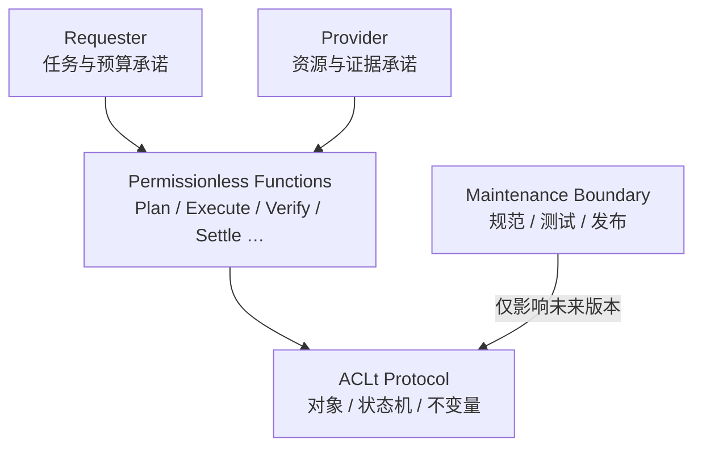

# ACLt Protocol

> **状态：G0——协议规格化**  
> **当前语义基线：v0.5**  
> **首个工程目标：V1 Conformance Target（RIR + Rust Profile + RPR）**<br>
> **文档性质：Living repository；随证明、仿真、实现和攻击测试持续修订**  
> **最后更新：2026-08-21**

ACLt Protocol 是一套面向异构、无许可分布式计算的开放、实现中立协议。`ACLt` 是受 *accurate* 启发形成的臆造名称，不是首字母缩写。

协议定义任务如何被不可变地承诺、规划、领取、执行、恢复、验证和结算，以及历史履约证据如何转化为未来的能力估计与有界风险暴露。它不是区块链、计算平台、市场、基金会或单一软件产品。

## 当前结论

ACLt Protocol 已形成一套完整的候选协议架构，但**尚未证明整体鲁棒性**。当前可以支持的严格表述是：

- 系统只保留 `Requester` 与 `Provider` 两类不可再约减的 Principal；
- Planner、Verifier、Scheduler 等职能被压缩为 permissionless functions；
- `ComputeReceipt` 固定任务、验证、期限、预算和结算语义；
- ACLt Abstract Machine 以版本化 Logical Object、合法事件、状态转换和终态组织多 Provider 计算；Provider 之间不存在共享机器地址空间；
- V1 以 `RIR` 作为机器/网络层的规范执行表示；Rust Profile 是参考前端而不是协议语义来源；
- RPR 是实现冻结 RIR runtime/effects/resource 语义的可替换边界；Host OS 隐藏状态不得进入任务结果；
- `Compile = Lowering + Decomposition + Packing`；该流水线是可审计函数，不是新的 Broker 或编译权威；
- 未来 C++23 等前端只有在降级到同一 RIR 并通过 conformance tests 后，才可声明兼容；
- Provider 可零前置抵押参与，但暴露、并发、价值、Lease、尝试和损失必须有界；
- 履约历史只允许形成 `PerformanceEvidence → CapabilityEstimate ± Uncertainty → ExposureDecision`；
- 履约能力不得授予验证票权、真理权、最终审计权或治理权；
- 验证使用 DIRECT/PROOF/REEXEC_BOUNDED/AUDIT_ONLY Profile；有限总体 e-process 的条件数学内核已闭合，Bayesian 只用于效率；
- Sybil 分析不假定标识独立，先以相关集群和硬损失上限控制风险；
- V1 不追求证明每个身份背后是不同自然人；官方主网用版本化 assurance、组件允许集合、工程审计和绝对损失预算限域启用能力；
- 多原因失效保存完整 `CauseSet` 并派生唯一 verdict；Dispatch/RPR 多点检查 active Lease capability，但不建立第三份 scope 权威；
- `UNRESOLVED`、`FAILED`、`EXPIRED` 和 `FUNDING_EXHAUSTED` 是合法安全终态；
- 资金来自预声明 `FundingPolicy`；发行只是可选来源，不是默认机制；
- 数据库、签名日志、联盟账本或公共区块链均可实现同一协议语义。
- SemanticStatus 与 V1 VersionDisposition 分别存储；`CORE` 不代表相应证明或实现已经完成。
- 结构/算法必须确定；日志忠实性、运行环境和部署事实可以使用限域、可撤销的工程证据，不必伪装成形式证明。

## 非目标与禁止主张

当前不得声称：

- 任意计算都可以廉价或绝对正确地验证；
- Provider 数量等于独立控制实体数量；
- 51% 是 ACLt Protocol 的默认安全阈值；
- Rank、信誉或历史表现代表真理；
- 攻击不划算等于攻击不可能；
- 临时发行使验证免费；
- 使用区块链自动带来协议安全或分布式容错；
- 中心化参考实现已经具备公共网络鲁棒性。
- 使用 Rust、RIR 或某个编译器自动保证结果正确、确定性、资源计量一致或分布式安全；
- V1 已支持或验证 unsafe Rust、完整 `std`/宿主 OS effects、原生执行、GPU/专用加速器或非确定性任务。

## 最小本体



图中的 Protocol 是规则，不是行为者；函数输出只有通过版本、签名、前置状态与不变量检查后才生效。

## 核心设计原则

1. **如无必要勿增实体**：公开、确定且可验证的职能优先写成协议函数；
2. **先承诺，后观察**：任务、验证、抽样、资金和结算政策先冻结；
3. **先限制损失，再讨论激励**：硬上限优先于“攻击成本大于收益”；
4. **不确定性必须显式化**：无法背书时返回 `UNRESOLVED`；
5. **证据不等于权威**：能力估计只影响有界暴露；
6. **不假定身份独立**：原始标识数不等于有效样本量；
7. **协议与实现分离**：底层基础设施可替换，语义不可漂移；
8. **维护最小权限**：维护者不得裁决运行中个案。
9. **前端不定义协议语义**：协议绑定 RIR、版本与执行 Profile；源语言只负责产生候选 RIR。
10. **成熟度与版本范围分离**：语义状态不与 `CORE/DEFERRED/REJECTED` 合并存储。
11. **工程事实分层闭合**：接口与算法必须唯一；来源与部署用版本化工程证据、fail-closed 和损失上限管理。

完整原则见 [`docs/00-overview/design-principles.md`](docs/00-overview/design-principles.md)。

## 文档阅读顺序

| 顺序 | 文档 | 用途 |
|---:|---|---|
| 1 | [`project-overview.md`](docs/00-overview/project-overview.md) | 项目目标、范围、非目标和成熟度 |
| 2 | [`terminology.md`](docs/00-overview/terminology.md) | 统一术语、状态标签和废弃语义 |
| 3 | [`system-context.md`](docs/00-overview/system-context.md) | 系统边界、Principal、函数和外部依赖 |
| 4 | [`threat-model.md`](docs/01-requirements/threat-model.md) | 攻击者、威胁、剩余风险和禁止主张 |
| 5 | [`invariants.md`](docs/01-requirements/invariants.md) | 16 条规范性安全不变量 |
| 6 | [`system-architecture.md`](docs/02-architecture/system-architecture.md) | 分层架构和实现边界 |
| 7 | [`ADR-0002`](docs/05-decisions/ADR-0002-normative-rir-and-v1-rust-profile.md) | RIR、Rust Profile 与 V1 能力边界 |
| 8 | [`ADR-0003`](docs/05-decisions/ADR-0003-separate-semantic-status-and-version-disposition.md) | SemanticStatus 与 VersionDisposition 二维分离 |
| 9 | [`ADR-0004`](docs/05-decisions/ADR-0004-verification-profiles-and-finite-population-e-process.md) | VerificationProfile 与有限总体 e-process 边界 |
| 10 | [`ADR-0005`](docs/05-decisions/ADR-0005-engineering-assumptions-and-mainnet-assurance.md) | 工程假设、主网 assurance 与单一权威边界 |
| 11 | [`verification-profile-schema.md`](docs/03-protocol/verification-profile-schema.md) | P0-1A canonical 语义与 P0-1B 实现目标 |
| 12 | [`v1-profile.md`](docs/03-protocol/v1-profile.md) | V1 CORE/DEFERRED/REJECTED 唯一映射 |
| 13 | [`protocol-spec.md`](docs/03-protocol/protocol-spec.md) | 当前规范性协议骨架 |
| 14 | [`result-validation.md`](docs/03-protocol/result-validation.md) | 验证流程、统计边界与证明义务 |
| 15 | [`verification-round-mathematical-model.md`](docs/06-research/verification-round-mathematical-model.md) | 验证轮条件定理、反例与对拍说明 |
| 16 | [`last-two-problem-trees.md`](docs/06-research/last-two-problem-trees.md) | 多原因判决与 Dispatch scope 的替代思路树 |
| 17 | [`current-status.md`](docs/07-roadmap/current-status.md) | 当前进度、证据成熟度与工程 Gate |
| 18 | [`open-questions.md`](docs/07-roadmap/open-questions.md) | P0/P1/P2 未决问题和 v0.6 依赖 |

完整索引见 [`docs/README.md`](docs/README.md)。

## 仓库结构

### 当前真实目录

```text
.
├── README.md
├── CONTRIBUTING.md
├── LICENSE                       # Apache License 2.0 英文全文（已存在）
├── docs/
    ├── README.md
    ├── 00-overview/
    │   ├── project-overview.md
    │   ├── design-principles.md
    │   ├── terminology.md
    │   └── system-context.md
    ├── 01-requirements/
    │   ├── threat-model.md
    │   └── invariants.md
    ├── 02-architecture/
    │   ├── system-architecture.md
    │   ├── identities-and-roles.md
    │   └── task-lifecycle.md
    ├── 03-protocol/
    │   ├── protocol-spec.md
    │   ├── v1-profile.md
    │   ├── result-validation.md
    │   ├── verification-profile-schema.md
    │   └── reputation.md
    ├── 04-analysis/
    │   ├── robustness.md
    │   └── administrative-cost.md
    ├── 05-decisions/
    │   ├── ADR-0001-no-unnecessary-entities.md
    │   ├── ADR-0002-normative-rir-and-v1-rust-profile.md
    │   ├── ADR-0003-separate-semantic-status-and-version-disposition.md
    │   ├── ADR-0004-verification-profiles-and-finite-population-e-process.md
    │   └── ADR-0005-engineering-assumptions-and-mainnet-assurance.md
    ├── 06-research/
    │   ├── claims-and-sources.md
    │   ├── verification-round-mathematical-model.md
    │   └── last-two-problem-trees.md
    ├── 07-roadmap/
    │   ├── current-status.md
    │   └── open-questions.md
    ├── 08-governance/
    │   ├── audit-procedure.md
    │   ├── audit-report-template.md
    │   └── audits/
    │       ├── audit-20260818-01-semantic-structure.md
    │       ├── audit-20260819-02-verification-model-closure.md
    │       ├── audit-20260819-03-submission-scope.md
    │       └── audit-20260821-04-engineering-closure-rollout.md
    └── codocs/                    # 历史版本档案；不构成当前规范
        └── README.md              # 历史状态与权威性说明
└── tests/
    └── verification_model/        # 精确有理数递推/闭式/DP 对拍资产
```

上述列出当前语义文档及历史档案入口；`docs/codocs/` 中的旧版本仅用于决策追踪，不构成当前规范。

### 已规划但尚未创建

```text
.
├── spec/
│   ├── algorithms/                # 规范性算法与伪代码
│   └── state-machines/            # 状态、转移与终态定义
└── simulations/
    ├── scenarios/                 # 可重现的仿真场景与参数
    └── results/                   # 可追溯的仿真输出与摘要
```

这些路径是 G0 后续工程化规格工作的最小候选集，现在不应表述为已落地。`spec/` 与 `simulations/` 只在相应 P0 输入和产物边界确认后创建。目录只表示资料组织，不表示系统中存在同名特权实体。

## 当前工程 Gates

| Gate | 内容 | 当前状态 |
|---|---|---|
| G0 | 规格、对象、RIR、状态机、不变量、威胁、统计和资金政策 | **进行中** |
| G1 | 能力、调度、验证、Sybil、资金、RIR/runtime 和行政成本仿真 | 未开始 |
| G2 | 单机参考实现、RIR toolchain/runtime 与确定性测试 | 未开始 |
| G3 | 局域网多 Provider MVP 与故障注入 | 未开始 |
| G4 | 持久化、备份、恢复和适配器一致性 | 未开始 |
| G5 | Sybil、串谋、预算耗尽和维护滥权对抗验证 | 未开始 |
| G6 | 异构硬件、外部参与者与可选账本试点 | 未开始 |

不得在前一 Gate 的退出证据不足时，把后一 Gate 的可运行结果解释为普遍安全证明；但来源忠实性和部署事实允许用工程证据限域推进，不要求先获得开放世界形式证明。

## 参与项目

当前最有价值的贡献是：

- 把 16 条不变量转化为机器可检查的状态机与性质测试；
- 完成 canonical schemas、编码和测试向量；
- 冻结 RIR canonical encoding、验证器、运行时 effects/resource model 和 Rust Profile lowering；
- 实现 VerificationProfile/MainnetAssuranceProfile、CauseSet reducer 和有限总体 e-process conformance；
- 实现 Lease capability、Dispatch/RPR 双检查和 append-only/finality 日志 contract；
- 建立相关性、集群暴露和最大损失仿真；
- 规格化 FundingPolicy、退款、故障归因和最多一次结算；
- 建立适配器一致性、发布密钥、撤销和漏洞响应流程。

提交前请阅读 [`CONTRIBUTING.md`](CONTRIBUTING.md)。

## 版本与更新

- v0.5 是当前语义基线，不是不可修改的产品版本；
- 新证据可以把 `CANDIDATE` 变更为 `DECIDED` 或 `INVARIANT`，也可以把旧结论变更为 `SUPERSEDED` 或 `REJECTED`；
- 影响协议语义的变更必须同时更新 ADR、威胁模型、不变量、协议规范、状态和未决问题；
- 文档冲突时，较新的明确决定与规范性文档优先，历史文件仅作追踪。

## 开源与许可

代码与参考实现的许可方案已经确定为 **Apache License 2.0**，SPDX 标识为 `Apache-2.0`。该决定不自动覆盖协议规范、项目文档、研究论文、名称、商标或兼容性声明；这些工件的许可与使用政策将分别决定。

仓库根目录已经包含未经修改的 Apache License 2.0 英文全文 `LICENSE`。未来适用源码仍需加入 SPDX 标识；存在归属声明或第三方通知要求时再维护 `NOTICE`。应准确表述为“代码许可证已经选定并在根目录落地”，而不是“仓库全部工件的开源授权已经完成”。官方许可文本与应用说明见 [Apache License 2.0](https://www.apache.org/licenses/LICENSE-2.0) 和 [Apache Licensing FAQ](https://www.apache.org/foundation/license-faq.html)。

## 名称说明

当前正式名称为 **ACLt Protocol**。DistributedCompute、RUDCP、DCP 和 BigMind 仅用于历史追踪。ACLt 的商标、域名和软件包名清查仍为 `OPEN`。
