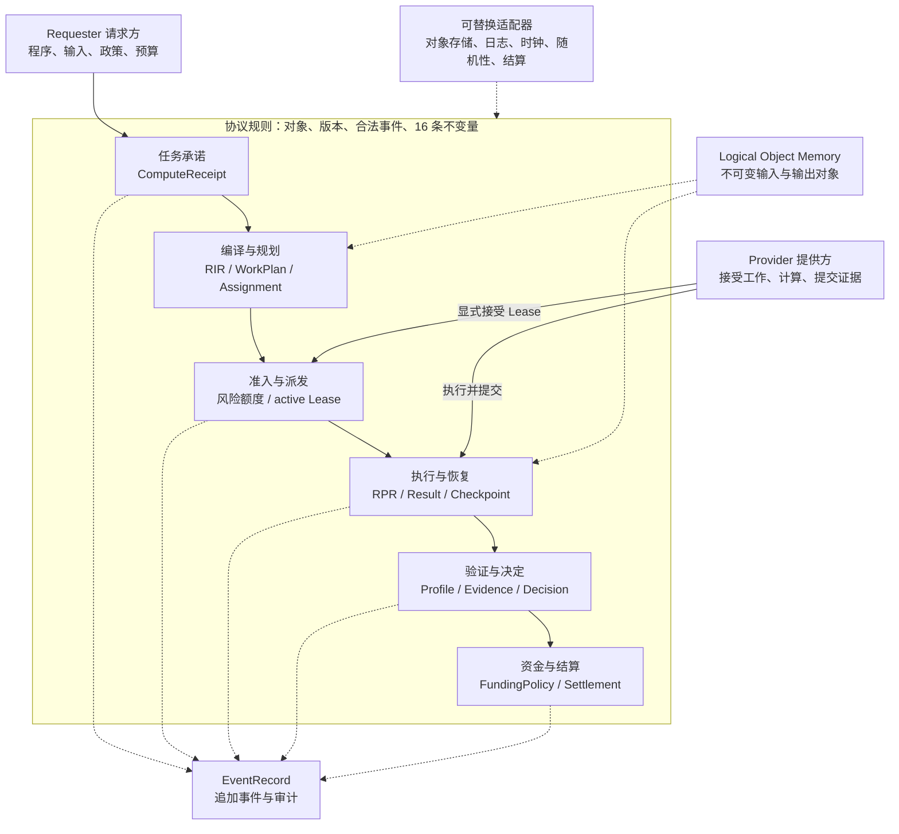
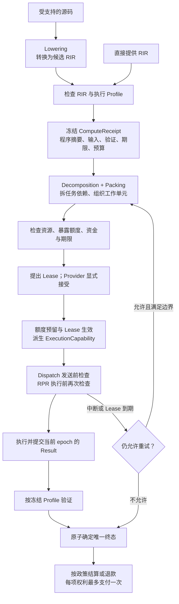
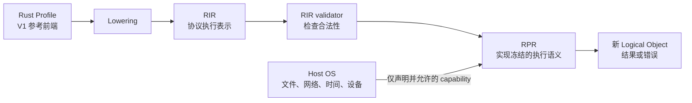
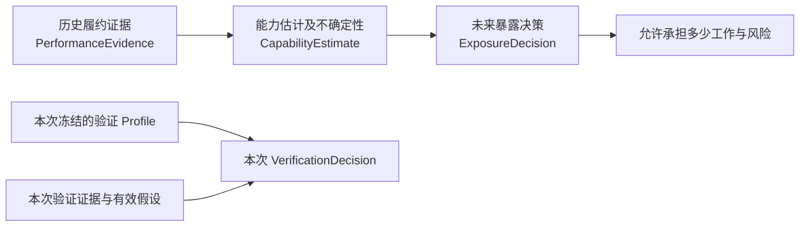

# ACLt Protocol：新合作者架构导览

> 文档性质：非规范性导览；解释与导航，不新增协议规则或完成度结论  
> 语义基线：v0.5；首个一致性目标：V1（RIR + Rust Profile + RPR）  
> 编写日期：2026-09-24；依据本地工作区现有文件，状态文档快照日期为 2026-08-21  
> 仓库位置：`docs/00-overview/architecture-guide.md`  
> 更新触发：架构边界、目录、测试入口或项目阶段发生变化

## 1. 先用一分钟理解项目

**ACLt 要定义一套规则，让互不信任的计算提供者协作完成任务，并明确：做什么、谁可以做、怎样检查结果、失败怎样退出、最后怎样结算。**

Requester 提出任务并承诺预算，Provider 接受工作并提供计算和证据。ACLt 用冻结的任务约定、执行授权、验证规则和损失上限，把这些行为连接起来。

它目前是一份持续演进的协议规格，加上局部可执行校验和数学模型。完整运行时、调度系统和多节点网络仍需建设。图中的模块表示**职责边界**，不是已部署的服务。

| 常见定位问题 | 回答 |
|---|---|
| 这是不是区块链？ | 它定义计算协议；区块链只是未来可选的账本或结算适配器。 |
| 谁参与？ | 两类基本参与者：Requester（请求方）和 Provider（提供方）。 |
| 谁当裁判？ | 验证函数按预先冻结的规则处理证据，没有固定的特权 Verifier 身份。 |
| 历史表现好就更可信？ | 历史表现只能影响以后分配多少工作和风险，不能增加“结果为真”的票权。 |
| 现在能启动完整网络吗？ | 当前仓库没有通过验收的完整网络；可先运行已有验证测试。 |
| v0.5 和 V1 是什么关系？ | v0.5 是协议语义基线；V1 是建立其上的首个兼容性目标，不是完成度标签。 |

定位依据：[项目概览](project-overview.md)、[当前状态](../07-roadmap/current-status.md)。

## 2. 一张图看整体架构



实线表示主要工作推进，虚线表示数据支撑或记录关系。图中将源码准备折叠进“编译与规划”；**Lowering 必须在 Receipt 冻结前完成**，详细顺序见下一节。

这些边界共同组成 ACLt Abstract Machine：它是一本有严格更新规则的“任务状态总账”。合法事件让状态前进；签名、版本、前置状态或不变量不满足，就不能推进。该模型不以各 Provider 共用内存、时钟或操作系统为前提。

权威来源：[系统架构](../02-architecture/system-architecture.md)、[不变量](../01-requirements/invariants.md)、[角色与权限](../02-architecture/identities-and-roles.md)。

## 3. 用一个任务串起全流程

假设请求方希望对一批输入做确定性计算。以下流程只展示协议路径，不表示这种任务已有现成可用的编译器或运行时。



1. **先约定。** `ComputeReceipt` 像不可变的任务合同：绑定程序和输入、允许的行为、验证方式、时间和资金边界。实质修改必须产生新 Receipt。
2. **再拆分。** `WorkPlan` 描述计划，`Assignment` 描述工作单元。优化不能改变任务含义、扩大权限或突破预算。
3. **接受后才有义务。** 排进候选名单或收到提案不等于接单。Provider 显式接受并完成额度预留后，Lease 才生效。
4. **按授权执行。** `ExecutionCapability` 来自 active Lease。派发处和运行时各检查一次，检查的是同一份授权。
5. **区分新旧结果。** `epoch` 标记当前执行轮次。旧轮次迟到结果可以保留作审计，不能覆盖当前结果或获得当前结算权利。
6. **根据证据结束。** 有证据支持的 `TRUSTED` 与无法背书的 `UNRESOLVED` 都有明确语义；`FAILED`、`EXPIRED`、`FUNDING_EXHAUSTED` 也是合法安全终态。结算依据预先冻结的政策处理，不等于所有终态都付同样的钱。

这是教学流程图，不是完整状态枚举或全部转移守卫。创建拒绝、规划失败、并发和资金异常等细节，以[任务生命周期](../02-architecture/task-lifecycle.md)和[协议规范](../03-protocol/protocol-spec.md)为准。

## 4. 计算层：源码、RIR、RPR 各负责什么



| 概念 | 含义 | 边界 |
|---|---|---|
| Rust Profile | V1 接受的 Rust 前端范围 | Rust 编译成功不等于符合 ACLt。 |
| RIR | 不同实现共同遵守的程序表示 | 源语言和某个编译器不能自行定义协议语义。 |
| RIR validator | 检查候选程序是否符合规范 | 不能跳过检查直接运行原生程序。 |
| RPR（RIR Portable Runtime） | 实际运行 RIR 的可替换运行时 | 结果、资源计量、错误和终止应遵守冻结规则。 |
| Logical Object | 带内容身份的不可变数据对象 | 输出创建新对象，不是跨节点共享可变 RAM。 |
| Host OS capability | 明确授权的宿主能力入口 | 文件、网络、时间、随机性等不能成为隐藏输入。 |

当前这些执行边界已经提出并记录，但完整 RIR/RPR 规格、实现和一致性证据仍是待完成工作。未来其他语言前端也必须转换到相同 RIR 并通过测试。

来源：[系统架构](../02-architecture/system-architecture.md)、[ADR-0002](../05-decisions/ADR-0002-normative-rir-and-v1-rust-profile.md)、[V1 范围](../03-protocol/v1-profile.md)。

## 5. 验证层：究竟在证明什么

验证不只是收集“同意票”。`VerificationProfile` 要提前绑定：检查哪个命题、用哪种方法、依赖哪些假设、在哪些条件下停止，以及结论明确不证明什么。

下表使用 canonical Schema 中的方法名称；其他概览中的 DIRECT、PROOF、AUDIT_ONLY 是简写。

| 方法 | 如何理解 | 结论边界 |
|---|---|---|
| `DIRECT_VERIFIED` | 直接检查输入与输出是否满足指定条件 | 条件是否准确表达用户意图、检查器是否正确仍需分别考虑。 |
| `PROOF_VERIFIED` | 检查针对绑定命题的证明 | 依赖命题绑定、证明系统假设和实现。 |
| `REEXEC_BOUNDED` | 在明确边界下重执行并进行有限总体统计验证 | 依赖错误支持能力上界、活性下界、抽样等前提。 |
| `REEXEC_AUDIT_ONLY` | 收集重执行与审计信息 | 不绑定 VerifiedClaim，不能产生 `TRUSTED`。 |

**`TRUSTED` 是带前提、范围和排除项的结论，不是“任意意义上的绝对正确”。** 有限总体 e-process 的条件数学内核已经闭合，不代表现实网络自动满足这些条件；Bayesian 方法只用于效率层，不能替代安全判据。

多种假设失效可以同时发生。仓库选择保留完整事实，再用冻结规则计算一个结果：


不能只保留“最严重的一个原因”而丢失诊断信息，也不能让不同组件各自解释一套最终判决。

来源：[VerificationProfile Schema](../03-protocol/verification-profile-schema.md)、[结果验证](../03-protocol/result-validation.md)、[数学模型](../06-research/verification-round-mathematical-model.md)。

## 6. 风险与权限：哪些信息可以影响哪些决定



两条路径职责不同：历史履约可以影响未来资源分配；本次结果是否得到支持，必须由本次验证规则和证据决定。标识数量不等于独立控制主体数量，因此还要考虑相关集群和硬损失上限。

维护者可以更新规范、测试、发布，并在预声明范围内通过主网 assurance 收紧或撤销能力。维护报告不能改变某个任务的真理权重，也不能追溯改写冻结 Receipt 或终态。主网 assurance 的结论不能自动外推到其他网络。

来源：[能力与暴露](../03-protocol/reputation.md)、[威胁模型](../01-requirements/threat-model.md)、[ADR-0005](../05-decisions/ADR-0005-engineering-assumptions-and-mainnet-assurance.md)。

## 7. 从架构找到仓库文件

下面按当前工作区的真实目录整理，省略缓存、归档包和重复交付目录。目录名表示资料组织，不表示同名服务已运行。

```text
ACLt/
├── README.md                        项目总入口
├── CONTRIBUTING.md                  贡献流程、同步要求和审查标准
├── LICENSE                          仓库全部工件的许可证文本（Apache-2.0）
├── docs/
│   ├── README.md                    文档索引、权威范围、冲突处理
│   ├── 00-overview/                 为什么做、术语、系统边界
│   │   └── architecture-guide.md    本导览的目标位置
│   ├── 01-requirements/             威胁模型、16 条不变量
│   ├── 02-architecture/             系统架构、角色、任务生命周期
│   ├── 03-protocol/                 对象与规则、V1、验证、能力证据
│   ├── 04-analysis/                 鲁棒性与行政成本
│   ├── 05-decisions/                ADR：决定了什么、为什么
│   ├── 06-research/                 数学模型、论断来源、研究问题
│   ├── 07-roadmap/                  当前状态、未决问题
│   ├── 08-governance/               审计程序和审计报告
│   └── codocs/                     历史档案，不是当前规范
├── schemas/verification-profile/    初始 JSON Schema 与 coverage.json
├── registries/verification-profile/ claim、排除项、禁用 assurance 种子
├── tools/verification_profile/      Python 参考校验工具
└── tests/
    ├── verification_model/         精确数学模型、独立对拍、向量
    └── verification_profile/       当前校验工具的局部测试
```

`spec/` 和 `simulations/` 是根 README 中的规划目录，目前不应当作已有实现入口。当前工作区还含交付包和重复副本；新参与者以根目录的 `docs/`、`tools/`、`tests/` 等为入口。

| 查阅目标 | 先读哪里 | 再看哪里 |
|---|---|---|
| 整体边界与组件职责 | [system-architecture.md](../02-architecture/system-architecture.md) | [system-context.md](system-context.md) |
| 任务、Lease、恢复与结算顺序 | [task-lifecycle.md](../02-architecture/task-lifecycle.md) | [protocol-spec.md](../03-protocol/protocol-spec.md) |
| 哪些设计不能破坏 | [invariants.md](../01-requirements/invariants.md) | [threat-model.md](../01-requirements/threat-model.md) |
| 验证对象字段与校验规则 | [verification-profile-schema.md](../03-protocol/verification-profile-schema.md) | [Schema 说明](../../schemas/verification-profile/README.md)、[validator.py](../../tools/verification_profile/validator.py) |
| 当前校验到底覆盖多少 | [coverage.json](../../schemas/verification-profile/coverage.json) | [Profile 测试说明](../../tests/verification_profile/README.md) |
| 数学结论与反例 | [数学模型说明](../06-research/verification-round-mathematical-model.md) | [模型测试说明](../../tests/verification_model/README.md) |
| 为什么采用某项设计 | [文档中心的 ADR 索引](../README.md) | [论断与来源](../06-research/claims-and-sources.md) |
| 现在最缺什么 | [current-status.md](../07-roadmap/current-status.md) | [open-questions.md](../07-roadmap/open-questions.md) |

## 8. 当前证据与覆盖范围

以下是读取时工作区的状态摘要，不替代[当前状态](../07-roadmap/current-status.md)和[覆盖清单](../../schemas/verification-profile/coverage.json)。

| 范围 | 当前证据 | 不应据此推出 |
|---|---|---|
| 协议文档与架构 | 已有 v0.5 文档骨架、职责边界和 16 条不变量 | 完整状态机或所有规范都已可执行。 |
| 有限总体验证模型 | 有递推、闭式、全枚举、DP 对拍和精确有理数向量 | 真实无许可网络已满足部署前提。 |
| P0-1A | 状态文档记录 `PASS / CLOSED` | 整个 P0-1 或 G0 已关闭。 |
| P0-1B | `STARTED / NOT CLOSED`；有初始 Schema、种子、validator 和测试 | 所有规则、编码与摘要已实现。 |
| 注册表种子 | 有 claim 模板、排除项和 disabled assurance 数据 | 已存在正式 ACTIVE 主网注册表。 |
| G0 | 进行中 | 已具备合格的 G2 参考实现。 |
| G1—G6 | 状态快照记录为未开始 | 仿真、网络、容灾或对抗验证已经验收。 |

P0-1B 当前覆盖清单明确列出：L1b 的 SV-10、SV-11、SV-57、SV-76 已实现；部分 L1a 规则和 SV-54a 只部分覆盖；L2 尚未实现。canonical CBOR、18 个摘要、完整五相位对象、全量 Type A 规则以及第二语言对拍仍有缺口。参考 validator 的 `--production` 会主动拒绝，避免把局部检查当作完整生产校验。

阅读状态时分清三个问题：`DECIDED` 表示设计已接受；V1 `CORE` 表示必须实现；测试通过表示某个检查有证据。三者不能互相替代。

## 9. 参与路径

### 9.1 第一次阅读

1. 阅读本导览，建立任务、执行、验证和结算之间的联系。
2. 读[贡献指南](../../CONTRIBUTING.md)，确认改动类别和同步要求。
3. 读[当前状态](../07-roadmap/current-status.md)与[未决问题](../07-roadmap/open-questions.md)，选择有明确关闭证据的小问题。
4. 读该问题对应的规范与不变量，再查看实现或测试。

### 9.2 先复现已有检查

在仓库根目录、可用的 Python 环境中运行以下已有入口。数学模型测试使用标准库和精确 `Fraction` 算术。

```powershell
python -m unittest discover -s tests/verification_model -p "test_*.py" -v
python -m unittest discover -s tests/verification_profile -t . -v
```

第一组验证数学模型与反例的一致性，第二组验证当前 Profile 工具覆盖的规则。通过这两组测试不等于 P0-1B、G0 或完整协议通过验收；本导览只说明入口，不作为本次文档编写重新执行协议测试的记录。

### 9.3 按专长选择第一个贡献

| 方向 | 合适的小任务 | 应交付的证据 |
|---|---|---|
| Python / 数据校验 | 从 coverage 清单中选择一个未覆盖的规则，补实现与覆盖登记 | 合法、非法、边界输入及可复现测试。 |
| 协议 / 状态机 | 为一个 Lease 或终态竞态补全前置条件和合法转移 | 对应 INV/TH、竞态反例、可执行模型或性质测试。 |
| 编译器 / 运行时 | 从 RIR 类型、编码、错误或 effect 的一个边界入手 | 规范定义、拒绝案例和一致性向量。 |
| 数学 / 安全 | 独立复算模型，或挑战部署假设 | 明确前提、反例与适用范围；不能只报告均值。 |
| 资金 / 存储 | 细化一种终态的退款、唯一权利或恢复行为 | 重放、响应丢失、重复请求下的确定结果。 |
| 文档 | 补一项术语解释、权威链接或图表 | 与现有规范含义一致，完成路径与术语检查。 |

以上是依据未决工作整理的参与建议，不代表任务已经分配或方案已经接受。

### 9.4 一次贡献怎样收尾


提交说明应讲清：改了什么、为什么、影响哪个对象与不变量、新增什么假设、如何验证、还剩什么风险。纯文档澄清保持规范含义；涉及协议语义的修改须遵守贡献指南的同步矩阵，不应只改一处代码。证据不足时保留开放状态。

## 10. 本文如何维护

本文是入口，不维护第二份规范。字段和校验语义去协议文档修改，架构边界去架构文档修改，V1 范围去唯一 Profile 修改，完成度去路线图与审计记录修改，然后更新这里的解释与链接。

若本文与权威文件冲突，按[文档中心](../README.md)的冲突解决顺序处理。历史 `codocs/` 用于追踪，不覆盖当前决定。

本文在 [docs/README.md](../README.md) 的“工程证据与维护”一节列为“架构阅读指南”。

本文所有相对链接均以 `docs/00-overview/architecture-guide.md` 为基准；单独下载后，应放回该位置再浏览仓库内链接。
