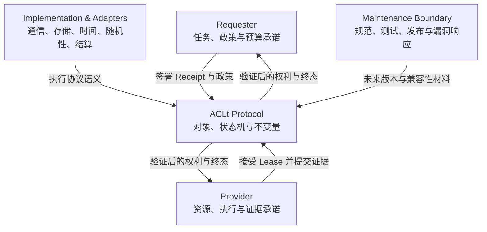

# ACLt 系统上下文

> 文档状态：架构边界基线  
> 更新日期：2026-08-18  
> 目的：说明谁能作出承诺、谁能执行函数、协议接受什么，以及哪些能力位于系统边界之外

## 1. 系统边界

ACLt 的协议边界包含：

- 规范化协议对象及其字段语义；
- 对象签名、版本、摘要和因果引用规则；
- 合法状态转换、前置条件和不变量；
- 任务规划、准入、Lease、执行、验证、终态和结算规则；
- RIR 版本、规范工件、执行 Profile 与前端一致性边界；
- 风险暴露、尝试、预算和资金上限；
- 追加式证据、审计和状态重放语义；
- 版本兼容、升级和适配器一致性要求。

ACLt 的协议边界不包含：

- 特定数据库、云服务、消息队列或公共链；
- 对互联网、时钟、随机源和硬件绝对可靠的保证；
- 对 Principal 现实身份或独立控制关系的自动证明；
- 维护组织的法人形式；
- 未经 Receipt 声明的任务正确性、输入合法性或外部经济价值；
- 对跨境支付、税务、监管和劳动关系的统一处理。

## 2. 上下文图

图中的 Protocol 是规则集合，不是能主动收发消息的行为者。实际消息由 Requester、Provider 或实现组件产生，只有满足协议规则后才形成有效状态转换。

## 3. 不可再约减的 Principal

| Principal | 向系统提供 | 从系统获得 | 必须承担的责任 | 不具有的默认权力 |
|---|---|---|---|---|
| `Requester` | 任务语义、输入引用、验证选择、期限、预算、资金及结算政策 | 合法规划、执行结果、验证终态和按政策产生的权利 | 任务可执行性声明、输入权利、预算真实性、恶意任务风险 | 不得覆盖验证终态，不得追溯改变政策，不得因付费获得真理权 |
| `Provider` | 资源声明、Lease 接受、结果、检查点、验证或其他函数证据 | 可领取工作、条件权利、结算和可归责履约证据 | 接受后的履约、证据真实性、密钥安全、并发和资源声明 | 不因历史表现获得验证票权、治理权或最终审计权 |

一个现实主体可以同时控制多个 PrincipalID、账户、节点或设备。ACLt 不把这些标识的数量直接视为独立参与者数量。

## 4. 无许可函数

ACLt 不为下列职能建立固定特权角色。任何 Principal 都可以尝试执行函数，但函数输出只有在满足协议前置条件和不变量后才被接受。

| 函数 | 主要输入 | 主要输出 | 协议检查 | 权威边界 |
|---|---|---|---|---|
| `Plan` | Receipt、依赖、资源约束 | WorkPlan、Assignment DAG | 版本、合法性、依赖、确定性、边界 | 只能提出计划，不保证最优 |
| `Admit` | 证据、能力估计、不确定度、暴露 | Eligibility、ExposureDecision | 证据版本、硬资源、风险及集群限额 | 不创建身份，不授予真理权 |
| `Schedule` | Assignment、候选、期限、政策 | 领取顺序或 Lease 提案 | 暴露、并发、epoch、期限 | 不得绕过准入和损失上限 |
| `Execute` | Assignment、RIR 工件、执行 Profile、有效 Lease | Result、Checkpoint、FailureEvidence | RIRVersion、validator、Lease、epoch、effects、资源、幂等性 | 结果不是自动可信结论 |
| `Sample` | EligibilitySnapshot、随机性承诺 | 不放回抽样序列 | 总体冻结、排除、分层、去重 | 不得观察结果后改总体或规则 |
| `Verify` | 候选结果、任务检查器、证据 | VerificationEvidence | 方法版本、输入绑定、来源、成本 | 单次验证不是最终裁决 |
| `Aggregate` | 抽样与验证证据 | ConfidenceState、Decision candidate | 预声明统计规则和停止条件 | 不得人工调整投票或权重 |
| `Settle` | 唯一终态、权利、预算、政策 | Settlement commit | 资金上限、唯一权利键、幂等性 | 不得创造未授权资金或重复结算 |
| `UpdateEvidence` | 可归责事件 | PerformanceEvidence | 来源、故障归因、追加性 | 只记录证据，不生成 Rank |

## 5. 非参与者与可选实体

| 名称 | 正确分类 | 说明 |
|---|---|---|
| `Protocol` | 规则集合 | 不持有密钥，不发消息，不承担义务 |
| `Control Plane` | 实现 | 可以中心化或分布式部署，但不因此成为 Principal |
| `Broker` / `Planner` | `Plan` 函数的历史称呼 | 不具有固定身份或特权 |
| `Verifier` | 执行 `Verify` 的 Principal 或节点的上下文称呼 | 不是独立身份组，也不拥有最终真理权 |
| `Scheduler`、`Sampler`、`Aggregator` | 函数执行上下文 | 输出必须由协议检查 |
| `Maintainer` | 维护责任 | 只在 Maintenance Boundary 内有效 |
| `Foundation` / 委员会 | 可选组织形式 | 只有证明净治理价值为正时才考虑引入 |
| 区块链 | 可选实现基础设施 | 不属于 ACLt 安全性的默认前提 |
| Node、Account、Device、Key | 实现、标识或证据载体 | 不新增 Principal 类型 |
| Rust/C++ frontend、compiler、RIR runtime | 实现组件 | 不是 Principal 或真理权威；输出必须通过统一 RIR conformance |
| Rank / Reputation | 已废弃的权威化抽象 | 当前协议不存在该实体 |

## 6. 核心交互生命周期

| 阶段 | 主要交互 | 协议结果 | 安全退出 |
|---|---|---|---|
| 1. 选择版本与政策 | Requester 选择兼容的 ProtocolVersion、验证、资金和结算政策 | 可解析的任务创建输入 | `REJECTED_AT_CREATE` |
| 2. 登记任务 | Requester 规范化并签署包含 RIRVersion/Profile/Digest 的 ComputeReceipt | 不可变 ReceiptID | `REJECTED_AT_CREATE` / `UNSUPPORTED` |
| 3. 规划任务 | 任意 Principal 执行 Plan | 合法 WorkPlan / Assignment | `FAILED_PLANNING` |
| 4. 准入与暴露 | Admit/Schedule 处理证据、能力、不确定度和限额 | ExposureDecision、Lease 提案 | 排队、拒绝或 `EXPIRED` |
| 5. 接受与执行 | Provider 接受 Lease 并按 epoch 执行 | Result、Checkpoint 或失败证据 | 重租约、`FAILED`、`EXPIRED` |
| 6. 冻结验证总体 | Sample 前建立 EligibilitySnapshot | 可审计总体、分层与随机承诺 | `UNRESOLVED` |
| 7. 序贯验证 | Sample、Verify、Aggregate 循环 | 置信状态持续更新 | 扩样或到达 Nmax |
| 8. 提交唯一终态 | Aggregate 应用预声明停止规则 | `TRUSTED` 或 `UNRESOLVED` | 事务重试，不得双终态 |
| 9. 结算 | Settle 应用 FundingPolicy 和 SettlementPolicy | 最多一次 Settlement | `FUNDING_EXHAUSTED` 或可重试实现失败 |
| 10. 追加证据 | UpdateEvidence 记录可归责事件 | 新 PerformanceEvidence | 证据不足时暂缓能力更新 |

## 7. 外部依赖与适配器

| 外部能力 | ACLt 对其要求 | 失效时的协议响应 |
|---|---|---|
| 网络传输 | 消息可认证、可去重并可关联版本和因果关系 | 延迟、重试、Lease 到期或条件性活性失败 |
| 持久化存储 | 保存不可变对象、追加事件和唯一提交约束 | 阻止不安全推进；恢复后重放 |
| 对象或内容存储 | 按摘要提供程序、输入、结果和检查点 | 内容不可用时拒绝执行、验证或进入失败状态 |
| 时钟与期限 | 提供足以执行 Lease 和 deadline 政策的时间语义 | 时钟假设不满足时不得声称正常活性 |
| 随机性来源 | 在抽样前承诺、可审计且不被结果观察后操纵 | 随机承诺无效时验证拒绝或 `UNRESOLVED` |
| RIR 执行环境 | 验证规范 RIR，隔离执行并报告 runtime、effects、资源和限制 | validator、Profile、沙箱或计量不满足时拒绝、`UNSUPPORTED` 或失败 |
| 结算通道 | 支持唯一权利键、额度检查和幂等提交 | 暂停结算、重试或 `FUNDING_EXHAUSTED` |
| 可选账本 | 保存或证明等价的对象与事件语义 | 适配器不合规时不得作为 ACLt 实现 |

ACLt 不规定这些能力必须由同一系统、组织或账本提供。参考实现可以采用中心化组件，但必须明确其故障模型，且不得把“实现可运行”表述为“协议已实现分布式容错”。

## 8. 信任与威胁边界

### 8.1 不默认信任

协议不默认信任：

- Requester 提交的任务是善意、可执行或合法的；
- Provider 声明的资源、独立性或结果是真实的；
- 多个标识对应多个独立控制实体；
- Planner、Verifier 或 Aggregator 的输出正确；
- 网络、存储、时钟、随机源或结算通道永不故障；
- 维护者永不犯错或滥权；
- 某种账本天然满足 ACLt 不变量。

### 8.2 当前依赖的显式假设

具体实现至少必须声明：

- 密码学签名和摘要所依赖的算法及密钥生命周期；
- 内容在任务生命周期内的可用性条件；
- Lease 和 deadline 使用的时钟及同步假设；
- 网络分区、重试和最终恢复模型；
- 数据持久化、事务、唯一键和灾难恢复模型；
- 随机性承诺和抽样可复算条件；
- 每类任务验证方法的正确性及覆盖范围；
- source frontend → RIR lowering、RIR validator、runtime 与资源/effects 模型的一致性条件；
- 资金来源、授权上限和结算最终性；
- 相关性信息的来源、缺失处理和隐私边界。

未声明的假设不得被用于安全结论。

## 9. 权限边界

| 动作 | Requester | Provider | 任意函数执行者 | 实现组件 | Maintainer |
|---|---:|---:|---:|---:|---:|
| 提出并签署 ComputeReceipt | 是 | 否 | 否 | 仅验证/记录 | 否 |
| 接受 Lease | 否 | 是 | 否 | 仅验证/记录 | 否 |
| 提出 WorkPlan | 可以 | 可以 | 可以 | 可以代表 Principal 执行 | 无特殊权 |
| 提交执行或验证证据 | 可以 | 可以 | 可以 | 仅在可归责时 | 无特殊权 |
| 冻结后修改 Receipt | 否 | 否 | 否 | 否 | 否 |
| 观察结果后修改验证规则 | 否 | 否 | 否 | 否 | 否 |
| 覆盖 VerificationDecision | 否 | 否 | 否 | 否 | 否 |
| 绕过 FundingPolicy 结算 | 否 | 否 | 否 | 否 | 否 |
| 发布未来 ProtocolVersion | 可提议 | 可提议 | 可提议 | 否 | 按发布流程执行 |
| 修改历史事件 | 否 | 否 | 否 | 否 | 否；只能追加更正 |

“可以执行函数”不等于“输出必然被协议接受”；“按发布流程执行”也不等于维护者拥有运行时裁决权。

## 10. Maintenance Boundary

维护边界可以管理：

- 规范、Schema、状态机、测试向量与参考实现；
- 发布签名、密钥轮换、版本撤销和兼容性说明；
- 漏洞接收、保密修复、协调披露和安全公告；
- ADR、变更日志和适配器一致性套件。

维护边界不得管理：

- 已冻结任务的语义、总体、权重、预算或终态；
- 运行中任务的个案证据价值；
- Requester 与 Provider 的个案权利裁决；
- 未经协议授权的结算或退款；
- 把维护者身份转化为验证或治理票权。

维护组织的具体形式仍为 `OPEN / POLICY`。除非新增组织能证明其净治理价值高于权限扩张、行政成本和新信任根，否则不应成为协议必需部分。

## 11. 实现一致性边界

数据库、追加式签名日志、Merkle 日志、联盟账本和未来公共区块链都可以实现 ACLt，但必须至少保持：

1. 同一 ReceiptID 不对应不同规范化语义；
2. 所有核心对象绑定明确 ProtocolVersion；
3. epoch 严格递增，旧 epoch 不能覆盖当前状态；
4. 每个任务只有一个协议终态；
5. 每个结算权利最多提交一次；
6. 承诺、结算和退款储备不超过授权资金上限；
7. 验证总体、规则和资金不得在观察结果后改变；
8. PerformanceEvidence 只能追加或以新事件更正；
9. 履约能力证据不能直接授予真理权；
10. 维护者不能改变个案结果、权重或结算。
11. 更换 Rust/C++ 等 frontend、compiler 或 RIR runtime 不得改变同一 Receipt 下的规范执行与结果语义。

无法通过这些一致性要求的基础设施，只能被称为相关软件，不能被称为符合 ACLt 的实现。
