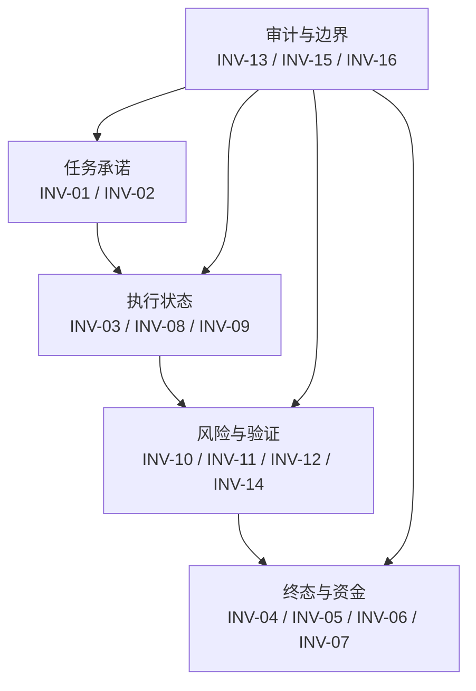

# ACLt Protocol 系统不变量

> 文档状态：G0 规范性安全需求  
> 更新日期：2026-08-18  
> 不变量集合版本：v0.1  
> 配套文档：[威胁模型](threat-model.md)

## 1. 文档目的

本文件定义所有符合 ACLt Protocol 的实现都必须保持的核心安全不变量。不变量描述“任何可接受历史中都不得发生什么”，不等于活性保证、统计定理已经证明或某组参数已经安全。

当前冻结的是不变量的规范性意图和稳定 ID。部分不变量仍缺少机器可执行谓词、状态机、参数或形式化证明；这些缺口必须明确标为 `OPEN/P0`，不得以实现经验代替。

## 2. 适用规则

1. 每个核心状态转换必须说明其保持哪些不变量；
2. 任一转换若无法证明保持全部相关不变量，必须拒绝、回滚或进入安全终态；
3. 实现缓存、索引、派生值和适配器不得获得绕过不变量的独立权限；
4. 并发、重试、崩溃、网络分区、恢复和实现迁移都不得成为例外；
5. ProtocolVersion 更新只能改变未来版本允许的行为，不得使历史有效状态追溯失效；
6. 若某个不变量被发现无法满足，系统必须停止相关推进并公开记录违反事件，不得静默修复历史。

## 3. 状态与证明成熟度

| 标签 | 含义 |
|---|---|
| `NORMATIVE` | 不变量的安全意图已确定，所有实现必须遵守 |
| `FORMALIZED` | 已有无歧义、可机器检查的谓词或状态机表达 |
| `TESTED` | 已有自动化正例、反例、并发或性质测试 |
| `PROVED` | 已在声明模型下完成形式化或数学证明 |
| `OPEN/P0` | 表达、算法、参数或证明尚未完成，阻塞对应安全主张或核心原型 |

当前 16 条不变量均为 `NORMATIVE`，但不能据此推断其已经 `FORMALIZED`、`TESTED` 或 `PROVED`。

## 4. 核心不变量总表

| ID | 不变量 | 主要对象 | 主要威胁 | 当前成熟度 |
|---|---|---|---|---|
| INV-01 | 同一 ReceiptID 下规范化任务语义不可变 | ProtocolVersion、ComputeReceipt | TH-01、TH-04、TH-12、TH-18、TH-24、TH-33—35 | `NORMATIVE / OPEN/P0` |
| INV-02 | 每个活对象绑定明确且允许的 ProtocolVersion | 所有核心对象 | TH-01、TH-02、TH-12、TH-13、TH-18、TH-31 | `NORMATIVE / OPEN/P0` |
| INV-03 | 新 Lease epoch 严格递增 | Assignment、Lease | TH-10、TH-28 | `NORMATIVE / OPEN/P0` |
| INV-04 | 每个任务最多提交一个协议终态 | VerificationDecision、TaskState | TH-21、TH-27、TH-28 | `NORMATIVE / OPEN/P0` |
| INV-05 | 每个结算权利最多提交一次 | Settlement | TH-10、TH-23、TH-27 | `NORMATIVE / OPEN/P0` |
| INV-06 | 承诺、结算与退款储备不得超过授权资金上限 | FundingPolicy、Settlement | TH-22、TH-25 | `NORMATIVE / OPEN/P0` |
| INV-07 | 成功结算必须以有效协议终态和结算政策为前提 | VerificationDecision、SettlementPolicy、Settlement | TH-21、TH-23、TH-24 | `NORMATIVE / OPEN/P0` |
| INV-08 | 旧 epoch 输出不得覆盖当前状态或产生当前权利 | Lease、Result、Checkpoint | TH-10、TH-12、TH-13、TH-28 | `NORMATIVE / OPEN/P0` |
| INV-09 | 尝试、期限、抽样、支出与恢复均有硬上限 | Receipt、Attempt、Verification、Funding | TH-03、TH-04、TH-11、TH-14、TH-20、TH-25、TH-26、TH-28 | `NORMATIVE / OPEN/P0` |
| INV-10 | 暴露按 Provider、相关集群、Receipt 和时间窗口受限 | ExposureDecision、Lease | TH-03、TH-07、TH-08、TH-11、TH-14、TH-17、TH-25、TH-26 | `NORMATIVE / OPEN/P0` |
| INV-11 | 同一 Snapshot 内验证抽样不放回 | EligibilitySnapshot、DrawRecord | TH-15、TH-16 | `NORMATIVE / OPEN/P0` |
| INV-12 | 观察结果后不得改变验证与资金承诺 | Snapshot、VerificationPolicy、FundingPolicy | TH-15—TH-20、TH-24、TH-30 | `NORMATIVE / OPEN/P0` |
| INV-13 | PerformanceEvidence 和关键事件只能追加或追加更正 | PerformanceEvidence、EventRecord | TH-05、TH-06、TH-13、TH-27、TH-32 | `NORMATIVE / OPEN/P0` |
| INV-14 | 能力证据不得直接授予验证、真理、审计或治理权 | CapabilityEstimate、ExposureDecision | TH-05—TH-09、TH-17、TH-26、TH-32 | `NORMATIVE / OPEN/P0` |
| INV-15 | Maintainer 不得改变运行中个案的语义、权重、终态或结算 | ProtocolVersion、Decision、Settlement | TH-09、TH-20、TH-30、TH-31 | `NORMATIVE / OPEN/P0` |
| INV-16 | 替换实现、前端、runtime 或适配器不得改变可观察协议语义 | Frontend、RIR Runtime、Storage、Log、Ledger、Settlement Adapter | TH-02、TH-08、TH-27—TH-31、TH-33—35 | `NORMATIVE / OPEN/P0` |

## 5. INV-01：Receipt 规范化语义不可变

### 规范陈述

对于任意两个被接受的 `ComputeReceipt` 对象 `r1` 和 `r2`：

\[
ReceiptID(r_1)=ReceiptID(r_2)
\Rightarrow CanonicalSemantics(r_1)=CanonicalSemantics(r_2)
\]

规范化语义必须覆盖所有影响执行义务、验证、期限、预算、尝试、资金、结算或权利的实质字段；V1 还必须覆盖 RIRVersion、规范 RIR 工件摘要、执行 Profile、effects 与资源边界。任何实质变更必须产生新的 ReceiptID。

### 禁止状态

- 相同 ReceiptID 对应不同程序、输入、环境或资源约束；
- 相同 ReceiptID 对应不同 RIR、RIRVersion、执行 Profile、允许 effects 或 runtime 语义；
- 验证规则、deadline、Nmax 来源、FundingPolicy 或 SettlementPolicy 被静默修改；
- 未知字段、默认值、字段顺序或编码差异导致不同实现解释出不同义务；
- 内容摘要仍存在，但被引用内容不可取得却继续推进。

### 执行位置

任务创建、规范化、登记、Plan、Lease、Verify、Settle 及状态重放。

### 最低验收方法

- canonical encoding golden vectors；
- 字段排列、默认值、Unicode、数字边界和未知字段性质测试；
- 单字段篡改必须改变 ReceiptID；
- 跨语言、跨实现序列化等价测试；
- 内容缺失和摘要不匹配负例。

### 未决事项

Schema、编码格式、摘要算法、字段覆盖、内容可用性和版本迁移仍为 `OPEN/P0`。

## 6. INV-02：显式协议版本绑定

### 规范陈述

每个能影响任务状态、验证结论、资金或权利的活对象都必须绑定一个明确、可解析且在相应状态转换中允许的 `ProtocolVersion`。不得依赖进程默认版本、数据库当前版本或隐式“最新版”。

### 禁止状态

- 对象没有 ProtocolVersion；
- 同一转换混用不兼容版本；
- 版本被撤销后仍创建新的受影响承诺；
- Maintainer 发布新版本后追溯改变旧 Receipt 的解释。

### 执行位置

所有对象入口、函数调用、状态转换、恢复、导入导出和适配器边界。

### 最低验收方法

- 缺失、未知、撤销和不兼容版本负例；
- 升级、降级和跨版本重放测试；
- 旧任务在新实现上保持旧语义的兼容性测试；
- 发布密钥撤销和恢复演练。

### 未决事项

版本兼容矩阵、撤销语义、迁移策略和发布签名格式仍为 `OPEN/P0`。

## 7. INV-03：Lease epoch 严格递增

### 规范陈述

对于同一 Assignment 的任意两个依次生效的 Lease：

\[
Lease_{new}.epoch > Lease_{old}.epoch
\]

epoch 的分配必须在并发、重试、领导者切换、崩溃恢复和存储迁移中保持原子单调性。

### 禁止状态

- 两个不同有效 Lease 使用相同 epoch；
- epoch 回退或复用；
- 未持久化新 epoch 就向 Provider 返回有效 Lease；
- 分区后的两个控制组件分别签发互相冲突的当前 Lease。

### 最低验收方法

- 并发签发和 compare-and-swap 性质测试；
- 崩溃点、领导者切换、分区和恢复测试；
- epoch 溢出和序列化边界测试；
- 状态机模型检查。

### 未决事项

Lease 状态机、存储一致性级别和分区权威仍为 `OPEN/P0`。

## 8. INV-04：协议终态唯一

### 规范陈述

每个 Receipt 的协议生命周期最多存在一个已提交终态。一旦终态提交，任何后续消息只能追加审计或更正证据，不得提交第二个互斥终态。

### 禁止状态

- 同一 Receipt 同时存在 `TRUSTED` 与 `UNRESOLVED`；
- `FAILED`、`EXPIRED` 或 `FUNDING_EXHAUSTED` 后又提交另一个终态；
- 重试、分区合并或灾难恢复产生不同终态；
- 通过“人工纠正”覆盖已提交终态。

### 最低验收方法

- 全终态组合竞态测试；
- 原子唯一约束测试；
- 崩溃前后、网络分区与恢复模型检查；
- 重放和重复消息测试。

### 未决事项

统一终态状态机、提交事务和更正语义仍为 `OPEN/P0`。

## 9. INV-05：结算最多一次

### 规范陈述

每个结算权利必须具有稳定唯一键 `EntitlementKey`，且：

\[
CommittedSettlementCount(EntitlementKey) \le 1
\]

最多一次属性必须在请求重试、响应丢失、并发 Settle、实现崩溃、结算通道超时和适配器迁移后保持。

### 禁止状态

- 相同权利在两个通道或适配器重复提交；
- 因调用方未收到响应而再次支付；
- 回滚状态后重新生成已结算权利；
- 拆分或合并权利绕过唯一键。

### 最低验收方法

- 并发与重复请求测试；
- 提交前后各崩溃点故障注入；
- 外部通道超时和未知结果测试；
- 灾难恢复与适配器迁移后的重复检测。

### 未决事项

EntitlementKey 规范、外部最终性和事务边界仍为 `OPEN/P0`。

## 10. INV-06：授权资金守恒

### 规范陈述

对每个 Receipt 及适用全局时间窗口：

\[
Committed + Settled + RefundReserved
\le AuthorizedFundingCap
\]

其中所有项目必须按预声明 FundingPolicy 的资金来源和用途分别核算。资金桶不得因实现方便隐式借用。

### 禁止状态

- 承诺超过已授权资金；
- 同一资金同时支持结算和退款储备；
- 未声明临时发行或跨桶借用；
- 并发验证、执行或退款造成超额预留；
- 以未来不确定收入覆盖当前已提交义务。

### 最低验收方法

- 资金状态机性质测试；
- 并发预留、释放、结算和退款竞态测试；
- 整数溢出、精度、舍入和币种边界测试；
- 资金耗尽、资不抵债和恢复场景测试。

### 未决事项

资金桶、资产单位、汇率/精度、发行上限、退款和资不抵债规则仍为 `OPEN/P0`。

## 11. INV-07：结算必须具有有效前提

### 规范陈述

成功 Settlement 必须引用：

1. 同一 Receipt 的唯一已提交终态；
2. Receipt 冻结的 SettlementPolicy；
3. 足够且匹配用途的授权资金；
4. 由终态与故障归因导出的合法权利；
5. 尚未提交的 EntitlementKey。

`TRUSTED` 不是所有结算的唯一前提；`UNRESOLVED`、`FAILED`、`EXPIRED` 或 `FUNDING_EXHAUSTED` 可以产生费用、退款或其他权利，但必须由预声明政策决定。

### 禁止状态

- 没有终态就结算；
- 结算引用另一 Receipt 或版本的 Decision；
- 运行后追溯改变退款或费用政策；
- 通过 Maintainer、Requester 或实现管理员手工制造权利。

### 最低验收方法

- 缺失、伪造、错版本和错 Receipt Decision 负例；
- 各终态的权利矩阵测试；
- 并发终态与结算竞态测试；
- 未授权资金和重复权利测试。

### 未决事项

终态—权利矩阵、故障归因、退款和外部通道失败语义仍为 `OPEN/P0`。

## 12. INV-08：旧 epoch 隔离

### 规范陈述

当 Assignment 的当前 epoch 为 `e_current` 时，任何 `e_old < e_current` 的 ResultSubmission、Checkpoint、heartbeat 或完成消息不得覆盖当前执行状态、触发当前 VerificationDecision 或产生当前结算权利。

旧 epoch 输出可以作为追加审计证据保留，但必须明确标注为 stale。

### 禁止状态

- 迟到结果覆盖新 Lease 的 Result；
- 旧 Checkpoint 被误当作当前恢复点；
- 旧完成消息取消或缩短新 Lease；
- 两个 epoch 的结果都产生支付权利。

### 最低验收方法

- 消息乱序、长延迟和重复提交测试；
- Lease 到期与重新签发竞态测试；
- stale 数据进入 Verify/Settle 的负例；
- 分区恢复和批量重放测试。

### 未决事项

stale 证据保留、费用和 Provider 归责规则仍为 `OPEN/P0`。

## 13. INV-09：所有消耗与恢复路径有界

### 规范陈述

每个 Receipt 必须在创建或允许的 ProtocolVersion 中确定有限的：

- deadline；
- Assignment/Lease/Attempt 数量或可计算上限；
- 单次和累计执行、验证、存储及传输支出；
- 验证 draw 上限；
- Checkpoint/恢复/重规划次数；
- 终态触发条件。

验证上限的接口为：

\[
N_{max}=\min(N_{population},N_{budget},N_{policy})
\]

该表达只规定上限来源，不证明具体验证方法安全。

### 禁止状态

- 无限 Lease、重试、重规划或验证轮；
- 达到 Nmax 后继续抽样或临时追加未声明资金；
- 无 deadline 或无法计算最大支出；
- 失败后在状态机外人工重启同一义务。

### 最低验收方法

- 所有计数和金额的边界性质测试；
- 预算、deadline、attempt 和 Nmax 同时耗尽的竞态测试；
- 崩溃恢复不重置计数器；
- 恶意长尾和资源耗尽仿真。

### 未决事项

各任务类型默认上限、Nbudget/Npolicy 算法、恢复计费与参数安全界仍为 `OPEN/P0/P1`。

## 14. INV-10：多维暴露硬上限

### 规范陈述

任意时刻的风险暴露必须同时满足 Provider、相关集群、Receipt 和时间窗口四个维度的授权上限。可进一步按设备、任务族、资产或实现实例增加维度，但不得删除核心维度。

\[
Exposure(d,t) \le AuthorizedExposureCap(d,t)
\]

准入必须原子预留额度；拒绝、到期或终态后按明确规则释放。未知控制相关性不得视为独立。

### 禁止状态

- 并发 Schedule 分别通过检查后共同超限；
- 多个 Sybil 标识绕过单 Provider 上限；
- 过期 CapabilityEstimate 持续支持高价值任务；
- 为探索新 Provider 而越过最大可接受损失；
- 实现故障时“先执行后补记”暴露。

### 最低验收方法

- 原子额度并发性质测试；
- Sybil/相关集群仿真；
- 额度预留、释放、超时和崩溃测试；
- 最坏损失计算与敏感性分析。

### 未决事项

暴露单位、相关集群定义、未知相关性折减、释放时点和参数校准仍为 `OPEN/P0/P1`。

## 15. INV-11：同一 Snapshot 内抽样不放回

### 规范陈述

对于某个冻结 `EligibilitySnapshot`，每个抽样单位最多作为新的独立 draw 被选择一次：

\[
\forall u,\ Count_{draws}(u,Snapshot) \le 1
\]

抽样单位可以是 Provider、相关集群或其他经协议定义的单位；具体单位仍须在统计规范中冻结。

### 禁止状态

- 同一单位在不同验证轮中被重复计为新证据；
- 重试 draw 产生重复单位却增加有效样本量；
- 更换标识后将同一相关控制者计为独立 draw；
- 多个并发 Sampler 使用不一致的已抽集合。

### 最低验收方法

- 并发多轮抽样和去重测试；
- 随机种子重放与 draw order 一致性测试；
- 标识/集群映射变化测试；
- 有限总体耗尽边界测试。

### 未决事项

抽样单位、总体定义、分层、相关集群和随机性协议仍为 `OPEN/P0`。

## 16. INV-12：观察后不可改变承诺

### 规范陈述

在首次观察相关 ResultSubmission 或 VerificationEvidence 前，至少必须冻结：

- EligibilitySnapshot 的总体、排除项和抽样单位；
- 分层、相关性处理、等价/聚类规则；
- 随机性承诺和 draw 生成规则；
- 误差目标、置信或证据阈值与停止规则；
- Npopulation、Nbudget、Npolicy 的计算规则；
- FundingPolicy、SettlementPolicy 和验证预算。

观察后任何实质变化都必须终止当前验证流程，并按新对象或新 Receipt 重新开始；不得选择性保留旧证据。

### 禁止状态

- 因初步结果不利而扩大或缩小总体；
- 改变分层、集群或权重以跨过停止阈值；
- 达到资金上限后临时增发；
- Maintainer、Requester 或多数 Provider 人工覆盖规则；
- 使用未经声明的可选停止方式并仍声称误差受控。

### 最低验收方法

- precommitment digest 校验；
- 每个冻结字段的事后篡改负例；
- 可选停止与序贯边界仿真；
- 并发 Aggregate 使用相同策略快照的测试。

### 未决事项

统计目标、anytime-valid 定理、分层自适应边界、相关性处理和策略摘要 Schema 仍为 `OPEN/P0`。

## 17. INV-13：证据与事件追加性

### 规范陈述

被协议接受的 PerformanceEvidence 和关键 EventRecord 不得被静默删除、覆盖或原地改写。更正必须产生新的追加事件，引用原事件并说明原因、来源、时间和权限。

### 禁止状态

- 删除失败记录以提高能力估计；
- 把平台或验证器故障原地改写为 Provider 故障；
- 灾难恢复丢失已提交终态或 Settlement 事件；
- Maintainer 直接修订历史而不留下更正链；
- 缓存派生值与底层证据不一致却继续使用。

### 最低验收方法

- 审计链和因果引用验证；
- 追加、纠正、撤销效果和重放测试；
- 日志截断、数据库回滚和备份恢复故障注入；
- 派生值从证据重算的一致性测试。

### 未决事项

事件 Schema、保留、压缩、隐私删除与密码学承诺方式仍为 `OPEN/P0/P1`。

## 18. INV-14：能力证据与真理权隔离

### 规范陈述

唯一允许的核心数据流是：

\[
PerformanceEvidence
\rightarrow CapabilityEstimate \pm Uncertainty
\rightarrow ExposureDecision
\]

CapabilityEstimate 只能影响特定任务的准入与有界风险暴露，不得直接或间接授予：

- VerificationDecision 的票权或最终决定权；
- 最终审计或争议裁决权；
- 协议治理或维护发布权；
- 绕过 Sample、Verify、Aggregate 或 SettlementPolicy 的权限。

### 禁止状态

- 高能力或高信誉 Provider 的验证证据自动具有更高真理权；
- 存在无法由证据重算的 Rank/ReputationState 权威对象；
- 历史执行成功允许绕过本任务验证；
- 维护者、付费 Requester 或大额 Provider 获得手工覆盖权。

### 最低验收方法

- 权限与数据流静态检查；
- API/Schema 中禁止权威字段的负例；
- 高/低能力主体产生相同类型 VerificationEvidence 的权限等价测试；
- 绕过验证或结算前置条件的攻击测试。

### 未决事项

CapabilityEstimate 接口、任务族边界、不确定度和有效期仍为 `OPEN/P0/P1`；隔离原则本身已确定。

## 19. INV-15：维护者不得裁决个案

### 规范陈述

Maintenance Boundary 可以发布未来 ProtocolVersion、Schema、测试、参考实现、漏洞修复和撤销信息，但不得改变运行中或已终态个案的：

- Receipt 语义；
- EligibilitySnapshot、抽样、相关性或权重；
- VerificationEvidence 的协议内价值；
- VerificationDecision；
- Settlement 权利、金额或资金来源。

维护者若另以 Requester 或 Provider 身份参与，只拥有该 Principal 的普通协议权利。

### 禁止状态

- 管理接口直接改终态或支付；
- 针对特定争议任务发布追溯规则；
- 把维护者分析当作优先验证证据；
- 发布密钥同时拥有无需协议检查的运行时写权限；
- 基金会或委员会成为隐藏的最终裁判。

### 最低验收方法

- 权限矩阵和管理接口越权测试；
- 维护密钥失陷演练；
- 历史版本与个案不可追溯修改测试；
- 发布、撤销、recusal 和漏洞响应桌面演练。

### 未决事项

发布流程、密钥结构、撤销、紧急响应和可选组织形式仍为 `OPEN/P0/POLICY`。

## 20. INV-16：实现与适配器语义等价

### 规范陈述

数据库、追加式签名日志、Merkle 日志、联盟账本、公共区块链、source frontend、compiler、RIR runtime 或其他 Adapter/实现组件的替换，不得改变对 Principal 可观察的对象语义、规范执行、合法状态转换、终态、资金权利和 INV-01 至 INV-15。

若底层基础设施无法提供所需原子性、唯一性、最终性、时间或重组边界，实现必须增加补偿层或拒绝宣称符合 ACLt Protocol。

### 禁止状态

- 数据库实现最多一次，而区块链适配器在重组后重复结算；
- 不同存储对相同 canonical object 计算不同 ReceiptID；
- 某实现允许 Maintainer 直接修改个案而另一实现不允许；
- 对象或事件迁移后丢失版本、因果引用或终态唯一性；
- 将“上链”本身当作满足不变量的证明。
- Rust 与未来 C++23 frontend 对同一规范输入产生不等价 RIR 语义；
- runtime 对不支持的 RIR/effect 静默回退到宿主原生执行；
- 不同 runtime 对同一 Receipt 的资源耗尽、错误或结果语义不同。

### 最低验收方法

- 所有适配器运行同一 conformance suite；
- 跨实现 golden vectors 和状态重放；
- 数据库事务、日志截断、链重组和结算最终性故障注入；
- 迁移前后对象、状态和权利的语义差分测试。
- RIR validator golden vectors、frontend lowering 差分测试和 runtime resource/effects conformance。

### 未决事项

Adapter contract、RIR canonical semantics、Rust Profile lowering、runtime/effects/resource model、可观察语义、最终性抽象、迁移协议和 conformance suite 仍为 `OPEN/P0`。

## 21. 不属于不变量的要求

以下内容重要，但不能被写成无条件安全不变量：

### 21.1 条件性活性

任务推进依赖内容可用、资金、网络最终恢复、时钟、存储和至少一个满足条件的响应执行者。活性必须随具体部署模型声明，不能只写“任务最终完成”。

### 21.2 统计正确性

有限总体、不放回、anytime-valid 序贯验证是当前研究方向。INV-11 和 INV-12 只固定抽样不重复与先承诺后观察的接口要求，不证明具体置信序列、误差界、分层或相关性折减正确。

### 21.3 经济激励相容

资金守恒和暴露上限是安全不变量；“攻击无利可图”取决于攻击者外部收益、时间窗口、身份租赁、串谋补贴和破坏动机，只能作为带假设的分析结论。

### 21.4 性能与可用性目标

吞吐、延迟、完成率、RPO、RTO 和成本属于可测 SLO 或验收指标，不是对所有执行历史都成立的不变量。

### 21.5 隐私保证

数据最小化与访问边界是需求，但具体匿名性、不可链接性或差分隐私参数必须在数据模型和攻击模型确定后单独定义。

## 22. 不变量依赖关系

该图表示规范依赖，不表示必须使用五个服务或组件实现。

## 23. 验证与测试矩阵

| 方法 | 主要覆盖不变量 | 最低要求 |
|---|---|---|
| Schema 与 golden vectors | INV-01、INV-02 | 跨语言一致、篡改负例、版本边界 |
| 状态机模型检查 | INV-03、INV-04、INV-05、INV-07、INV-08 | 枚举竞态、重试、超时、分区和崩溃路径 |
| Property-based testing | INV-01、INV-03、INV-05、INV-06、INV-09—INV-13 | 随机生成合法/非法序列并验证不变量 |
| 并发与故障注入 | INV-03—INV-10、INV-13、INV-16 | 在每个持久化和外部调用边界注入失败 |
| 统计仿真与证明 | INV-11、INV-12 | 验证不放回、可选停止、误差目标和相关性敏感性 |
| 权限与数据流测试 | INV-14、INV-15 | 证明能力和维护身份不能绕过验证与结算前置条件 |
| Adapter conformance | INV-01—INV-16 | 同一测试向量在所有实现产生同一可观察语义 |
| RIR/frontend/runtime conformance | INV-01、INV-02、INV-09、INV-16 | 同一规范输入产生等价 RIR；非法 effects fail closed；资源与结果语义一致 |
| 灾难恢复演练 | INV-04—INV-08、INV-13、INV-16 | 恢复后终态、结算、资金和事件历史一致 |

## 24. G0 完成标准

在退出 G0 之前，至少必须完成：

1. 将 INV-01 至 INV-16 转化为机器可表达谓词、状态机守卫或策略约束；
2. 为每条不变量建立至少一个合法示例、一个直接反例和一个并发/故障反例；
3. 明确每条不变量的执行组件、原子事务边界和失败响应；
4. 证明或测试崩溃恢复不会重置 epoch、attempt、draw、funding、terminal 或 settlement 状态；
5. 建立 Threat ID ↔ Invariant ID ↔ Test ID 的双向追踪；
6. 对 INV-11/12 单独记录“接口不变量已确定、统计定理未完成”；
7. 对 INV-14/15 建立结构性权限测试，防止 Rank 或维护裁决以其他名称重新出现；
8. 对 INV-16 建立至少两个不同持久化实现或一个实现加故障适配器的语义对照；
9. 对 INV-01/02/09/16 建立 RIR validator、Rust Profile lowering 与 runtime conformance 的正反测试；
10. 未完成项继续标为 `OPEN/P0`，不得以“设计上应该成立”替代证据。

## 25. 变更规则

- 不变量 ID 一经公开使用不得重新分配；废弃时保留 ID 并标记 `SUPERSEDED`；
- 修改不变量语义必须建立 ADR，同时更新威胁模型、状态机、Schema 和测试矩阵；
- 新增不变量必须说明其对应威胁、违反状态、执行位置和验收方法；
- 删除或放宽不变量属于安全边界变化，必须提供反例分析、迁移路径和版本隔离；
- 实现细节不得在未修改 ProtocolVersion 的情况下改变不变量的外部语义。
