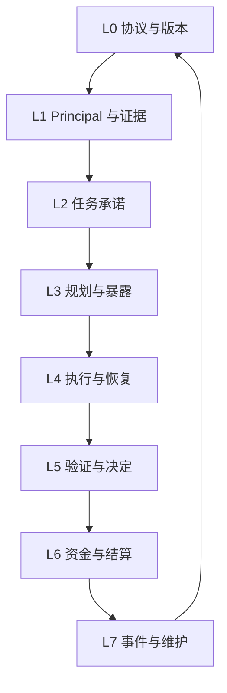
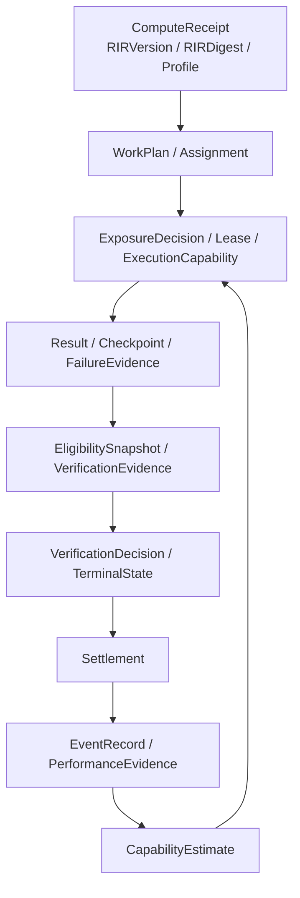

# ACLt Protocol 系统架构

> 当前执行见[开发政策](../development-policy.md)（2026-11-19）；本页旧 SHA 校验与审批要求按该决定处理。

> 文档状态：`CANDIDATE` architecture baseline  
> 语义基线：v0.5  
> 最后更新：2026-08-21
> 更新触发：对象、函数、信任边界、状态机、适配器或不变量发生变化

## 1. 架构目标

本架构把协议语义与部署方式分离。它必须支持：

- 两类不可再约减 Principal 与无许可函数；
- 不可变任务承诺和版本绑定；
- 零抵押 Provider 下的有界暴露；
- Lease、epoch、checkpoint 和有界恢复；
- RIR 规范执行边界、V1 Rust Profile 与未来 frontend 一致性；
- 任务特定、相关性感知、显式不确定的验证；
- 资金守恒、最多一次结算和安全终态；
- 可替换存储、日志、结算或账本 Adapter；
- 维护者无法裁决运行中个案。

架构图中的层和模块是语义边界，不要求一层对应一个进程、服务、组织或链上合约。

### 1.1 ACLt Abstract Machine

ACLt 将协议规范为一台由多台不可信计算机共同承载、但由统一对象与状态转换描述的 Abstract Machine。其状态可抽象为：

\[
M=(P,O,T,A,L,X,V,F,E)
\]

- `P`：被协议引用的 Principal 与授权状态；
- `O`：Logical Object Memory；
- `T`：Task 与 ComputeReceipt 状态；
- `A`：WorkPlan 与 Assignment 状态；
- `L`：Lease、epoch 与 attempt 状态；
- `X`：Execution、Result 与 Checkpoint 状态；
- `V`：EligibilitySnapshot、VerificationEvidence 与 Decision 状态；
- `F`：Funding、Entitlement 与 Settlement 状态；
- `E`：追加式 EventRecord 序列。

机器只能通过满足 ProtocolVersion、前置状态和 INV-01 至 INV-16 的事件发生转换：

\[
M\xrightarrow{ValidEvent}M'
\]

“computer-of-computers”是对该抽象的项目定位，不表示 Provider 共享地址空间、时钟、内核、故障域或现实控制主体。Protocol 仍是规则，不是执行事件的行为者。

Abstract Machine 的组成边界为 `DECIDED`，在 V1 为 `CORE`；machine-readable 状态 Schema 和完整转换关系保持 `OPEN/P0`。

### 1.2 Logical Object Memory

Logical Object Memory 是 Abstract Machine 可引用的不可变 Logical Object 集合，而不是分布式共享 RAM：

- 每个对象由对象类型、Schema/ProtocolVersion、canonical content 和 digest 无歧义标识；
- Task 只能通过 Receipt 中的显式 Object reference 读取输入；
- Task 输出创建新对象，不能原地修改另一个 Provider 可见的共享地址；
- 缓存、复制、分片和物理存储位置不得改变对象身份；
- Provider 本地 RAM、临时文件和进程状态不自动成为协议对象；
- 实际对象可用性与版本支持按实现检查；摘要字段记录，摘要不符拒绝已停用。

V1 明确不提供跨 Provider 共享可变内存或分布式原子操作。Logical Object 的不可变与显式引用模型为 `DECIDED`、V1 `CORE`；字段 Schema、保留、垃圾回收、可用性、加密和隐私仍为 `OPEN/P0/P1`。

### 1.3 Compile 流水线

ACLt 将 Compile 定义为：

\[
Compile=Lowering+Decomposition+Packing
\]

| 阶段 | 输入 | 输出 | 必须保持 |
|---|---|---|---|
| Lowering | SourcePackage、FrontendProfileVersion | 候选规范 RIR | 不由源语言定义协议真相；输出通过 validator 与 lowering conformance |
| Decomposition | Receipt、RIR、Logical Object refs、Task policy | TaskGraph/Assignment dependencies | 覆盖要求工作；不改变结果、失败、权限或依赖语义 |
| Packing | 合法分解、资源/验证/资金边界 | WorkPlan、Assignment 与执行上下文 | 不扩大 effects、deadline、预算、暴露或 SettlementPolicy |

Compile、Plan 和具体 toolchain 均是公开可复算函数或实现，不是 Broker Principal。允许多个合法计划，但给定候选输出的合法性判断必须由相同冻结规则复算。三阶段边界为 `DECIDED`、V1 `CORE`；精确 IR、TaskGraph、合法性谓词、唯一性和等价性证明仍为 `OPEN/P0`。

### 1.4 RPR 与 Host OS

RPR（RIR Portable Runtime）是实现 RIR 可观察语义的可替换运行时边界。RPR 必须：

- 只执行 Receipt 绑定且通过 validator 的 RIR；
- 默认拒绝 Host OS 文件、网络、时间、随机性、环境变量和设备状态；
- 只通过 ExecutionProfile 显式声明并由规范接口提供的 capability 暴露 effect；
- 规范化资源耗尽、终止、错误和结果；
- 将 RPR/Host 故障与 Task 语义失败分开记录；
- 不支持时返回 `UNSUPPORTED` 或 fail closed，不得静默 native fallback。

Host OS、容器、VM 或沙箱产品是实现机制，不是规范语义来源。RPR 边界为 `DECIDED`、V1 `CORE`；capability ABI、计量、错误码、checkpoint portability 和跨实现差分证据仍为 `OPEN/P0`。

### 1.5 Provider Dispatch

Provider Dispatch 是 `Admit + Schedule + Lease proposal + Provider accept` 的协议阶段，不是新的实体。V1 冻结以下边界：

1. Assignment 只描述可执行工作，不对任何 Provider 产生义务；
2. Admit 必须先验证硬资源、暴露、相关集群、期限和资金边界；
3. Schedule 只能产生候选顺序或 Lease proposal；
4. Provider 显式接受后，当前 epoch Lease 才生效；
5. 生效与暴露预留必须原子或具有等价补偿；
6. 拒绝未接受的提案不得产生负面 PerformanceEvidence；
7. active Lease 是执行范围的唯一写入权威，并派生不可变的 `ExecutionCapability`；
8. Dispatch 在发送前、RPR 在执行前分别校验同一 `ExecutionCapability`，二者是独立校验点而不是第三份可写 Scope；
9. 传输可以 push、pull 或混合，但不得改变相同状态语义。

Offer/accept/active Lease/ExecutionCapability 的权威边界为 `DECIDED`、V1 `CORE`；候选选择、排序、pull API、时钟和竞态算法仍为 `OPEN/P0`。

## 2. 分层架构

| 层 | 规范内容 | 主要对象/函数 | 首要性质 | SemanticStatus | V1 |
|---|---|---|---|---|---|
| L0 协议与版本 | 类型、状态机、不变量、升级 | ProtocolVersion、ConformanceTarget、ADR、Release | 可追踪、不可按个案追溯变更 | `OPEN`；二维模型已 `DECIDED` | `CORE` |
| L1 Principal 与证据 | 密钥、标识、控制关联、历史事件 | PrincipalID、PerformanceEvidence | 可归责、不假定独立 | `CANDIDATE` | `CORE` |
| L2 任务承诺与执行语义 | Logical Object、RIRVersion、RPR Profile、输入、验证、预算和政策 | ComputeReceipt、Logical Object、FundingPolicy、SettlementPolicy | 语义不可变、前端与 Host OS 不定义协议真相 | `INVARIANT` 接口；Schema `OPEN` | `CORE` |
| L3 Compile、规划与暴露 | Lowering、Decomposition、Packing、能力估计、准入 | WorkPlan、Assignment、CapabilityEstimate、ExposureDecision | 合法转换、无 Rank、暴露有界 | `CANDIDATE`；三阶段边界已 `DECIDED` | `CORE` |
| L4 Dispatch、执行与恢复 | Lease proposal、accept、ExecutionCapability、Attempt、epoch、checkpoint、result | Schedule、Provider Dispatch、Execute | 单一范围权威、双点校验、迟到隔离、有界重试 | `CANDIDATE`；握手边界已 `DECIDED` | `CORE` |
| L5 验证与决定 | Snapshot、抽样、检查、聚合、停止 | Sample、Verify、Aggregate、Decision | 不放回、预承诺、显式不确定 | `CANDIDATE`，Priority `P0` | `CORE` |
| L6 资金与结算 | 额度、费用、退款、唯一权利 | FundingPolicy、SettlementPolicy、Settlement | 守恒、最多一次、不得隐性借用 | `OPEN`，Priority `P0` | `CORE` |
| L7 事件、运维与维护 | 追加事件、重放、适配器、发布、主网保障 | EventRecord、AuditView、Release、MainnetAssuranceProfile | 可审计、语义等价、保障只能收紧能力 | `OPEN`，Priority `P0` | `CORE` |

L7 可以通过未来 ProtocolVersion、追加更正或已预声明的 `MainnetAssuranceProfile` 撤销/收紧未来可调用能力，但不能改写已冻结 Receipt、重算已终态 Decision，或把维护意见变成个案真理权。

## 3. 核心数据流

循环只影响未来 ExposureDecision；历史证据不能反向改变本次 VerificationDecision。

## 4. 核心边界

### 4.1 Principal 边界

Requester 对任务、输入权利、政策和预算承诺负责；Provider 对接受 Lease 后的履约、资源声明和证据真实性负责。Node、Account、Device 和 Key 是载体，不是新 Principal。

### 4.2 Permissionless function 边界

任何 Principal 均可执行 Plan、Admit、Schedule、Execute、Sample、Verify、Aggregate、Settle 或 UpdateEvidence。输出只有通过：

1. Schema 与 ProtocolVersion；
2. 签名和因果引用；
3. 当前状态前置条件；
4. 资源、暴露和资金限制；
5. INV-01 至 INV-16；
6. RIR validator、执行 Profile、effects 与 runtime conformance；

之后才可被接受。

### 4.3 Implementation 边界

Control Plane 可以实现登记、调度、Lease、验证聚合和结算协调，但不因此成为 Principal。其管理员权限不得越过协议守卫。

### 4.4 Maintenance 边界

维护者负责规范、测试、发布、兼容、撤销、漏洞响应，以及为 ACLt 官方主网发布版本化 `MainnetAssuranceProfile`。该 Profile 只能在预声明适用域内减少、暂停或撤销可调用能力；不能覆盖 Receipt、Snapshot、Decision 或 Settlement，也不能进入验证权重和停止规则。其他网络不得自动继承官方主网保障结论。

## 5. 参考实现逻辑组件

以下是参考实现的候选逻辑组件，不是协议必需实体：

| 组件 | 职责 | 不得拥有的权限 |
|---|---|---|
| Registry | 接收、规范化并索引 ProtocolVersion 与 Receipt | 不得修改已登记语义 |
| Frontend/RIR toolchain | 将 Rust Profile 或未来 conforming frontend 降级为规范 RIR 并执行 validator | 不得绕过 RIR、静默 native fallback 或成为真理权威 |
| RPR | 按冻结 Profile 执行、计量、隔离并报告结果/错误 | 不得访问未声明 Host OS effects、改变资源语义或静默 native fallback |
| Planner engine | 运行 Plan 合法性算法 | 不得因“优化”改变任务义务 |
| Admission engine | 计算 CapabilityEstimate 与 ExposureDecision | 不得授予验证或治理权 |
| Lease coordinator | 原子签发 epoch-bound Lease 并派生 ExecutionCapability | 不得回退 epoch、创建第二份范围权威或绕过暴露 |
| Result store | 保存内容寻址结果和 Checkpoint | 不得把存储成功当作结果可信 |
| Verification engine | 冻结 Snapshot、抽样、验证与聚合 | 不得观察后改策略或手工投票 |
| Settlement engine | 计算并提交唯一权利 | 不得越过资金上限或终态前提 |
| Event log | 追加事件、重放和审计 | 不得静默删除或覆盖历史 |
| Assurance registry | 发布、版本化和撤销 ACLt 官方主网保障 Profile | 不得裁决个案、放宽冻结政策或把报告写入验证权重 |
| Adapter layer | 提供存储、时间、随机性、结算等能力 | 不得改变可观察协议语义 |

实现可以合并或拆分这些组件；任何拆分都不能新增协议身份或绕过原子边界。

## 6. 适配器架构

| Adapter | 最低语义要求 | 主要未决问题 |
|---|---|---|
| Object/content | 按摘要寻址、完整性验证、生命周期可用 | 保留、复制、删除和隐私 |
| Event/storage | 追加事件、唯一键、原子提交、可重放 | 事务、分区、RPO/RTO |
| Clock | 为 Lease、deadline 和有效期提供声明模型 | 漂移、容差、可信时间 |
| Randomness | 观察前承诺、可审计、可复算 | 偏置、磨矿、不可用 |
| Settlement | 唯一权利、幂等提交、额度和最终性 | 超时、未知结果、重组 |
| Ledger | 保持对象、事件和结算语义 | 数据库/日志/链间等价性 |

公共链是 Ledger/Settlement Adapter 的一个未来选项，不是协议核心。引入时必须对重组、最终性、费用、可用性和隐私建立适配器测试。

## 7. 部署配置

### Profile A：单机参考实现

用于 G2 验证状态机、并发、重放和崩溃恢复。可以使用单数据库，但必须通过事务、唯一约束和故障注入保持不变量。它不证明分布式容错。

### Profile B：局域网多 Provider

用于 G3 测试异构节点、断线、弃单、checkpoint、重新 Lease 和沙箱。Control Plane 仍可中心化。

### Profile C：冗余控制与持久化

用于 G4 验证分区权威、领导者切换、备份恢复和 Adapter conformance。

### Profile D：外部无许可试点

用于 G5/G6 测试 Sybil、串谋、相关性隐私、资金耗尽、维护滥权和异构任务。只有前序 Gate 证据满足后才能进入。

## 8. 原子性边界

以下操作必须具有可证明的原子或等价补偿语义：

- ReceiptID 与 canonical Receipt 登记；
- 暴露额度预留与 Lease 生效；
- epoch 递增与 Lease 返回；
- 当前 Result 接收与 stale 判断；
- Snapshot 冻结与首次 draw；
- 唯一终态提交；
- 资金预留、权利生成与最多一次 Settlement；
- EventRecord 与状态变更之间的可重放一致性。

具体事务模型仍为 `OPEN/P0`。

## 9. 故障域

| 故障域 | 安全响应 |
|---|---|
| Provider 退出 | Lease 到期、checkpoint 恢复、重新分配或安全失败 |
| Planner 错误 | 拒绝不合法 WorkPlan；不得污染 Receipt |
| 验证器错误 | `UNSUPPORTED`/`UNRESOLVED`；不得人工背书 |
| 网络分区 | 保持终态、epoch、资金和结算安全；活性可暂停 |
| 存储回滚 | 重放校验失败时停止推进；不得重新支付 |
| 随机性失效 | 当前验证无效并安全终止或重建新流程 |
| 结算通道未知结果 | 查询唯一权利状态，不得盲目重试支付 |
| Maintainer/发布密钥失陷 | 撤销未来版本和主网保障 Profile，保留历史个案语义；不追溯改写终态 |

## 10. 架构验收

G0 架构退出至少要求：

- 所有对象和函数有 Schema、输入、输出和责任主体；
- 每条状态转换映射到不变量与 Threat ID；
- 原子边界、失败响应和安全终态明确；
- 单机与未来分布式部署保持相同可观察语义；
- 不存在隐藏 Rank、固定 Verifier、Foundation 个案裁决或未经声明的区块链依赖；
- active Lease 是唯一执行范围权威；Dispatch 与 RPR 对同一 ExecutionCapability 的校验可对拍；
- 假设失效保留规范化 `CauseSet`，终态兼容枚举由版本化 reducer 唯一派生；
- 工程来源事实由追加式、可终局化日志和访问审计验证，不伪装成 Schema 内定理；
- 官方主网保障只能缩小能力并绑定网络、版本、适用域和证据，不能成为运行时 Principal；
- Adapter contract 和 conformance suite 可以机器执行。
- RIR grammar、canonical encoding、validator、Rust Profile lowering 和 runtime conformance 可以机器执行。

## 11. 当前未决问题

- canonical encoding 和 ProtocolVersion 迁移；
- Abstract Machine 的 machine-readable 状态与合法转换；
- Logical Object 字段、生命周期、可用性、保留与隐私；
- RIR 指令/类型/错误语义、canonical encoding、Rust Profile 子集、RPR runtime effects/resource model；
- RPR capability contract、资源计量、终止、错误和 checkpoint portability；
- Lowering/Decomposition/Packing 输入输出 Schema、WorkPlan/Assignment 合法性与合并；
- Provider Dispatch 候选选择、排序、传输、时钟和并发状态机；
- Control Plane 的事务、分区与时钟模型；
- 相关集群、暴露单位和原子额度；
- 验证 Registry、统计规则和随机性；
- Funding/Settlement/退款与资不抵债；
- 发布密钥、撤销、隐私和灾难恢复；
- 公共链 Adapter 的最小未来接口。

权威跟踪见 [`../07-roadmap/open-questions.md`](../07-roadmap/open-questions.md)。
