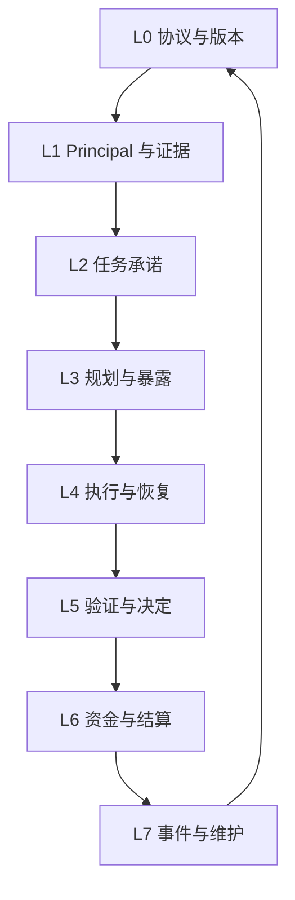
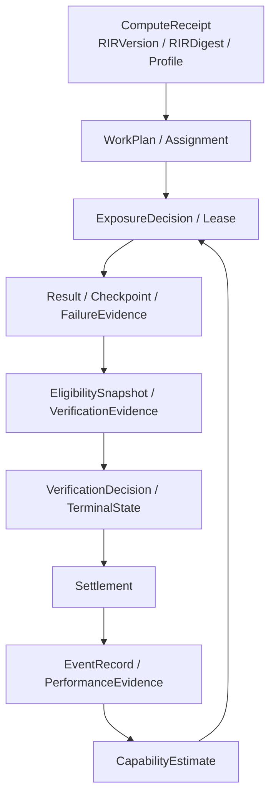

# ACLt Protocol 系统架构

> 文档状态：`CANDIDATE` architecture baseline  
> 语义基线：v0.5  
> 最后更新：2026-08-18  
> 更新触发：对象、函数、信任边界、状态机、适配器或不变量发生变化

## 1. 架构目标

本架构把协议语义与部署方式分离。它必须支持：

- 两类不可再约减 Principal 与无许可函数；
- 不可变任务承诺和版本绑定；
- 零抵押 Provider 下的有界暴露；
- Lease、epoch、checkpoint 和有界恢复；
- RIR 规范执行边界、V1 Rust Profile 与未来 frontend 一致性；
- 任务特定、相关性感知、显式不确定的验证；
- 资金守恒、最多一次结算和安全终态；
- 可替换存储、日志、结算或账本 Adapter；
- 维护者无法裁决运行中个案。

架构图中的层和模块是语义边界，不要求一层对应一个进程、服务、组织或链上合约。

## 2. 分层架构

| 层 | 规范内容 | 主要对象/函数 | 首要性质 | 当前状态 |
|---|---|---|---|---|
| L0 协议与版本 | 类型、状态机、不变量、升级 | ProtocolVersion、ADR、Release | 可追踪、不可按个案追溯变更 | `OPEN/P0` |
| L1 Principal 与证据 | 密钥、标识、控制关联、历史事件 | PrincipalID、PerformanceEvidence | 可归责、不假定独立 | `CANDIDATE` |
| L2 任务承诺与 RIR | RIRVersion、规范工件、输入、执行 Profile、环境、验证、预算和政策 | ComputeReceipt、FundingPolicy、SettlementPolicy | 语义不可变、前端不定义协议真相 | `DECIDED / INVARIANT` 接口 |
| L3 规划与暴露 | 合法拆分、能力估计、准入、调度 | WorkPlan、CapabilityEstimate、ExposureDecision | 无 Rank、暴露有界、保留探索 | `CANDIDATE` |
| L4 执行与恢复 | Lease、Attempt、epoch、checkpoint、result | Schedule、Execute | 迟到隔离、有界重试、条件性活性 | `CANDIDATE` |
| L5 验证与决定 | Snapshot、抽样、检查、聚合、停止 | Sample、Verify、Aggregate、Decision | 不放回、预承诺、显式不确定 | `CANDIDATE/P0` |
| L6 资金与结算 | 额度、费用、退款、唯一权利 | FundingPolicy、SettlementPolicy、Settlement | 守恒、最多一次、不得隐性借用 | `OPEN/P0` |
| L7 事件、运维与维护 | 追加事件、重放、适配器、发布 | EventRecord、AuditView、Release | 可审计、语义等价、维护最小权 | `OPEN/P0` |

L7 只能通过未来 ProtocolVersion 或追加更正影响系统，不能改写已冻结个案。

## 3. 核心数据流

循环只影响未来 ExposureDecision；历史证据不能反向改变本次 VerificationDecision。

## 4. 核心边界

### 4.1 Principal 边界

Requester 对任务、输入权利、政策和预算承诺负责；Provider 对接受 Lease 后的履约、资源声明和证据真实性负责。Node、Account、Device 和 Key 是载体，不是新 Principal。

### 4.2 Permissionless function 边界

任何 Principal 均可执行 Plan、Admit、Schedule、Execute、Sample、Verify、Aggregate、Settle 或 UpdateEvidence。输出只有通过：

1. Schema 与 ProtocolVersion；
2. 签名和因果引用；
3. 当前状态前置条件；
4. 资源、暴露和资金限制；
5. INV-01 至 INV-16；
6. RIR validator、执行 Profile、effects 与 runtime conformance；

之后才可被接受。

### 4.3 Implementation 边界

Control Plane 可以实现登记、调度、Lease、验证聚合和结算协调，但不因此成为 Principal。其管理员权限不得越过协议守卫。

### 4.4 Maintenance 边界

维护者负责规范、测试、发布、兼容、撤销和漏洞响应。其权限仅作用于未来版本或追加式更正，不能覆盖 Receipt、Snapshot、Decision 或 Settlement。

## 5. 参考实现逻辑组件

以下是参考实现的候选逻辑组件，不是协议必需实体：

| 组件 | 职责 | 不得拥有的权限 |
|---|---|---|
| Registry | 接收、规范化并索引 ProtocolVersion 与 Receipt | 不得修改已登记语义 |
| Frontend/RIR toolchain | 将 Rust Profile 或未来 conforming frontend 降级为规范 RIR 并执行 validator | 不得绕过 RIR、静默 native fallback 或成为真理权威 |
| RIR runtime | 按冻结 Profile 执行、计量、隔离并报告结果/错误 | 不得访问未声明宿主 effects 或改变资源语义 |
| Planner engine | 运行 Plan 合法性算法 | 不得因“优化”改变任务义务 |
| Admission engine | 计算 CapabilityEstimate 与 ExposureDecision | 不得授予验证或治理权 |
| Lease coordinator | 原子签发 epoch-bound Lease | 不得回退 epoch 或绕过暴露 |
| Result store | 保存内容寻址结果和 Checkpoint | 不得把存储成功当作结果可信 |
| Verification engine | 冻结 Snapshot、抽样、验证与聚合 | 不得观察后改策略或手工投票 |
| Settlement engine | 计算并提交唯一权利 | 不得越过资金上限或终态前提 |
| Event log | 追加事件、重放和审计 | 不得静默删除或覆盖历史 |
| Adapter layer | 提供存储、时间、随机性、结算等能力 | 不得改变可观察协议语义 |

实现可以合并或拆分这些组件；任何拆分都不能新增协议身份或绕过原子边界。

## 6. 适配器架构

| Adapter | 最低语义要求 | 主要未决问题 |
|---|---|---|
| Object/content | 按摘要寻址、完整性验证、生命周期可用 | 保留、复制、删除和隐私 |
| Event/storage | 追加事件、唯一键、原子提交、可重放 | 事务、分区、RPO/RTO |
| Clock | 为 Lease、deadline 和有效期提供声明模型 | 漂移、容差、可信时间 |
| Randomness | 观察前承诺、可审计、可复算 | 偏置、磨矿、不可用 |
| Settlement | 唯一权利、幂等提交、额度和最终性 | 超时、未知结果、重组 |
| Ledger | 保持对象、事件和结算语义 | 数据库/日志/链间等价性 |

公共链是 Ledger/Settlement Adapter 的一个未来选项，不是协议核心。引入时必须对重组、最终性、费用、可用性和隐私建立适配器测试。

## 7. 部署配置

### Profile A：单机参考实现

用于 G2 验证状态机、并发、重放和崩溃恢复。可以使用单数据库，但必须通过事务、唯一约束和故障注入保持不变量。它不证明分布式容错。

### Profile B：局域网多 Provider

用于 G3 测试异构节点、断线、弃单、checkpoint、重新 Lease 和沙箱。Control Plane 仍可中心化。

### Profile C：冗余控制与持久化

用于 G4 验证分区权威、领导者切换、备份恢复和 Adapter conformance。

### Profile D：外部无许可试点

用于 G5/G6 测试 Sybil、串谋、相关性隐私、资金耗尽、维护滥权和异构任务。只有前序 Gate 证据满足后才能进入。

## 8. 原子性边界

以下操作必须具有可证明的原子或等价补偿语义：

- ReceiptID 与 canonical Receipt 登记；
- 暴露额度预留与 Lease 生效；
- epoch 递增与 Lease 返回；
- 当前 Result 接收与 stale 判断；
- Snapshot 冻结与首次 draw；
- 唯一终态提交；
- 资金预留、权利生成与最多一次 Settlement；
- EventRecord 与状态变更之间的可重放一致性。

具体事务模型仍为 `OPEN/P0`。

## 9. 故障域

| 故障域 | 安全响应 |
|---|---|
| Provider 退出 | Lease 到期、checkpoint 恢复、重新分配或安全失败 |
| Planner 错误 | 拒绝不合法 WorkPlan；不得污染 Receipt |
| 验证器错误 | `UNSUPPORTED`/`UNRESOLVED`；不得人工背书 |
| 网络分区 | 保持终态、epoch、资金和结算安全；活性可暂停 |
| 存储回滚 | 重放校验失败时停止推进；不得重新支付 |
| 随机性失效 | 当前验证无效并安全终止或重建新流程 |
| 结算通道未知结果 | 查询唯一权利状态，不得盲目重试支付 |
| Maintainer/发布密钥失陷 | 撤销未来版本，保留历史个案语义 |

## 10. 架构验收

G0 架构退出至少要求：

- 所有对象和函数有 Schema、输入、输出和责任主体；
- 每条状态转换映射到不变量与 Threat ID；
- 原子边界、失败响应和安全终态明确；
- 单机与未来分布式部署保持相同可观察语义；
- 不存在隐藏 Rank、固定 Verifier、Foundation 裁决或区块链依赖；
- Adapter contract 和 conformance suite 可以机器执行。
- RIR grammar、canonical encoding、validator、Rust Profile lowering 和 runtime conformance 可以机器执行。

## 11. 当前未决问题

- canonical encoding 和 ProtocolVersion 迁移；
- RIR 指令/类型/错误语义、canonical encoding、Rust Profile 子集、runtime effects/resource model；
- WorkPlan/Assignment 合法性与合并；
- Control Plane 的事务、分区与时钟模型；
- 相关集群、暴露单位和原子额度；
- 验证 Registry、统计规则和随机性；
- Funding/Settlement/退款与资不抵债；
- 发布密钥、撤销、隐私和灾难恢复；
- 公共链 Adapter 的最小未来接口。

权威跟踪见 [`../07-roadmap/open-questions.md`](../07-roadmap/open-questions.md)。
