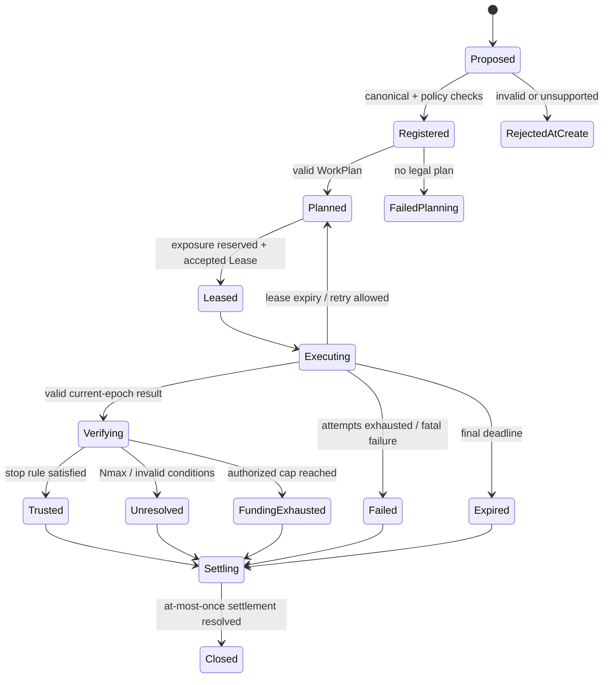

# ACLt Protocol 任务生命周期

> 文档状态：`CANDIDATE` state-machine baseline  
> 语义基线：v0.5  
> 最后更新：2026-08-21
> 更新触发：Receipt、Plan、Lease、验证、终态、资金或结算语义变化

## 1. 生命周期目标

每个任务必须从一个不可变 `ComputeReceipt` 开始，在有界执行、验证和资金条件内推进，并且最多进入一个协议终态。任何阶段都必须能够拒绝非法转换或进入准确的安全退出，而不是无限重试或人工裁决。

## 2. 顶层状态机

状态名是当前候选规范。精确枚举、嵌套状态和转换守卫仍需机器化。

SourcePackage、Lowering 和候选 RIR 的准备发生在 `Proposed` 之前；只有 canonical Receipt 登记后才进入 ACLt Protocol 状态机。直接提交规范 RIR 的任务可以跳过 source frontend，但不能跳过 validator。

## 3. 阶段与输出

| 阶段 | 主要动作 | 必要前置条件 | 输出 | 安全退出 |
|---|---|---|---|---|
| 0. Compile 候选工件 | Lowering、Decomposition 可行性和 Profile 检查 | source/RIR、对象引用和 Profile 明确 | 候选 RIR、lowering provenance | UNSUPPORTED / 本地诊断 |
| 1. 选择版本与政策 | 绑定 ProtocolVersion、验证、资金、结算 | 全部可解析且兼容 | 创建输入 | REJECTED_AT_CREATE |
| 2. 登记 Receipt | canonicalize、摘要、签署、登记 | 预算和字段合法 | ReceiptID | REJECTED_AT_CREATE |
| 3. Decomposition 与 Packing | 任意 Principal 提出合法分解和打包 | Receipt 与规范 RIR 可用 | WorkPlan、Assignment DAG | FAILED_PLANNING |
| 4. 能力与暴露 | 估计任务族能力并原子预留额度 | 证据版本、资源和限额有效 | ExposureDecision | 排队/拒绝/EXPIRED |
| 5. Provider Dispatch | Schedule 产生 Lease proposal，Provider 显式接受；Dispatch/RPR 校验 Lease 派生 capability | epoch、期限、scope 与暴露有效 | 生效 active Lease 与 ExecutionCapability | proposal 失效、释放额度 |
| 6. 执行与恢复 | RPR Execute、heartbeat、checkpoint | 当前 active Lease | Result/Checkpoint/Failure | retry/FAILED/EXPIRED |
| 7. 验证快照 | 冻结总体、分层、相关性和随机性 | 有效候选结果与策略 | EligibilitySnapshot | UNSUPPORTED/UNRESOLVED |
| 8. 序贯验证 | Sample、Verify、Aggregate | Snapshot 未破坏 | ConfidenceState | 扩样/UNRESOLVED |
| 9. 终态 | 原子提交唯一状态 | 停止或边界条件 | TerminalState | 事务重试 |
| 10. 结算 | 计算权利并最多一次提交 | 终态、政策、资金有效 | Settlement | FUNDING_EXHAUSTED/暂停 |
| 11. 证据更新 | 追加可归责事件 | 来源和故障归因充分 | PerformanceEvidence | 暂缓更新 |

## 4. ComputeReceipt 冻结点

Receipt 登记前必须明确：

- 程序和输入引用；
- RIRVersion、规范 RIR 工件摘要、source frontend/Profile 与 lowering 版本；
- runtime、允许 effects、资源计量和错误/终止语义；
- 执行环境与资源限制；
- 成功、结果等价与验证类型；
- deadline、Lease、attempt 和恢复边界；
- 有限总体与 Nmax 的政策来源；
- FundingPolicy、SettlementPolicy 和预算；
- ProtocolVersion 与 canonical encoding。

登记后任何实质变化必须生成新 ReceiptID。修正文书不能改变原任务义务。

Lowering 必须发生在 Receipt 冻结前，Receipt 绑定其 RIRVersion、RIR digest、FrontendProfileVersion 和 lowering provenance。Decomposition/Packing 可以在登记后由任意 Principal 提议，但只能产生受同一 Receipt 约束的合法 WorkPlan 和 Assignment。

## 5. Compile 与规划阶段

\[
Compile=Lowering+Decomposition+Packing
\]

- Lowering 把受支持 source frontend 转换为候选规范 RIR；
- Decomposition 把冻结的计算与对象依赖表达为有界工作图；
- Packing 把合法分解组织为 WorkPlan、Assignment、资源和验证上下文。

WorkPlan 只需合法、确定且可验证，不承诺全局最优。合法性至少检查：

- 所有 Assignment 的并集覆盖要求的工作；
- 依赖图无非法环或未声明依赖；
- 合并规则与任务结果语义一致；
- 每个单元资源和输出大小有界；
- 失败、取消和部分完成语义明确；
- 规划不会扩大 Receipt 的权限、预算或 deadline。

三阶段边界已决定并进入 V1 CORE。具体 source/RIR/TaskGraph Schema、DAG 合法性、计划唯一性、等价性算法和 golden vectors 的 SemanticStatus 为 `OPEN`，Priority 为 `P0`。

## 6. 暴露与 Lease

Assignment 不绑定 Provider，也不产生执行义务。Schedule 只能生成候选顺序或 Lease proposal；Provider 拒绝或忽略未接受 proposal 不产生负面 PerformanceEvidence。

Lease 生效必须同时完成：

1. 绑定 Receipt、Assignment、Provider、ProtocolVersion；
2. 原子预留 Provider、相关集群、Receipt 和窗口暴露；
3. 分配严格递增 epoch；
4. 写入期限、资源、提交和权利条件；
5. 获取 Provider 接受签名。

active Lease 是本次执行 scope、RPR、environment、resource tuple 的唯一授权来源。实现必须从它派生不可伪造或可重算的 `ExecutionCapability`，至少绑定 `ReceiptID`、`LeaseID`、epoch、执行元组摘要、scope 摘要、expiry 和 issuer key。Dispatch 只能传递并验证该 capability；RPR 启动时必须再次验证。二者不得创建第三份可覆盖 scope，也不得从本地配置补写不同执行元组。

若执行元组发生任何实质变化，旧 Lease/capability 立即不再适用，必须创建新 Lease 并重新经过 scope、暴露与接受检查。这里采用“一个权威、多检查点”：Dispatch/RPR 检查提高来源忠实性，但不会增加新的协议真相。

Lease 到期、拒绝或失败后的额度释放必须是幂等的。未接受 Lease 不产生负面 PerformanceEvidence。

Transport 可以是 Provider pull、Control Plane push 或混合方式；协议只接受相同的 proposal → accept → active Lease 状态转换。候选选择、排序、pull API、并发冲突和时间模型仍为 `OPEN/P0`。

## 7. 执行与迟到隔离

执行前必须先验证 RIR 工件与 Receipt/Profile 一致，并校验 active Lease 派生的 `ExecutionCapability`；RPR 只可读取 Receipt 显式引用的 Logical Object 和已绑定 ExecutionProfile capability。Host OS 文件、网络、时间、随机性、环境变量或设备状态不得成为隐藏输入。不支持的指令、effect 或 runtime 必须 fail closed，不得静默回退到原生执行。ResultSubmission 和 Checkpoint 必须绑定当前 epoch、RIR/RPR 版本、execution tuple digest、内容摘要、环境版本和幂等键。若 `epoch < current_epoch`：

- 可以保存为 stale audit evidence；
- 不得覆盖当前执行状态；
- 不得进入当前验证；
- 不得产生当前结算权利。

若尝试、deadline 或预算达到上限，任务必须进入相应终态，不能在状态机外重新启动同一义务。

## 8. 验证阶段

首次 draw 前冻结 EligibilitySnapshot、总体、排除项、抽样单位、分层、相关性处理、随机性、误差目标、停止规则和资金上限。

当前研究方向为有限总体、不放回、anytime-valid 序贯验证：

\[
N_{max}=\min(N_{population},N_{budget},N_{policy})
\]

该接口不证明统计方法已经安全。若随机性、总体、验证器或相关性假设失效，不得输出 TRUSTED。

## 9. 终态语义

| 终态 | 严格含义 | 允许结算 | 绝对正确性 |
|---|---|---|---|
| `TRUSTED` | 在预声明模型、官方主网 assurance 和停止规则下满足条件性背书 | 按 SettlementPolicy | 不证明 |
| `UNRESOLVED` | 在 Nmax/预算/政策内不能背书单一结果 | 按预声明过程费用/退款 | 不证明 |
| `FAILED` | 执行或系统条件失败且不能继续 | 按故障归因 | 不适用 |
| `EXPIRED` | 最终期限到达 | 按责任矩阵 | 不适用 |
| `FUNDING_EXHAUSTED` | 授权资金阻止继续或结算 | 仅按剩余额度和政策 | 不适用 |
| `REJECTED_AT_CREATE` | 创建条件不合法 | 不进入执行服务 | 不适用 |
| `FAILED_PLANNING` | 没有合法 WorkPlan | 仅按创建/规划政策 | 不适用 |
| `UNSUPPORTED` | 当前版本无合规验证或执行语义 | 不进入相关阶段 | 不适用 |

每个 Receipt 最多提交一个互斥协议终态。

## 10. 结算阶段

Settlement 必须引用：唯一终态、冻结 SettlementPolicy、合法故障归因、足够资金和未提交 EntitlementKey。

\[
Committed + Settled + RefundReserved \le AuthorizedFundingCap
\]

超时或响应丢失后必须查询唯一权利状态，不能盲目重试支付。发行若被选择，也必须在 Receipt 前声明并受上限约束。

## 11. 证据更新

只有可归责事件才能更新 PerformanceEvidence。记录至少包括任务族、环境、条件、结果、期限表现、验证来源、失败来源和因果引用。

- 更正通过新事件追加；
- 平台、任务或验证器故障不能自动归罪 Provider；
- 跨任务族迁移默认关闭；
- 证据只影响未来 CapabilityEstimate 和 ExposureDecision；
- 本次验证和终态不得被历史能力反向覆盖。

## 12. 关键竞态

| 竞态 | 必须保持 |
|---|---|
| 两个 Schedule 同时签 Lease | epoch 唯一递增，暴露不超限 |
| Lease 到期与 Result 同时到达 | 以原子状态和 epoch 判断，不产生双权利 |
| Dispatch/RPR 所见执行元组与 Lease capability 不同 | 拒绝启动或作废 Attempt；不得就地改写 scope |
| retry 与旧 Checkpoint 同时恢复 | stale 隔离，当前状态唯一 |
| Nmax 与 TRUSTED 条件同时出现 | 预声明顺序和原子 Decision |
| terminal 与 funding exhaustion 同时出现 | 唯一终态及确定性权利映射 |
| Settlement 提交后响应丢失 | 最多一次，不盲重试 |
| 发布新 ProtocolVersion 时任务运行 | 旧任务继续使用冻结版本 |

## 13. 不变量映射

- Receipt/版本：INV-01、INV-02；
- Lease/执行：INV-03、INV-08、INV-09、INV-10；
- 验证：INV-11、INV-12、INV-14；
- 终态/资金：INV-04、INV-05、INV-06、INV-07；
- 证据/维护/适配器：INV-13、INV-15、INV-16。

## 14. 当前未决问题

- 完整状态枚举和合法转换表；
- WorkPlan 覆盖、合并与部分失败；
- Lowering/Decomposition/Packing Schema、合法性和语义保持证明；
- Lease 时钟、heartbeat 和 checkpoint；
- Provider Dispatch 候选顺序、proposal/accept 竞态、ExecutionCapability 和传输接口；
- attempt、deadline、暴露和损失参数；
- 验证 Registry、Snapshot、随机性和停止规则；
- terminal—refund—fee—fault attribution 矩阵；
- 事务、幂等、分区和灾难恢复；
- Evidence 更正、隐私与保留。
- Logical Object 生命周期、RIR validator、Rust Profile lowering、RPR/Host OS capability、runtime/effects/resource 与 checkpoint 可移植语义。

### 2026-10-23 工程映射说明（非规范对象）

[最小承诺切片](../testing/TASK-COMMITMENT-SLICE1-20261023.md)用 ExperimentalTaskCommitment / experimental_task_id 探索执行前冻结与输入/工件/上限绑定。它不构成本文的 ComputeReceipt 登记，也未实现 active Lease、ExecutionCapability 或 EventRecord；无授权诊断执行不进入本协议状态机。正式生命周期与冻结字段要求保持不变。

### 2026-10-24 工程映射：实验授权（非正式 Lease/capability）

[授权与启动切片](../testing/TASK-AUTHORIZATION-SLICE2-20261024.md)对 ExperimentalTaskCommitment 派生的 scope/tuple 进行调度与启动双检查，依赖单一可信实验账本的在线消费和本地持久意图。ExperimentalExecutionGrant 不是本文的 active Lease/ExecutionCapability，不新增协议 Principal；它不能证明任意宿主不能旁路，也不改变正式状态机与冻结义务。

### 实验提交/ACK 与恢复补记（2026-10-24）

[可重放链切片](../testing/TASK-REPLAY-SLICE3-20261024.md)在独立实验部署记录授权到提交接纳的完整因果链。ACCEPT 是 A 保存完整实验包，ACK 是 B 收到原回执，两者可以暂时分离。已封存完整包可重传而不重新消费/计算；未封存状态不自动恢复 guest。接纳不证明正确执行，不替代正式终态、EventRecord、验证判决和结算，也不改变本文章节的规范要求。

### 实验资金冻结/预留补记（2026-10-24）

[资金切片](../testing/FUNDING-RESERVATION-SLICE1-20261024.md)在独立测试部署冻结任务相关资金政策并将可用余额原子转为预留。冻结本身不授权资金/执行，预留也不是 active Lease；旧启动入口未接该账本。不存在付款、退款或自动取消；未知状态保留占用，现有 ACCEPT/Task OK 不作为结算依据。后续须在统一准入中确保冻结/预留先于 grant 与调用，本片不改变正式生命周期或终态要求。
