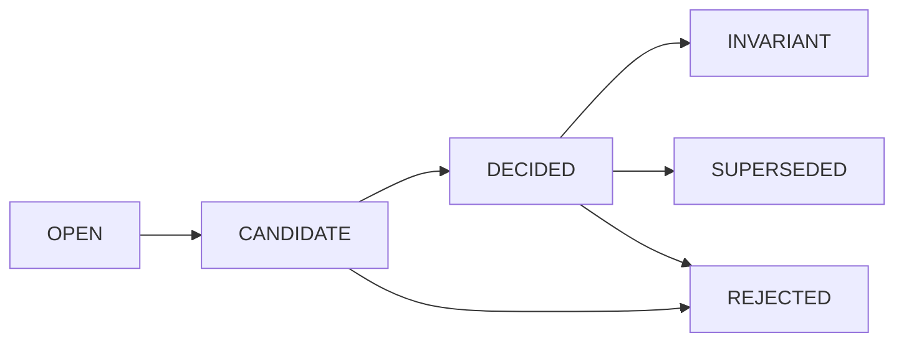

# ACLt Protocol 文档中心

> 文档状态：Living index and governance  
> 当前语义基线：v0.5  
> 最后更新：2026-11-08

本目录是 ACLt Protocol 的权威文档中心。文档不是一次性说明材料，而是随反例、证明、仿真、实现、攻击测试和工程试点持续修订的规格系统。

## 1. 阅读路径

### 快速理解

1. [`00-overview/project-overview.md`](00-overview/project-overview.md)
2. [`00-overview/design-principles.md`](00-overview/design-principles.md)
3. [`00-overview/terminology.md`](00-overview/terminology.md)
4. [`00-overview/system-context.md`](00-overview/system-context.md)

### 安全与实现

1. [`01-requirements/threat-model.md`](01-requirements/threat-model.md)
2. [`01-requirements/invariants.md`](01-requirements/invariants.md)
3. [`02-architecture/system-architecture.md`](02-architecture/system-architecture.md)
4. [`02-architecture/task-lifecycle.md`](02-architecture/task-lifecycle.md)
5. [`03-protocol/protocol-spec.md`](03-protocol/protocol-spec.md)
6. [`03-protocol/v1-profile.md`](03-protocol/v1-profile.md)
7. [`03-protocol/result-validation.md`](03-protocol/result-validation.md)

### 研究与决策

1. [`04-analysis/robustness.md`](04-analysis/robustness.md)
2. [`04-analysis/administrative-cost.md`](04-analysis/administrative-cost.md)
3. [`05-decisions/ADR-0001-no-unnecessary-entities.md`](05-decisions/ADR-0001-no-unnecessary-entities.md)
4. [`05-decisions/ADR-0002-normative-rir-and-v1-rust-profile.md`](05-decisions/ADR-0002-normative-rir-and-v1-rust-profile.md)
5. [`05-decisions/ADR-0003-separate-semantic-status-and-version-disposition.md`](05-decisions/ADR-0003-separate-semantic-status-and-version-disposition.md)
6. [`05-decisions/ADR-0004-verification-profiles-and-finite-population-e-process.md`](05-decisions/ADR-0004-verification-profiles-and-finite-population-e-process.md)
7. [`05-decisions/ADR-0005-engineering-assumptions-and-mainnet-assurance.md`](05-decisions/ADR-0005-engineering-assumptions-and-mainnet-assurance.md)
8. [`05-decisions/ADR-0006-rir-deterministic-wasm-core-subset.md`](05-decisions/ADR-0006-rir-deterministic-wasm-core-subset.md)（`PROPOSED` 草案）
9. [`05-decisions/ADR-0007-formal-object-migration-foundation.md`](05-decisions/ADR-0007-formal-object-migration-foundation.md)（D-1～D-6 首轮迁移路线已接受；字段/实现未验收）
10. [ADR-0008 FM-S3 首轮接口决定](05-decisions/ADR-0008-fm-s3-interface-decisions.md)（候选 S3b/S3c 路线）；选项分析见[接口备忘](05-decisions/reviews/MEMO-20261105-fm-s3-interfaces.md)
11. [`06-research/verification-round-mathematical-model.md`](06-research/verification-round-mathematical-model.md)
12. [`06-research/last-two-problem-trees.md`](06-research/last-two-problem-trees.md)
13. [`06-research/claims-and-sources.md`](06-research/claims-and-sources.md)
14. [`07-roadmap/current-status.md`](07-roadmap/current-status.md)
15. [`07-roadmap/open-questions.md`](07-roadmap/open-questions.md)
16. [`07-roadmap/formal-object-migration.md`](07-roadmap/formal-object-migration.md)（工程规划草案，非规范）
17. [`08-governance/audit-procedure.md`](08-governance/audit-procedure.md)

### 工程证据与维护

- [2026-10-14 工程维护记录](08-governance/audits/audit-20261014-01-repository-maintenance.md)：统一入口、交付完整性及连续重跑修复。

- [开发与维护指南](development.md)：统一检查、目录职责、校验清单及更新包边界。

- [2026-10-13 导航维护记录](08-governance/audits/audit-20261013-01-document-navigation.md)：实验入口、复现边界与历史报告标注。

- [运行与协作环境规范](08-governance/environment-standard.md)：ENV-1 工具版本、安装验收、Git 协作与交接约定。

- [当前实验索引](../experiments/README.md)、[state3 使用说明](../experiments/aclt-minimal-verifier-state3/README.md)与[多节点 admission 原型](../experiments/aclt-multinode-admission/README.md)。
- [架构阅读指南](00-overview/architecture-guide.md)与[交互演示](00-overview/aclt-theater.html)：帮助理解架构，不替代规范或验证证据。
- [单机集成修复报告](testing/INTEGRATION-FIX.md)与[逐条规则覆盖账本](testing/SINGLEHOST-COVERAGE.json)。
- [自动进度流程](workflow/README.md)：当前可复用测试状态由运行记录生成。
- [2026-10-07 Markdown 维护报告](08-governance/audits/audit-20261007-01-markdown-maintenance.md)：该轮范围、检查与保留项。

## 2. 文档权威范围

| 内容 | 唯一权威位置 |
|---|---|
| 项目目标、范围、非目标 | `00-overview/project-overview.md` |
| 顶层设计原则 | `00-overview/design-principles.md` |
| 术语、SemanticStatus 与 VersionDisposition 定义 | `00-overview/terminology.md` |
| 系统边界和外部依赖 | `00-overview/system-context.md` |
| 攻击者、威胁和剩余风险 | `01-requirements/threat-model.md` |
| 核心安全不变量 | `01-requirements/invariants.md` |
| 分层架构与实现边界 | `02-architecture/system-architecture.md` |
| RIR、V1 Rust Profile 与前端边界 | `05-decisions/ADR-0002-normative-rir-and-v1-rust-profile.md` |
| 二维状态模型及版本命名 | `05-decisions/ADR-0003-separate-semantic-status-and-version-disposition.md` |
| Principal、函数与权限 | `02-architecture/identities-and-roles.md` |
| 任务状态与生命周期 | `02-architecture/task-lifecycle.md` |
| 规范性协议骨架 | `03-protocol/protocol-spec.md` |
| V1 CORE/DEFERRED/REJECTED 映射 | `03-protocol/v1-profile.md` |
| 结果验证与统计边界 | `03-protocol/result-validation.md` |
| VerificationProfile 与有限总体 e-process 决定 | `05-decisions/ADR-0004-verification-profiles-and-finite-population-e-process.md` |
| 工程假设、主网 assurance 与单一权威边界 | `05-decisions/ADR-0005-engineering-assumptions-and-mainnet-assurance.md` |
| VerificationProfile P0-1A canonical 语义与 P0-1B 实现目标 | `03-protocol/verification-profile-schema.md` |
| 验证轮条件定理、反例与对拍资产 | `06-research/verification-round-mathematical-model.md`、`tests/verification_model/` |
| 多原因 verdict 与 Dispatch scope 完整思路树 | `06-research/last-two-problem-trees.md` |
| 证据、能力估计与暴露 | `03-protocol/reputation.md` |
| 鲁棒性证据与反证 | `04-analysis/robustness.md` |
| 行政成本与治理扩张门槛 | `04-analysis/administrative-cost.md` |
| 架构决定及理由 | `05-decisions/` |
| 论断、来源及引用边界 | `06-research/claims-and-sources.md` |
| 当前完成度 | `07-roadmap/current-status.md` |
| 未决问题和候选方案 | `07-roadmap/open-questions.md` |
| 审计程序与报告格式 | `08-governance/` |
| 当前审计记录 | `08-governance/audits/audit-20260821-10-p0-1a-independent-entry.md`；前序记录保留在同目录 |

同一结论不得在多个文件中形成互相独立的权威版本；其他文件应链接到权威位置。

## 3. 二维状态模型

每项核心结论必须分别处理两个问题：语义是否成熟，以及是否进入某个 ConformanceTarget。没有明确字段的描述不得被用作安全或兼容性主张。

### 3.1 SemanticStatus

| 状态 | 含义 |
|---|---|
| `OPEN` | 已识别但尚无被接受方案 |
| `CANDIDATE` | 有明确候选但尚未接受 |
| `DECIDED` | 已被当前语义基线接受 |
| `INVARIANT` | 正确实现和兼容版本不得违反 |
| `SUPERSEDED` | 被新语义替代，保留追踪价值 |
| `REJECTED` | 已评估并拒绝 |

`DERIVED`、`ASSUMPTION` 和 `HYPOTHESIS` 是 ClaimQualifier；`P0–P2` 是 Priority；它们不与 SemanticStatus 或 VersionDisposition 共用字段。

### 3.2 VersionDisposition

| 状态 | 含义 |
|---|---|
| `CORE` | 指定目标必须实现并通过 conformance |
| `DEFERRED` | 指定目标不支持，未来可以独立准入 |
| `REJECTED` | 指定目标明确禁止，必须拒绝或 fail closed |

V1 映射只在 [`03-protocol/v1-profile.md`](03-protocol/v1-profile.md) 存储。各语义权威文件不复制 VersionDisposition；Profile 也不覆盖来源的 SemanticStatus。

## 4. Living document 更新规则

### 4.1 触发更新的事件

- 用户或项目明确接受、否定或修改设计；
- 新反例、论文、实验或攻击否定现有假设；
- Schema、状态机、参数、适配器或实现行为发生变化；
- Gate 退出证据完成或失败；
- 发现文档冲突、术语漂移或未记录的权限；
- 外部依赖、许可证、品牌或安全流程状态变化。

### 4.2 必须记录的内容

每次实质更新至少记录：

- 变化前后的语义和状态；
- 证据、反例或决定来源；
- 受影响的 Claim、Threat、Invariant、ADR 和 Open Question ID；
- 兼容性、迁移和残余风险；
- 是否影响 v0.5 基线或需要新版本。

### 4.3 升降级规则



状态不是单向晋升。新的证据可以让已接受结论降级、被替代或被拒绝。

## 5. 冲突解决顺序

发生冲突时，按以下顺序处理：

1. 较新的明确项目决定；
2. 当前 ProtocolVersion 的规范性对象、状态机与不变量；
3. 已接受 ADR；
4. 当前权威文档；
5. 历史项目文件；
6. 助手建议或未接受草案；
7. 外部文献。

外部文献可以支持理论边界、候选方法或工程先例，但不能替 ACLt Protocol 证明组合系统。

## 6. 追踪标识

| 前缀 | 对象 |
|---|---|
| `DP-` | Design Principle |
| `SG-` | Security Goal |
| `TH-` | Threat |
| `INV-` | Invariant |
| `ADR-` | Architecture Decision Record |
| `CLM-` | Claim |
| `OQ-` | Open Question |
| `G0–G6` | Engineering Gate |

ID 一经使用不得重分配。废弃项保留原 ID 并标记 `SUPERSEDED` 或 `REJECTED`。

## 7. 最小同步要求

任何改变协议语义的提交必须至少检查：

```text
Decision / evidence
  ├── terminology and overview
  ├── ADR
  ├── threat model
  ├── invariants
  ├── architecture / protocol spec
  ├── claims and sources
  └── current status / open questions
```

不得只更新实现或单份说明文件而让规范性文档保持旧语义。

## 8. 当前目录状态

| 目录 | 当前作用 | 成熟度 |
|---|---|---|
| `00-overview` | 已建立项目语义与边界 | v0.5 baseline |
| `01-requirements` | 已建立威胁模型和 16 条不变量 | 规范意图已定，形式化未完成 |
| `02-architecture` | 当前候选分层与生命周期 | G0 draft |
| `03-protocol` | 当前规范性协议骨架与 V1 VersionDisposition Profile | G0 draft |
| `04-analysis` | 鲁棒性和行政成本证据账本 | 进行中 |
| `05-decisions` | 架构决定与评审备忘 | ADR-0001—0008 已建立；ADR-0006 为 `PROPOSED` |
| `06-research` | 论断—来源—边界 | 持续核查 |
| `07-roadmap` | 状态和未决问题 | 持续更新 |
| `08-governance` | 审计程序、模板和审计记录 | 程序已接受；报告持续追加 |
| `testing` | 单机/双机实验、覆盖登记与集成证据；不替代规范 | 限域工程证据 |
| `releases` | 开发者预览发行说明、发布检查清单与已知限制；不替代状态页或规范 | 草案；未发布 |
| `workflow` | 自动进度流程说明与历史示例 | 工具说明；实时状态由执行器生成 |
| `codocs` | 历史版本与决策追踪；不构成当前规范 | archived / superseded where marked |

## 9. v0.5 的严格定位

v0.5 是当前 ProtocolVersion 语义基线，V1 是建立在其上的首个 ConformanceTarget，两者不是相互替代的版本号。V1 的能力处置见唯一 Profile；它已选择 RIR 和 Rust Profile，但仍处于 G0。有限总体验证的条件数学内核与工程闭合原则已决定；具体主网的 \(B/Q\)、assurance 组件、相关性折减、资金退款、RIR/RPR conformance、实现一致性和参数化最大损失仍需工程证据和冻结配置。

- [2026-10-20 接纳端回滚与复制工程记录](testing/AUTHORITY-ADMISSION-20261020.md)：实验 v2、限定故障矩阵和独立离线证据。

- [2026-10-23 第一项工作三切片收尾](testing/RIR-WORK1-CLOSEOUT-20261023.md)：候选 RIR 执行链、统一复现、双机新证据与 Receipt 绑定交接；不关闭协议 Gate。

- [2026-10-23 第二项工作切片 1](testing/TASK-COMMITMENT-SLICE1-20261023.md)：实验最小任务承诺、身份/执行绑定和双机证据；正式对象与授权仍单列。

- [2026-10-24 第二项工作切片 2](testing/TASK-AUTHORIZATION-SLICE2-20261024.md)：实验授权、一次性在线消费和持久启动意图，含真实 LAN 双机证据；不替代正式对象/conformance。

- [2026-10-24 第二项工作切片 3](testing/TASK-REPLAY-SLICE3-20261024.md)：完整实验提交/接纳、幂等重传与独立离线因果重放，含真实双机故障证据；正式对象和 Gate 状态不变。

- [第二项工作统一收尾](testing/TASK-WORK2-CLOSEOUT-20261024.md)：任务承诺、实验授权和因果提交/ACK 重放三片组合验收；[复现与交接](testing/TASK-WORK2-MAINTENANCE.md)提供显式双机运行和只读证据核对命令。

- [2026-10-24 第三项工作切片 1](testing/FUNDING-RESERVATION-SLICE1-20261024.md)：冻结实验资金政策、整数余额与原子预留，含真实双机和独立离线守恒检查；尚无支付/退款或正式结算语义。

- [2026-10-24 第三项工作切片 2](testing/FIXED-SETTLEMENT-SLICE2-20261024.md)：同一冻结任务双端 outcome、资金前置许可、唯一固定测试分配及支付/退款；不替代正式验证/结算矩阵。

- [2026-10-24 第三项工作切片 3](testing/SETTLEMENT-RECOVERY-SLICE3-20261024.md)：真实结算丢回复、首次竞争、进程中断与查询原权利，包含 9 份独立 checkpoint 重放；不代表断电或真实支付保证。

- [第三项工作统一收尾](testing/FUNDING-WORK3-CLOSEOUT-20261024.md)：测试资金冻结/预留、双端固定分配、实际故障恢复三片组合验收；[维护与交接](testing/FUNDING-WORK3-MAINTENANCE.md)提供显式双机新跑和只读复核入口。


原定第四项是 [B/Q 反例与校准研究：第一片](06-research/bq-boundaries-slice1.md)。模型重跑入口与证据见 [本轮记录](testing/BQ-BOUNDARY-SLICE1-20261026.md)。

- [B/Q 第二片：任务级校准与敏感性](06-research/bq-calibration-slice2.md)：固定样本 Q 检验、独立真值/scope 契约和人工压力网格；[本轮记录](testing/BQ-CALIBRATION-SLICE2-20261026.md)。不等于实际部署 B/Q 校准。

- [B/Q 第三片：部署证据与失效边界](06-research/bq-readiness-slice3.md)：只读清单、创建前降级与分阶段撤销/到期投影；[本轮记录](testing/BQ-READINESS-SLICE3-20261026.md)。研究建议不会启用能力或更改 Receipt/终态。

- [B/Q 第四项统一收尾](testing/BQ-WORK4-CLOSEOUT-20261026.md)：三片研究组合重跑、离线重算与限域结论；[维护入口](testing/BQ-WORK4-MAINTENANCE.md)。真实 B/Q 和部署资格仍未建立。

- [正式迁移实施入口：FM-S1a](07-roadmap/formal-migration-plan.md)：共享编码与最小角色签名是下一代码切片；[FM-F0 交接](testing/FORMAL-MIGRATION-F0-20261026.md)记录六项路线接受、命名及规范边界修正。FM 不计入 BQ-WORK4。

- [FM-S1a 实现与双机复核](testing/FM-S1A-20261028.md)：共享编码、最小测试角色签名、89 固定向量与两端独立构建；[候选字节合约](../schemas/formal-migration/README.md)。下一片 FM-S1b。

- [FM-S1b 政策/Receipt 实现](testing/FM-S1B-20261028.md)：111 费用格、单向摘要 DAG、输入/执行引用与 Requester 签名；[候选合约](../schemas/formal-migration/policy.md)。费用为假设求值，非资金结算。

- [RIR 独立 stats-core](testing/RIR-INDEPENDENT-CORE-20261028.md)：原始外壳直接进入 Rust、受限验证和独立结果编码/摘要；[入口与剩余边界](../experiments/aclt-rir-stats-probe/INDEPENDENT-CORE.md)。全 ADR conformance 尚未完成。

- [FM-S2 前置收口](testing/FM-S2-READINESS-20261028.md)：[保留双机机器摘要](testing/MIGRATION-EVIDENCE-20261028.md)、[ADR-0006 分层评审](05-decisions/reviews/REVIEW-20261028-layered.md)及 [FM-S3 audit 依赖](07-roadmap/fm-s3-audit-dependencies.md)。

- [FM-S2 限定测试集成](testing/FM-S2-20261031.md)：单权威原子资金/暴露、唯一 Attempt、17 双机场景与公共日志重放；[机器摘要](testing/FM-S2-20261031.summary.json)。非正式准入，资金保持预留待 FM-S3。

- [2026-11-05 有界审计修复](testing/AUDIT-FIXES-20261105.md)：历史来源更正、控制面/验证器加固、确定性源码交付与本地/双机回归；不提升协议验收状态。

- [2026-11-05 CI 源码校验修复](testing/CI-GIT-SOURCE-FIX-20261105.md)：PR #65 线上任务读取保留源码失败的诊断，Git 访问只信任调用方给定仓库并保留错误输出；该修复的线上重跑当时为 NOT_RUN。

- [FM-S3a 签名结果](testing/FM-S3A-RESULTS-20261105.md)：候选审计合约、Receipt 重绑定、双角色签名结果与 S2 快照纯重放；本地局部切片。

- [FM-S3 候选总体收尾](testing/FM-S3-CLOSEOUT-20261106.md)：[权威接纳与唯一终态（S3b）](testing/FM-S3B-AUTHORITY-20261106.md)、[权利与恢复（S3c）](testing/FM-S3C-SETTLEMENT-20261106.md)，8 个双物理机场景与两端 39 事件重放；正式接口与准入 OPEN。

- [FM-S3 接口规范切片收尾](testing/FM-S3-INTERFACE-CLOSEOUT-20261106.md)：Profile v2 无 claim 编码、无 Snapshot Phase B、接纳边界与非主网部署草案；P0-1B 3/24/92。

- [FM-S3 候选 Task trap](testing/FM-S3-TASK-TRAP-20261106.md)：opt-in trap 合约与真实除零双机 8 场景；执行闭合、可耗尽预算与正式启动来源待后续切片。

- [FM-S3 执行闭合、可耗尽预算与 RPR 入口](testing/FM-S3-TERMINALS-20261106.md)：观察方签名闭合、激活时资金边界与已核验入口启动状态；本地与后续组合双机矩阵均通过。
- [Work 2/3 历史矩阵与 FM-S3 双机回归](testing/FM-S3-HISTORICAL-MATRIX-20261106.md)：逐项对照 38 个历史场景，补跑结果与结算回放、首次结算并发、worker 中断及停服恢复。
- [P0-1B Profile 摘要与判决结构第一片](testing/PROFILE-DIGEST-R1-20261107.md)：正式摘要与规则级证据，Python/Rust 正负向量。
- [FM 第四项证据归档收尾](testing/FM-EVIDENCE-CLOSEOUT-20261107.md)：五份公开归档、24 套历史快照的离线重放，外部审计原文、CI 运行记录和 FM-A 候选证据列。

- [2026-11-06 仓库维护记录](08-governance/audits/audit-20261106-01-repository-maintenance.md)与[开发者预览发行说明草案](releases/PREVIEW-20261106.md)：索引与入口同步、发布准备检查；预览尚未发布。

- [P0-1B Profile 注册上下文第二片](testing/PROFILE-REGISTRATION-R2-20261107.md)：嵌套字段、显式 schema lock、注册/事件快照摘要与闭合 DAG；限定 audit Phase R。

- [P0-1B Profile 排除声明与注册引用第三片](testing/PROFILE-REFERENCES-R3-20261108.md)：14 项基线、选择集/注册对象/快照绑定、正式摘要，以及 R3 TimeRange/ExternalTypedObject wire。

- [P0-1B 共同注册规则第四片](testing/PROFILE-RULES-R4-20261108.md)：四种方法的假设/撤销/scope、必需类、supersedes/降级声明与静态 AssumptionSet 摘要；固定 audit 集成。

- [P0-1B 方法矩阵第五片](testing/PROFILE-MATRICES-R5-20261108.md)：四方法参数/失败/条件集合与冻结投影模型；明确 signature、非 audit reachable_terminals 和正式 import 的剩余缺口。

- [R6：固定 audit I/F 测试接线、创建上下文与 Intent/记录摘要](testing/PROFILE-CREATION-R6-20261108.md)。

- [R7：注册资产、选择/绑定规则集中实现与扩展项边界](testing/PROFILE-SELECTION-R7-20261108.md)。

- [R8：Claim、假设快照与承诺集中实现，及候选输入胶囊](testing/PROFILE-COMMITMENTS-R8-20261108.md)。

- [R9：运行期绑定、冻结状态与七种 Phase B 载荷组件](testing/PROFILE-RUNTIME-R9-20261108.md)。

- [R10：Phase D 审计重放与终态投影](testing/PROFILE-DECISION-R10-20261109.md)。

- [R11：FM-S3 权威证据、Phase D 与结算复核](testing/PROFILE-AUTHORITY-R11-20261109.md)。
