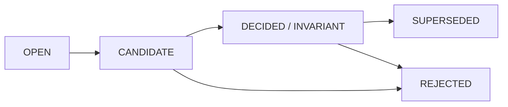

# ACLt Protocol 文档中心

> 文档状态：Living index and governance  
> 当前语义基线：v0.5  
> 最后更新：2026-08-17

本目录是 ACLt Protocol 的权威文档中心。文档不是一次性说明材料，而是随反例、证明、仿真、实现、攻击测试和工程试点持续修订的规格系统。

## 1. 阅读路径

### 快速理解

1. [`00-overview/project-overview.md`](00-overview/project-overview.md)
2. [`00-overview/design-principles.md`](00-overview/design-principles.md)
3. [`00-overview/terminology.md`](00-overview/terminology.md)
4. [`00-overview/system-context.md`](00-overview/system-context.md)

### 安全与实现

1. [`01-requirements/threat-model.md`](01-requirements/threat-model.md)
2. [`01-requirements/invariants.md`](01-requirements/invariants.md)
3. [`02-architecture/system-architecture.md`](02-architecture/system-architecture.md)
4. [`02-architecture/task-lifecycle.md`](02-architecture/task-lifecycle.md)
5. [`03-protocol/protocol-spec.md`](03-protocol/protocol-spec.md)
6. [`03-protocol/result-validation.md`](03-protocol/result-validation.md)

### 研究与决策

1. [`04-analysis/robustness.md`](04-analysis/robustness.md)
2. [`04-analysis/administrative-cost.md`](04-analysis/administrative-cost.md)
3. [`05-decisions/ADR-0001-no-unnecessary-entities.md`](05-decisions/ADR-0001-no-unnecessary-entities.md)
4. [`06-research/claims-and-sources.md`](06-research/claims-and-sources.md)
5. [`07-roadmap/current-status.md`](07-roadmap/current-status.md)
6. [`07-roadmap/open-questions.md`](07-roadmap/open-questions.md)

## 2. 文档权威范围

| 内容 | 唯一权威位置 |
|---|---|
| 项目目标、范围、非目标 | `00-overview/project-overview.md` |
| 顶层设计原则 | `00-overview/design-principles.md` |
| 术语与状态标签 | `00-overview/terminology.md` |
| 系统边界和外部依赖 | `00-overview/system-context.md` |
| 攻击者、威胁和剩余风险 | `01-requirements/threat-model.md` |
| 核心安全不变量 | `01-requirements/invariants.md` |
| 分层架构与实现边界 | `02-architecture/system-architecture.md` |
| Principal、函数与权限 | `02-architecture/identities-and-roles.md` |
| 任务状态与生命周期 | `02-architecture/task-lifecycle.md` |
| 规范性协议骨架 | `03-protocol/protocol-spec.md` |
| 结果验证与统计边界 | `03-protocol/result-validation.md` |
| 证据、能力估计与暴露 | `03-protocol/reputation.md` |
| 鲁棒性证据与反证 | `04-analysis/robustness.md` |
| 行政成本与治理扩张门槛 | `04-analysis/administrative-cost.md` |
| 架构决定及理由 | `05-decisions/` |
| 论断、来源及引用边界 | `06-research/claims-and-sources.md` |
| 当前完成度 | `07-roadmap/current-status.md` |
| 未决问题和候选方案 | `07-roadmap/open-questions.md` |

同一结论不得在多个文件中形成互相独立的权威版本；其他文件应链接到权威位置。

## 3. 文档状态

| 状态 | 含义 |
|---|---|
| `DECIDED` | 已接受的决定 |
| `DERIVED` | 从明确前提推出的结论 |
| `INVARIANT` | 正确实现不得违反的性质 |
| `CANDIDATE` | 研究方向已选，但尚未冻结 |
| `ASSUMPTION` | 当前模型依赖的未证明前提 |
| `HYPOTHESIS` | 需要实验或仿真检验 |
| `OPEN` | 尚未决定或规格化 |
| `SUPERSEDED` | 被新语义替代，保留追踪价值 |
| `REJECTED` | 明确排除 |

每项核心结论必须标记状态；没有标签的描述不得被用作安全主张。

## 4. Living document 更新规则

### 4.1 触发更新的事件

- 用户或项目明确接受、否定或修改设计；
- 新反例、论文、实验或攻击否定现有假设；
- Schema、状态机、参数、适配器或实现行为发生变化；
- Gate 退出证据完成或失败；
- 发现文档冲突、术语漂移或未记录的权限；
- 外部依赖、许可证、品牌或安全流程状态变化。

### 4.2 必须记录的内容

每次实质更新至少记录：

- 变化前后的语义和状态；
- 证据、反例或决定来源；
- 受影响的 Claim、Threat、Invariant、ADR 和 Open Question ID；
- 兼容性、迁移和残余风险；
- 是否影响 v0.5 基线或需要新版本。

### 4.3 升降级规则



状态不是单向晋升。新的证据可以让已接受结论降级、被替代或被拒绝。

## 5. 冲突解决顺序

发生冲突时，按以下顺序处理：

1. 较新的明确项目决定；
2. 当前 ProtocolVersion 的规范性对象、状态机与不变量；
3. 已接受 ADR；
4. 当前权威文档；
5. 历史项目文件；
6. 助手建议或未接受草案；
7. 外部文献。

外部文献可以支持理论边界、候选方法或工程先例，但不能替 ACLt Protocol 证明组合系统。

## 6. 追踪标识

| 前缀 | 对象 |
|---|---|
| `DP-` | Design Principle |
| `SG-` | Security Goal |
| `TH-` | Threat |
| `INV-` | Invariant |
| `ADR-` | Architecture Decision Record |
| `CLM-` | Claim |
| `OQ-` | Open Question |
| `G0–G6` | Engineering Gate |

ID 一经使用不得重分配。废弃项保留原 ID 并标记 `SUPERSEDED` 或 `REJECTED`。

## 7. 最小同步要求

任何改变协议语义的提交必须至少检查：

```text
Decision / evidence
  ├── terminology and overview
  ├── ADR
  ├── threat model
  ├── invariants
  ├── architecture / protocol spec
  ├── claims and sources
  └── current status / open questions
```

不得只更新实现或单份说明文件而让规范性文档保持旧语义。

## 8. 当前目录状态

| 目录 | 当前作用 | 成熟度 |
|---|---|---|
| `00-overview` | 已建立项目语义与边界 | v0.5 baseline |
| `01-requirements` | 已建立威胁模型和 16 条不变量 | 规范意图已定，形式化未完成 |
| `02-architecture` | 当前候选分层与生命周期 | G0 draft |
| `03-protocol` | 当前规范性协议骨架 | G0 draft |
| `04-analysis` | 鲁棒性和行政成本证据账本 | 进行中 |
| `05-decisions` | 已接受架构决定 | 最小 ADR 集合 |
| `06-research` | 论断—来源—边界 | 持续核查 |
| `07-roadmap` | 状态和未决问题 | 持续更新 |

## 9. v0.5 的严格定位

v0.5 是当前最高语义基线，但仍处于 G0。它已经替代旧 Rank、51%、固定角色和默认发行语义；有限总体序贯验证、相关性折减、资金退款、实现一致性和参数化最大损失仍未证明或冻结。
