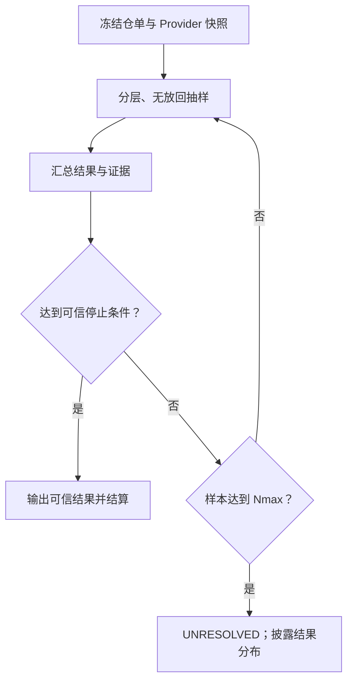

> **SUPERSEDED — 历史归档。** 本文的 51% 阈值与默认发行规则已被现行 ACLt 规范替代；保留原文仅作历史追踪。当前入口见 [归档说明](../README.md)。

# RUDCP 公开论证链、证明义务与项目结构 v0.3

> 日期：2026-08-16  
> 状态：内部协作基线／可审计设计记录  
> 语言：中文  
> 对应英文版：`RUDCP_Public_Argument_Proof_Obligations_and_Project_Structure_v0.3_EN.md`

## 0. 文档用途与证据纪律

本文件重建的是项目提出者可以公开给合作者检查的**论证路径、决策理由、证明义务和反证条件**。它不是对任何人的私密思维过程作逐字记录，也不把直觉包装成定理。

文中使用以下状态标签：

| 标签 | 含义 | 可以怎样表述 |
|---|---|---|
| `DECIDED` | 已接受的设计决定 | “首版将……” |
| `DERIVED` | 在已写明前提下可推出的设计结论 | “在 A、B 成立时，C 成立” |
| `INVARIANT` | 实现不得破坏的安全性质 | “任何执行都必须满足……” |
| `ASSUMPTION` | 当前依赖、但尚未证明的模型前提 | “模型暂时假设……” |
| `HYPOTHESIS` | 必须用仿真或实验检验的经验性主张 | “需要验证是否……” |
| `OPEN` | 尚未决定的问题 | “仍需选择……” |
| `REJECTED` | 已明确排除的方案或表述 | “首版不采用／不得声称……” |

**严谨性规则：** 一个论证只有在“前提—机制—结论—适用范围—反证条件—验证方法”六项齐全时，才算形成可审计的证明义务。经济激励只能支持理性参与者模型，不能替代身份独立性、密码学安全或分布式一致性的证明。

## 1. 项目的顶层命题

### 1.1 目标命题

RUDCP 试图构建一个完全开源、面向异构闲置设备的分布式计算系统，使 Requester 能提交受资源约束的通用计算任务，并在 Provider 不稳定、网络不可靠、部分参与者不可信的条件下，得到：

1. 可审计的任务拆分与分配记录；
2. 经预先声明政策验证的结果，或明确的 `UNRESOLVED`；
3. 不超过仓单预算、最多一次的最终结算；
4. 节点退出后的有界恢复，而不是永久悬空；
5. 普通 Provider 零初始资金准入。

### 1.2 当前能主张与不能主张的结论

**当前能主张：** 已形成可被规格化、仿真和反驳的系统设计骨架；普通节点退出恢复、无抵押信誉、仓单不可变性、分层验证和最小治理均已有明确方向。

**当前不能主张：** 系统鲁棒性已经证明；51% Provider 一定代表独立多数；信誉一定收敛；任意通用任务都能廉价验证；验证增发没有真实成本；中心控制平面已经容错。

## 2. 角色、信任边界与公开性

### 2.1 已确定角色

| 角色 | 核心职责 | 是否可以兼任 | 当前信任边界 |
|---|---|---|---|
| `Requester` | 提交任务、输入、预算、期限、验证要求；接收结果或 `UNRESOLVED` | 可以兼任 Broker 或 Provider | 不拥有审计最终决定权 |
| `Broker` | 将任务拆成合法 Assignment，并分配给 Provider | 可由 Requester 自行承担，也可由第三方承担 | 拆单与分配必须公开可审计 |
| `Provider` | 承接 Assignment、执行、提交结果；合格时也可参与验证 | 节点可以兼任其他角色 | 普通 Provider 不可信、可退出、可提交错误结果 |
| `Protocol / Control Plane` | 登记仓单、发放租约、维护事件、执行验证与结算规则 | 首版为中心化实现 | 逻辑暂时可信但可能崩溃；必须受版本和审计约束 |
| `Foundation / Maintainers` | 维护开源规则、版本、测试、审计证据和发布流程 | 需利益冲突回避 | 不得按个案改变报告权重或验证结论 |

### 2.2 开源与可审计性论证链

| 编号 | 前提／观察 | 推导 | 当前结论 | 状态 |
|---|---|---|---|---|
| A1 | Broker 能影响拆单和 Provider 获得的工作 | 若 Assignment 规则不可见，外部无法区分优化、偏差和操纵 | 合法 Assignment 格式、拆单规则和分配事件必须公开 | `DERIVED` |
| A2 | 首版拆单不追求全局最优 | 若仍宣称最优，将引入无法兑现的证明义务 | 首版采用最简贪心，只保留资源、依赖、期限、验证和预算等基本边界 | `DECIDED` |
| A3 | 节点可以兼任多角色 | 角色名称不能等同于独立控制实体 | 身份模型必须区分角色、账户、设备、Provider 实例和最终控制人 | `DERIVED`／`OPEN` |
| A4 | Foundation 掌握维护权 | 若维护者可按个案改权重，开源代码仍可能被治理裁量绕过 | 规则变更只能经版本化、公开评审和可追溯发布；个案裁量不得追溯改变规则 | `DECIDED` |

## 3. 从问题到机制的公开论证链

### 3.1 链 B：为什么使用不可变计算仓单

**问题。** 任务执行期间，如果程序、输入、验证规则、预算或期限可被修改，Provider 承接的义务、Requester 购买的结果和验证者检查的对象将不再相同。

**前提。** 可结算关系要求各方对同一版本的任务对象达成一致。

**机制。** 每个任务单元登记为：

\[
C_j=(ID,P,I,E,R,V,S,D,B,A,\Pi)
\]

其中 `P/I/E` 固定程序、输入和执行环境；`R` 固定资源边界；`V/S` 固定验证和成功条件；`D` 固定租约与最终期限；`B` 固定任务、验证及平台预算；`A` 固定尝试上限；`Π` 固定拆分、检查点、重试与结果合并规则。

**推导。** 若任何实质字段改变，则生成新 ReceiptID；执行过程只追加事件，不回写仓单主体。

**结论。** 同一 ReceiptID 可以作为租约、结果、验证、信誉和结算的共同引用对象。

**证明义务。** 必须完成 canonical serialization、哈希字段范围、版本迁移规则、签名／摘要规则以及内容寻址对象的持久化验证。

**反证条件。** 若存在两个语义不同的仓单得到同一 ReceiptID，或同一 ReceiptID 的关键字段可被静默改写，则该链失败。

### 3.2 链 C：为什么普通 Provider 可以零抵押准入

**目标约束。** 普通 Provider 永远不提供初始资金、押金或财产性担保。

**问题。** 没有罚没时，如何约束占单、随意放弃、刷分和反复创建新身份？

**机制组合。**

1. Provider 仅在接受租约后承担履约记录；接受前拒绝不扣信誉；
2. 接受后放弃、超时或验证失败形成追加式 `ReputationEvent`；
3. 新节点只有低并发、低风险、低权重仓单准入；
4. 单节点、单仓单和全局尝试均有上限；
5. 高价值任务要求历史履约证据和较低评级不确定度；
6. 约束对象是未来任务机会、并发额度和风险暴露，而非财产罚没。

**有限结论。** 零抵押与基于历史履约的风险控制可以同时存在。

**不能推出。** 该机制不能证明 Sybil 攻击消失，也不能证明攻击成本天然高于收益。

**证明义务。** 需要量化新身份能够造成的最大延迟、重试成本、错误接受概率和可重复攻击收益。

### 3.3 链 D：为什么信誉必须是分任务族、带不确定度的能力估计

**观察。** CPU、GPU、内存密集、期限敏感和验证任务的能力并不相同；历史记录也可能陈旧。

**否定项。** 单一永久积分会错误迁移能力，并强化早期优势。

**候选模型。**

\[
\mathbf r_i=(r_i^{CPU},r_i^{GPU},r_i^{Memory},r_i^{Reliability},r_i^{Deadline},r_i^{Validation})
\]

对任务族内的最小模型：

\[
p_{ij}=\sigma\left(\frac{r_i-d_j}{\tau}\right),\qquad
r_i'=r_i+K w_j(y_{ij}-p_{ij})
\]

能力估计同时保存不确定度：

\[
r_i\sim\mathcal N(\mu_i,\sigma_i^2),\qquad
r_i^{safe}=\mu_i-z\sigma_i
\]

**推导。** 低于现有能力的重复任务增益趋小；超预期完成高难任务增益较大；长期休眠或设备变更主要扩大不确定度，而不是简单删除历史。

**防垄断补充。** 调度必须保留探索额度和晋级挑战，否则新节点没有获得证据的路径。

**状态。** 公式和方向为 `HYPOTHESIS`，接口和多维原则为 `DECIDED`；`K、τ、z、w_j` 尚未校准。

### 3.4 链 E：为什么使用租约、epoch 和有界重试

**问题。** Provider 可崩溃、断网、主动退出或长时间占单。

**机制。** Broker／控制平面签发有限期 Lease；每次重新分配使 epoch 严格递增；心跳只用于进度和超时决策；旧 epoch 的迟到结果不得覆盖新 epoch 或终态；尝试次数和最终期限有上限。

**安全结论。** 在实现正确时，旧租约不能恢复为当前收益权，迟到结果不能导致状态回滚或重复支付。

**条件活性结论。** 仅在控制平面最终恢复、网络最终可达、存在合格完成者、仓单未过期且验证可用时，任务最终进入成功结算；否则必须在有限期限内进入 `FAILED`、`EXPIRED` 或 `UNRESOLVED`，而非永远悬空。

**证明义务。** 需要状态机、幂等 API、时钟假设、模型检查、重复／乱序／分区／崩溃恢复测试。

### 3.5 链 F：分层随机、无放回、逐轮扩大的结果验证

#### 3.5.1 已确定的过程

1. 固定仓单、候选结果集合与“合格 Provider 快照”；
2. 按预先声明的分层规则，从快照中无放回抽取验证 Provider；
3. 每轮收集结果、证据和控制关系信息；
4. 若某结果达到预先定义的可信停止条件，立即停止并输出该结果；
5. 否则扩大样本并进入下一轮；
6. 当累计样本达到 `Nmax = 51% × 合格 Provider 快照` 仍没有可信结果，终止为 `UNRESOLVED`；
7. Requester 获知候选结果及分布，但不拥有审计最终决定权；Requester 可以自行采用某个 `UNRESOLVED` 候选，协议不为其背书；
8. 无论可信停止还是 `UNRESOLVED`，不退款；理由是执行和验证服务已经发生；验证成本由协议增发承担。

#### 3.5.2 该过程真正能证明什么

在以下前提全部成立时，抽样过程能提供一个可计算的统计证据：采样框架未被操纵；每个 Provider 只被抽取一次；分层变量事先固定；结果分类规则固定；停止规则没有在观察数据后改变；样本之间的依赖被显式建模或足够小。

它**不能单独证明**：Provider 属于独立控制实体；多数结果是真实结果；51% 是安全阈值；Alice 无法拥有多个 Provider；协议外收益为零。

#### 3.5.3 经济信任链及其严格边界

项目当前的经济直觉是：

\[
C_{Rank}+C_{Verification}+C_{Coordination}>G_{attack}^{protocol}
\]

则追求协议内收益的理性攻击者缺乏攻击动机；即使 Alice 控制若干 Provider，每个 Provider 可造成的损害受仓单和验证规则限制。

严谨版本必须改写为：

\[
C_{attack} > G_{protocol}+G_{external}+V_{disruption}-P_{detection}
\]

并明确重复攻击、借用身份、串通补贴、外部头寸、竞争破坏、非理性目标和成本回收。只有在右侧收益上界和左侧成本下界均可被证明时，才能得到“特定攻击在特定参数下经济上不占优”。

**不能跨越的逻辑缺口：** “攻击不划算”不推出“样本独立”。近似独立必须另有身份、控制关系、资源来源、抽样设计或相关性折扣证据。因此当前状态是：经济安全为 `ASSUMPTION/HYPOTHESIS`，而不是系统定理。

### 3.6 链 G：为什么可信停止、达到 Nmax 和不退款可以同时存在

**服务对象区分。** Requester 购买的不是无条件正确答案，而是仓单声明的执行与验证过程。

**推导。** 若系统已按规则执行计算、抽样、验证、扩大轮次并产生可审计证据，则即使最终为 `UNRESOLVED`，系统仍完成了过程性服务。

**当前决定。** 两种终止均不退款；验证成本不从单个新 Provider 收取初始资金，而由协议增发支付。

**尚未闭合的证明义务。** 必须在任务创建前向 Requester 明示交付定义；区分“任务预算、Provider 执行报酬、验证预算、平台费和增发”；定义增发上限、承担者和稀释／通胀效应；防止协议通过无限验证消耗制造无限发行。

### 3.7 链 H：为什么 Foundation 必须保持最小权限

**问题。** Foundation 若同时维护规则、发布分析、审查披露并调整个案权重，会形成不可审计的利益冲突。

**已定边界。** Foundation／维护者只维护开源代码、规则版本、测试、发布和审计证据；分析发布者和道德披露者可以贡献证据，但不得在同一事项中通过维护权限改变权重或结论。

**派生控制。** 最小权限、双人复核、公开 ADR、版本化规则、利益冲突披露、回避、禁止追溯改规则、可复现构建和追加式审计日志。

**未决。** 何时需要法人基金会、谁任命维护者、紧急补丁权限、密钥轮换、撤销与申诉程序。

### 3.8 链 I：如何判断行政成本是否值得

行政不是目标，而是风险控制。建议使用：

\[
NV_{gov}=E[L_{without}-L_{with}]+V_{audit}+V_{compliance}+V_{trust}-C_{total}
\]

其中：

\[
C_{total}=C_{maintenance}+C_{verification}+C_{review}+C_{delay}+C_{infra}+C_{legal}+C_{opportunity}+C_{issuance}
\]

只有当保守情景下 `NV_gov > 0`，且不存在更低成本的等效自动控制时，行政层才值得保留或扩张。阶段 0 只定义维护角色和规则，不预设庞大法人或委员会。

## 4. 已确定进度的详细结构

### 4.1 项目边界

| ID | 已确定内容 | 状态 | 仍需产物 |
|---|---|---|---|
| SCOPE-01 | 全系统完全开源 | `DECIDED` | 许可证、贡献与发布政策 |
| SCOPE-02 | 核心角色为 Requester、Broker、Provider，节点可兼任 | `DECIDED` | 控制实体和利益冲突模型 |
| SCOPE-03 | Broker 可由 Requester 或第三方承担 | `DECIDED` | Broker API、审计事件和责任边界 |
| SCOPE-04 | 拆单为最简贪心，只满足基本合法边界，不承诺最优 | `DECIDED` | Assignment 合法性规范和基线算法 |
| SCOPE-05 | 首版中心化控制平面 | `DECIDED` | 故障恢复、一致性和审计规格 |
| SCOPE-06 | 首版不依赖区块链、不发行可交易代币、任务默认无公网 | `DECIDED` | 威胁模型和执行策略 |

### 4.2 核心数据对象

| 对象 | 已确定字段／责任 | 未完成的规格 |
|---|---|---|
| `ComputeReceipt` | 不可变程序、输入、环境、资源、验证、期限、预算、尝试和拆分规则 | JSON Schema、canonical encoding、签名和版本 |
| `Assignment` | Broker 产生的公开、合法任务单元 | 贪心算法、边界检查、依赖图和失败语义 |
| `NodeIdentity` | 账户、设备、Provider 实例和密钥关联 | 最终控制人、轮换、撤销和 Sybil 风险 |
| `CapabilityProfile` | 任务族能力、资源声明和环境 | 测量可信度、漂移和基准 |
| `Lease` | Receipt/Assignment、Provider、epoch、期限、条件收益权 | 原子发放、续租、并发和时钟假设 |
| `Attempt` | 单次执行的开始、进度、终止和原因 | 去重、重放和迟到处理 |
| `Checkpoint` | 可恢复执行状态 | 完整性、兼容性、持久化和费用 |
| `ResultSubmission` | 结果、摘要、epoch、证据和幂等键 | 格式、大小、重复提交和保留期 |
| `VerificationPolicy` | 分层、抽样、轮次、可信停止、Nmax、预算 | 置信模型、相关性、资格快照和不可判定规则 |
| `VerificationDecision` | 可信结果或 `UNRESOLVED`，及证据链 | 决策结构、申诉、最终性和公开范围 |
| `ReputationEvent` | 任务族、难度、权重、结果、时间和证据 | 可归责性、参数、衰减和更正 |
| `Settlement` | 验证后一次性支付、预算守恒 | 事务边界、唯一键、失败恢复和增发会计 |

### 4.3 已确定的安全不变量

1. `INV-01 Receipt immutability`：同一 ReceiptID 的关键字段不可变。
2. `INV-02 Epoch monotonicity`：新租约 epoch 严格大于旧租约。
3. `INV-03 Single terminal state`：仓单不能同时处于多个最终状态。
4. `INV-04 At-most-once settlement`：同一结算权利最多支付一次。
5. `INV-05 Budget conservation`：累计支付和已承诺验证支出不得超过适用预算／发行上限。
6. `INV-06 Verify before settle`：未经有效 VerificationDecision 不得成功结算。
7. `INV-07 Late-result isolation`：旧 epoch 结果不得覆盖新 epoch 或终态。
8. `INV-08 Bounded attempts`：已消耗尝试不得超过仓单上限。
9. `INV-09 Auditable transitions`：每次状态变化对应唯一、可追踪事件。
10. `INV-10 Exposure limit`：节点不得超过当前并发和风险额度。
11. `INV-11 Sampling without replacement`：同一验证轮系中同一 Provider 不得重复计票。
12. `INV-12 No case-specific weight mutation`：维护者不得为特定报告追溯改变权重规则。

### 4.4 已确定的状态机骨架

| 状态机 | 最小状态 | 必须覆盖的异常 |
|---|---|---|
| Receipt | `DRAFT → REGISTERED → ASSIGNED/RUNNING → VERIFYING → SETTLED/FAILED/EXPIRED/UNRESOLVED` | 重复注册、规则版本变更、过期与取消 |
| Lease | `OFFERED → ACCEPTED → ACTIVE → COMPLETED/ABANDONED/TIMED_OUT/SUPERSEDED` | 重复接受、乱序心跳、epoch 竞争 |
| Attempt | `CREATED → RUNNING → SUBMITTED/FAILED/TIMED_OUT` | 崩溃恢复、重复结果、迟到结果 |
| Verification | `SNAPSHOT → ROUND_n → TRUSTED/EXPAND/UNRESOLVED` | Provider 失联、样本不足、相关性暴露、证据冲突 |
| Settlement | `PENDING → AUTHORIZED → COMMITTED` 或 `FAILED_RETRYABLE/FAILED_FINAL` | 重放、并发提交、部分写入和恢复 |
| Reputation | `ACTIVE / DORMANT / RESTRICTED / REVOKED` | 设备变更、休眠、不确定度扩张和申诉 |

### 4.5 验证与实验体系

| 方法 | 要证明／发现的内容 | 阶段 |
|---|---|---|
| 单元与属性测试 | Schema、状态转移、预算和幂等不变量 | G0-G2 |
| TLA+/PlusCal 或等价模型检查 | epoch、单一终态、只结算一次、分区与重放 | G0-G2 |
| 离散事件仿真 | 信誉校准、探索、Nmax、攻击收益、成本和集中度 | G1 |
| 故障注入 | 进程、网络、数据库、对象存储和验证器故障 | G2-G4 |
| 对抗策略测试 | Sybil、串通、刷分、占单、外部收益和治理滥用 | G1/G5 |
| 真实节点试验 | 性能漂移、断网恢复、异构归一化和执行环境 | G3-G6 |

## 5. 未解决问题的结构

### 5.1 P0：阻塞 G0 的问题

#### P0-A 身份、控制关系与近似独立

- 合格 Provider 的最小资格是什么？
- `Nmax` 的分母是账户、设备、Provider 实例、控制实体还是可验证资源？
- 快照在何时冻结，退出／加入／吊销如何处理？
- 节点兼任角色时如何披露利益冲突？
- 如何对共同所有权、共同资金、共同网络或一致行动进行去重／相关性折扣？
- “近似独立”的可测标准和最大允许相关性是什么？

#### P0-B 可信停止规则

- “可信”是确定性验证、误差界、后验概率、置信区间还是加权多数？
- 多个候选结果如何聚类，浮点误差如何处理？
- 逐轮查看数据会产生可选停止偏差，如何校正？
- 分层变量和每层权重如何预先冻结？
- 何时因验证器缺陷而不是 Provider 分歧进入 `UNRESOLVED`？

#### P0-C `Nmax = 51%` 的安全含义

- 51% 当前是流程上限，不是已证明的拜占庭阈值；其风险目标是什么？
- 若 Provider 总体过小、极度集中或样本无法达到 51%，如何终止？
- 是否需要按任务价值、验证成本和相关性动态降低／提高上限？
- 达到 Nmax 后还存在两个相近候选结果时，如何披露？

#### P0-D 结算、预算与增发

- 执行预算、验证预算、平台费和协议发行如何分账？
- `UNRESOLVED` 时 Provider、验证者和 Broker 分别获得什么？
- 不退款条款如何在任务创建前被 Requester 明确接受？
- 全局发行上限、单位验证发行率和紧急停止条件是什么？
- 如何保证重复、乱序、并发和崩溃后仍只结算一次？

#### P0-E 控制平面与存储故障

- 数据库一致性级别、领导者切换和租约时钟假设是什么？
- 网络分区时哪一侧可以续租、验证或结算？
- 事件日志、对象存储和检查点的复制、RPO、RTO 是多少？
- 软件升级和规则版本不一致时如何恢复？

### 5.2 P1：可带参数进入仿真的问题

#### P1-A 经济攻击模型

- 协议内收益、外部头寸、破坏价值、串通补贴和重复攻击如何上界？
- Rank 获取成本是否可转移、租借、购买或通过自发任务回收？
- 攻击失败的检测概率和惩罚只是信誉损失还是另有后果？
- 非理性、政治或竞争性攻击如何进入压力测试？

#### P1-B 信誉、公平与集中度

- `K、τ、z` 和任务权重如何校准？
- 新节点探索比例与高价值任务失败率如何权衡？
- 前 1%、5%、10% Provider 的任务集中度上限是什么？
- 休眠、硬件变更和概念漂移时，不确定度扩张多快？
- 主动放弃、超时、错误结果和平台故障是否使用不同权重？

#### P1-C 任务拆分与异构归一化

- 最简贪心拆分的顺序、平局规则和确定性如何定义？
- 拆分是否破坏可验证性、依赖、检查点或结果合并？
- CPU/GPU/内存/网络成本如何在任务族内归一化？
- 何种证据允许信誉跨任务族迁移？默认应为不迁移。

#### P1-D Foundation 与行政成本

- 维护者任命、撤销、回避和紧急权限如何设计？
- 漏洞披露者、分析发布者和维护者之间如何隔离职责？
- 哪些流程必须人工，哪些应由测试、签名和审计日志自动化？
- 哪些可测收益足以支持成立法人基金会或专职行政？

### 5.3 P2：后续研究路线

- 交互式验证、可验证计算、零知识证明或可信执行环境；
- 复杂非确定性任务和机器学习训练验证；
- GPU、跨区域、跨架构和大数据输入；
- 外部节点公开试点、监管与跨境支付；
- 控制平面进一步联邦化或去中心化。

## 6. 项目阶段与完成门禁

| 门禁 | 目标 | 必须提交的证据 |
|---|---|---|
| G0 | 系统规格与鲁棒性基线 | 章程、术语、参与者、威胁模型、对象 Schema、状态机、不变量、验证政策草案、仿真计划和 ADR |
| G1 | 离散事件仿真 | 基线比较、参数敏感性、错误接受率、完成率、尾延迟、集中度、攻击损失和真实成本 |
| G2 | 单机控制平面原型 | 崩溃、重放、重复和并发下不双付、不分裂；事件可追踪 |
| G3 | 局域网 MVP | 真实节点退出、断网和恢复时满足不变量及初始 SLO |
| G4 | 持久化与灾备 | 数据损失不超过 RPO，服务在 RTO 内恢复，备份通过恢复演练 |
| G5 | 对抗验证与治理测试 | 量化 Sybil、串通、刷分、外部收益、验证器错误和治理滥用的损失或检测率 |
| G6 | 异构扩展与外部试点 | 新硬件与任务类型不破坏既有不变量，信誉不错误迁移 |

## 7. G0 的推荐协作分工

| 工作流 | 负责人 A | 负责人 B | 交叉验收 |
|---|---|---|---|
| 章程、角色、经济与治理 | 起草 | 对抗审查 | 所有 `ASSUMPTION` 必须可见 |
| Threat Model | 审阅 | 起草 | 覆盖协议外收益与控制关系 |
| ComputeReceipt / Assignment | 起草 Schema | 写负例与攻击样例 | canonical encoding 和版本无歧义 |
| Lease / Settlement | 写状态机 | 写重放、乱序和崩溃测试 | 证明 `INV-02/03/04/05/07` |
| VerificationPolicy | 写流程 | 写统计与 Sybil 反例 | 区分过程正确、统计可信和身份独立 |
| Reputation simulation | 设定假设与指标 | 实现仿真 | 与随机、固定配额、Beta/UCB 基线比较 |

## 8. 必须建立的 ADR

1. `ADR-001`：开源范围、许可证与发布治理；
2. `ADR-002`：Requester／Broker／Provider 角色兼任与控制实体；
3. `ADR-003`：最简贪心拆单与合法 Assignment；
4. `ADR-004`：计算仓单不可变字段和 ReceiptID；
5. `ADR-005`：零抵押准入、并发和风险额度；
6. `ADR-006`：多维信誉、不确定度和探索；
7. `ADR-007`：分层无放回抽样与逐轮扩大；
8. `ADR-008`：可信停止、Nmax=51% 与 `UNRESOLVED`；
9. `ADR-009`：Requester 的知情权与无审计决定权；
10. `ADR-010`：不退款、验证增发和预算上限；
11. `ADR-011`：Foundation 最小权限、回避和规则变更；
12. `ADR-012`：行政成本指标与治理扩张门槛。

## 9. 参考文献与贡献边界

1. David P. Anderson, [An Incentive System for Volunteer Computing](https://boinc.berkeley.edu/boinc_papers/credit/text.php).
2. David P. Anderson, [BOINC: A System for Public-Resource Computing and Storage](https://boinc.berkeley.edu/grid_paper_04.pdf).
3. D. P. Anderson et al., [High-Performance Task Distribution for Volunteer Computing](https://boinc.berkeley.edu/boinc_papers/server_perf/server_perf.pdf).
4. Mark E. Glickman, [Glicko and Glicko-2 Rating Systems](https://www.glicko.net/glicko.html).
5. Roslan Ismail and Audun Jøsang, [The Beta Reputation System](https://aisel.aisnet.org/bled2002/41/).
6. T. L. Lai and Herbert Robbins, [Asymptotically Efficient Adaptive Allocation Rules](https://doi.org/10.1016/0196-8858(85)90002-8).
7. Peter Auer, Nicolò Cesa-Bianchi and Paul Fischer, [Finite-time Analysis of the Multiarmed Bandit Problem](https://doi.org/10.1023/A:1013689704352).
8. Kevin Jamieson et al., [lil’ UCB](https://proceedings.mlr.press/v35/jamieson14.html).
9. H. G. Rice, [Classes of Recursively Enumerable Sets and Their Decision Problems](https://www.jstor.org/stable/1990888).
10. Open Container Initiative, [OCI Image Format Specification](https://github.com/opencontainers/image-spec).
11. Leslie Lamport, Robert Shostak and Marshall Pease, [The Byzantine Generals Problem](https://lamport.azurewebsites.net/pubs/the-byz-generals.pdf).
12. Michael J. Fischer, Nancy A. Lynch and Michael S. Paterson, [Impossibility of Distributed Consensus with One Faulty Process](https://dl.acm.org/doi/10.1145/3149.214121).
13. MLCommons, [MLPerf Benchmarks](https://mlcommons.org/benchmarks/).
14. Golem Network, [Provider Documentation](https://docs.golem.network/docs/providers/provider-installation).
15. John R. Douceur, [The Sybil Attack](https://www.microsoft.com/en-us/research/publication/the-sybil-attack/).
16. M. Babaioff et al., [On Bitcoin and Red Balloons](https://www.microsoft.com/en-us/research/wp-content/uploads/2012/06/bitcoin.pdf).
17. NIST, [SP 800-30 Rev. 1: Guide for Conducting Risk Assessments](https://csrc.nist.gov/pubs/sp/800/30/r1/final).
18. NIST, [Cybersecurity Framework 2.0](https://nvlpubs.nist.gov/nistpubs/CSWP/NIST.CSWP.29.pdf).

上述资料支持相关理论边界、工程先例和分析方法；它们没有替 RUDCP 证明其组合机制。RUDCP 的计算仓单、零抵押信誉、分层逐轮验证、Nmax/UNRESOLVED、增发承担验证和 Foundation 边界属于项目当前的组合设计与待验证贡献。任何对外材料都应使用“基于、借鉴、扩展、候选机制”而非“已被文献证明”。

