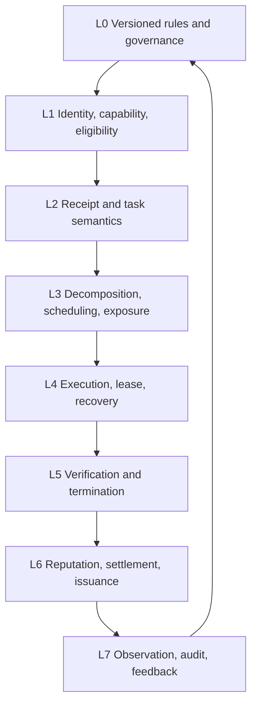
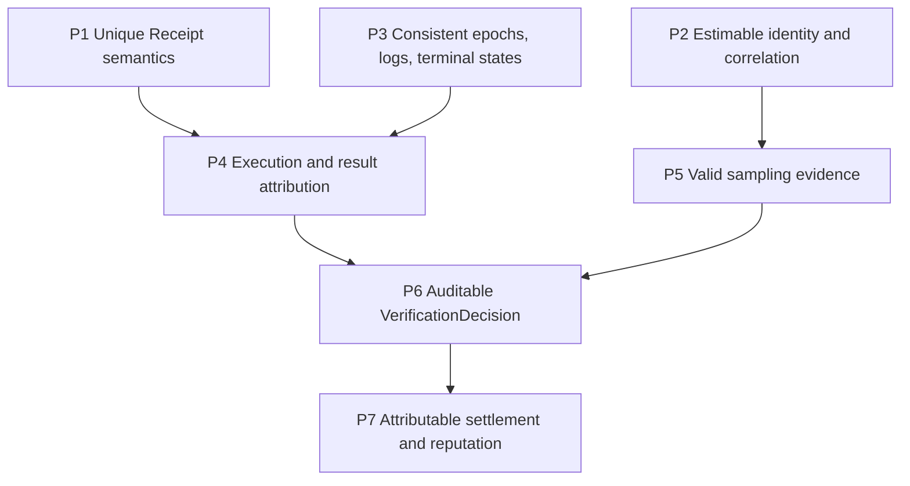

> **SUPERSEDED — historical archive.** This document records an earlier stage of the project under a former name. It is not the current ACLt Protocol specification. For the current entry points, see the [archive notes](../README.md).

# RUDCP Complete Project Architecture and Argument Mapping v0.4

> Date: 2026-08-16  
> Status: Internal collaboration baseline / system architecture and traceability record  
> Language: English  
> Upstream baseline: `RUDCP_Public_Argument_Proof_Obligations_and_Project_Structure_v0.3_EN.md`  
> Chinese counterpart: `RUDCP_完整项目思路架构与论证映射_v0.4_中文.md`

## 0. Purpose, Scope, and Status Discipline

This document answers two questions:

1. What is the complete RUDCP concept from task creation, decomposition, scheduling, and execution through verification, settlement, and governance?
2. Where does each argument, theory, and proof obligation in v0.3 apply in the system; which property does it protect; and what does it not prove?

This is an **architecture and public-argument traceability record**, not a finished implementation specification or proof of robustness. It retains the following status labels:

| Label | Meaning |
|---|---|
| `DECIDED` | An accepted first-version design choice |
| `DERIVED` | A design conclusion following from stated premises |
| `INVARIANT` | A property no correct implementation may violate |
| `ASSUMPTION` | A model premise currently relied upon but not proved |
| `HYPOTHESIS` | An empirical claim requiring simulation or experiment |
| `OPEN` | A question not yet decided or specified |
| `REJECTED` | An excluded first-version design or prohibited claim |

**Evidence discipline:** a design being decided means only that the architectural choice is frozen for this version. It does not establish security, economics, or performance. Every cross-layer conclusion must name its upstream premises. Failure of a premise must be traceable to affected components and a safe degraded state.

## 1. Project Proposition and Boundary

### 1.1 Project proposition

RUDCP aims to be a fully open-source distributed-compute coordination system for heterogeneous idle devices. A Requester submits work constrained by resources, deadline, budget, and verification policy. A Broker decomposes and assigns the work, Providers execute it, and the system applies a predeclared verification process to produce either a trusted result or an explicit `UNRESOLVED`, followed by bounded, auditable, at-most-once settlement.

### 1.2 First-version objectives

| ID | Objective | Acceptance result | Status |
|---|---|---|---|
| OBJ-01 | Zero up-front capital for ordinary Providers | Joining and declining an unaccepted task requires no stake | `DECIDED` |
| OBJ-02 | No silent alteration of task obligations | ReceiptID uniquely binds canonical task semantics | `INVARIANT` |
| OBJ-03 | Bounded recovery after Provider departure | Re-leasing, increasing epoch, and terminal deadline | `DECIDED` / `INVARIANT` |
| OBJ-04 | Verification of erroneous or disputed results | Predeclared policy, staged expansion, auditable evidence | `DECIDED` |
| OBJ-05 | Explicit termination when trust cannot be established | Enter `UNRESOLVED` at the cap | `DECIDED` |
| OBJ-06 | No duplicate payment and bounded expenditure | At-most-once settlement plus budget and issuance caps | `INVARIANT` / `OPEN` |
| OBJ-07 | Maintenance authority cannot alter individual cases | Versioned rules and no retroactive weight mutation | `DECIDED` / `INVARIANT` |

### 1.3 Explicit non-commitments for the first version

- No promise of cheap correctness decisions for arbitrary general computation;
- no promise that greedy decomposition is globally optimal;
- no equation of account or Provider counts with independent controllers;
- no claim that `51%` is a proved Byzantine threshold;
- no use of “high attack cost” as proof of sample independence;
- no first-version dependency on a blockchain, tradable token, or fully decentralized control plane;
- no case-specific, retroactive verification-weight changes by the Requester or Foundation.

## 2. Complete Layered Architecture

### 2.1 Eight-layer model

| Layer | Main components | Input | Output | Primary property |
|---|---|---|---|---|
| L0 Charter and governance | Foundation, Maintainers, ADRs, release process | Proposals, disclosures, audit evidence | Versioned rules and implementation | Least privilege, traceability, no retroactive rules |
| L1 Identity and capability | NodeIdentity, CapabilityProfile, control links | Keys, devices, resources, history | Qualified identity, capability, and risk profile | Attribution, frozen eligibility, visible correlation |
| L2 Task modelling | ComputeReceipt, program/input/environment refs | Requester need and budget | Immutable receipt | Determinate semantics, addressability, auditability |
| L3 Decomposition and scheduling | Broker, Assignment, Scheduler | Receipt, capability, reputation, resources | Legal work units and Provider candidates | Legality, determinism, bounded exposure, exploration |
| L4 Execution and recovery | Lease, Attempt, Worker, Checkpoint | Assignment and environment | Result, evidence, or failure event | Monotonic epoch, late-result isolation, bounded retry |
| L5 Result verification | VerificationPolicy, Sampler, Verifier, Decision | Candidate results and Provider snapshot | Trusted result or `UNRESOLVED` | Precommitment, no replacement, auditable stopping |
| L6 Reputation and economics | ReputationEngine, Settlement, Issuance Ledger | Performance events, decision, budget | Capability updates, payment, issuance | Attribution, at-most-once, budget conservation |
| L7 Observability and operations | EventLog, Metrics, Audit, Recovery | Events and faults from all layers | Replayable record, SLOs, recovery evidence | Append-only, idempotent, testable RPO/RTO |

### 2.2 Control relationships

Arrows represent specification or evidence dependencies, not a requirement to implement all components in one service. L7 feedback may create a future rule version or ReputationEvent; it may not rewrite a frozen Receipt, VerificationPolicy, or Settlement.

## 3. Participants, Authority, and Trust Boundaries

| Participant | May do | May not do | Main risks | Controls |
|---|---|---|---|---|
| Requester | Create tasks, select allowed policies, fund budgets, inspect results | Unilaterally determine the protocol result; modify a registered Receipt | Malicious task, budget deception, result shopping | Receipt, reservation, policy allow-list, no audit decision power |
| Broker | Decompose work, create Assignments, propose allocation | Bypass resource/dependency/budget limits; hide allocation | Biased scheduling, collusion, irreproducible planning | Deterministic greedy baseline, public events, legality validator |
| Provider | Accept a Lease, execute, submit results/checkpoints | Override a newer epoch, vote twice, exceed exposure | Abandonment, wrong result, task capture, Sybil | Lease, epoch, attempt cap, exposure cap, verification |
| Verifying Provider | Verify under policy and submit evidence | Be counted twice in a verification series; change stopping rules | Collusion, cursory verification, hidden common control | Frozen eligibility, sampling without replacement, correlation discount |
| Control Plane | Register, lease, orchestrate verification, authorize settlement | Change rules without a version; silently discard events | Single point of failure, reordering, double payment, selective action | State machines, idempotency, transactions, event log, disaster recovery |
| Foundation/Maintainers | Maintain code, specs, tests, releases, disclosures | Alter case-specific weights or results | Concentrated authority, conflict, emergency-power abuse | Least privilege, recusal, two-person review, ADRs, reproducible release |

**Identity boundary:** roles may overlap; distinct roles therefore do not imply distinct controllers. The system must separately model accounts, keys, devices, Provider instances, network/funding/ownership links, and ultimate controllers. Missing control-link evidence must be represented as uncertainty, not assumed independence.

## 4. Core Objects and Ownership

| Object | Creator / authority | Core content | Freeze point | Referenced by |
|---|---|---|---|---|
| `RuleVersion` | Governance/Release | Schema, state machines, verification, economic rules | Release signature | Whole system |
| `NodeIdentity` | Identity Service | Account, keys, device, declared control links | Version read at snapshot | Scheduling, verification, reputation, settlement |
| `CapabilityProfile` | Capability/Reputation | Resources, task-family ability, mean, uncertainty | Version read at scheduling | Decomposition, scheduling, sampling |
| `ComputeReceipt` | Requester + Registry | Program, input, environment, resources, verification, deadline, budget, attempts, decomposition | ReceiptID registration | Assignment through Settlement |
| `Assignment` | Broker | Legal work unit, dependencies, merge and verification context | Publication | Lease, Attempt, Result |
| `Lease` | Scheduler | Provider, epoch, start/expiry, conditional entitlement | Acceptance | Attempt, result, settlement |
| `Attempt` | Execution Control | One execution lifecycle and reason | Termination | Retry, reputation, audit |
| `Checkpoint` | Provider/Storage | Recoverable state, format, digest, compatibility version | Submission | Reassignment and recovery |
| `ResultSubmission` | Provider | Result, digest, epoch, evidence, idempotency key | Validated receipt | Verification |
| `EligibilitySnapshot` | Verification Coordinator | Eligible set, strata, correlation data, timestamp | Before verification | Sampler and Nmax |
| `VerificationPolicy` | Receipt + RuleVersion | Sampling, clustering, rounds, stopping, Nmax, budget | Receipt registration | VerificationDecision |
| `VerificationDecision` | Verification Engine | Trusted result or `UNRESOLVED` and evidence chain | Terminal commit | Settlement and Reputation |
| `ReputationEvent` | Evidence Adapter | Task family, difficulty, attribution, outcome, time, evidence | Append-only; corrections are new events | CapabilityProfile |
| `Settlement` | Settlement Engine | Beneficiary, amount, source, unique key, state | Commit | Accounting and audit |
| `ProtocolIssuance` | Issuance Ledger | Verification expense, cap, reason, dilution owner | Commit | Budget conservation and governance review |

## 5. End-to-End Lifecycle

### 5.1 Normal path

| Stage | System action | Success condition | Failure/degraded exit | Main invariants |
|---|---|---|---|---|
| 1. Rule selection | Bind RuleVersion and allowed verification/settlement policy | All policies parse and remain valid | `REJECTED_AT_CREATE` | INV-12 |
| 2. Receipt registration | Canonicalize, hash, and register ComputeReceipt | ReceiptID uniquely binds semantics | `REJECTED_AT_CREATE` | INV-01 |
| 3. Decomposition | Broker creates a legal Assignment DAG | Resource, dependency, budget, merge rules hold | `FAILED_PLANNING` | INV-01/05 |
| 4. Candidate filtering | Filter by capability, reputation, uncertainty, exposure | At least one qualified candidate | Queue or `EXPIRED` | INV-10 |
| 5. Leasing | Atomically issue and accept a finite Lease | Current epoch and available exposure | Retry or another Provider | INV-02/08/10 |
| 6. Execution | Run, heartbeat, checkpoint, submit result | Parseable result under valid epoch | `FAILED`, `TIMED_OUT`, re-lease | INV-07/08 |
| 7. Verification | Freeze eligibility, stratify, sample without replacement | Predeclared trusted-stop condition met | Expand or `UNRESOLVED` | INV-06/11 |
| 8. Decision | Write one VerificationDecision | Consistent `TRUSTED` or `UNRESOLVED` | Transaction retry | INV-03/09 |
| 9. Settlement | Authorize execution, verification, and related fees | Unique-key commit within budget/issuance cap | Retryable or final failure | INV-04/05/06 |
| 10. Reputation update | Map attributable evidence to task-family ability | Evidence source and platform faults distinguished | Defer or append correction after appeal | INV-09 |

### 5.2 Terminal semantics

| Terminal state | Meaning | Does it mean the answer is correct? | Current refund policy | Reputation handling |
|---|---|---|---|---|
| `SETTLED/TRUSTED` | Result met the declared stop condition and was settled | Trusted only within the policy/model scope, not absolute truth | No refund | Update from attributable evidence |
| `UNRESOLVED` | Cap reached without a trusted result | No; candidate and evidence distribution must be disclosed | Currently no refund, but terms and cost model remain incomplete | Do not blame all Providers merely for disagreement |
| `FAILED` | Execution or system condition failed irrecoverably | No | `OPEN`: distinguish by failure attribution | Penalize only attributable Provider failure |
| `EXPIRED` | Final deadline reached | No | `OPEN`: distinguish no capacity, Provider fault, platform fault | Treat according to causal source |
| `REJECTED_AT_CREATE` | Task violated rule, budget, or safety boundary | Not applicable | Should not enter execution settlement | No Provider effect |

## 6. Detailed Subsystem Concept

### 6.1 Identity, eligibility, and control relationships

- **Decided:** accounts, devices, Provider instances, and roles are distinct; the eligible-Provider set is frozen before verification.
- **Candidate mechanisms:** key signatures, device evidence, resource benchmarks, performance history, control disclosures, and network/funding/ownership correlation signals.
- **Strict boundary:** these can raise Sybil cost or estimate correlation; they cannot unconditionally prove ultimate-controller independence.
- **Open:** minimum eligibility, privacy boundary, revocation, key rotation, correlation discount, and the Nmax denominator.

### 6.2 Task packaging and immutable Receipt

Candidate Receipt structure:

\[
C_j=(ID,P,I,E,R,V,S,D,B,A,\Pi,RuleVersion)
\]

Program, input, environment, resources, verification/success criteria, deadline, budget, attempt cap, decomposition/checkpoint/merge policy, and rule version are semantic commitments. Material changes require a new ReceiptID; runtime information is append-only event data.

### 6.3 Broker decomposition and scheduling

- The first version uses deterministic minimal greedy planning to produce **legal and reproducible** Assignments, not a global optimum;
- scheduling reads hard resource constraints, task-family safe capability bounds, current concurrency, risk exposure, deadline, and exploration quota;
- new nodes receive low-risk, low-concurrency work and obtain promotion evidence through exploration;
- a Requester or third party may be the Broker, but its output must pass an independent legality validator and emit audit events.

### 6.4 Execution, leases, retry, and checkpoints

- A Lease is a finite, epoch-bound conditional entitlement, not permanent ownership;
- reassignment strictly increments the epoch; old-epoch results may remain as evidence but may not overwrite current state or earn payment;
- heartbeat informs timeout decisions but is not correctness evidence;
- a Checkpoint binds ReceiptID, AssignmentID, epoch, environment/format version, and digest;
- liveness is conditional on eventual control-plane recovery, eventual network reachability, a qualified executor, and an unexpired task.

### 6.5 Result verification

Four evidence sources must not be conflated:

| Type | Applicable tasks | Advantage | Limitation |
|---|---|---|---|
| Deterministic recomputation/comparison | Reproducible tasks with affordable checking | Direct semantic evidence | Verification may cost nearly as much as execution |
| Property, certificate, or spot-check | Tasks producing checkable evidence | May lower cost | Requires task-specific verifier |
| Multi-Provider redundancy/statistical aggregation | Comparable results without cheap certificates | More general | Depends on independence, classification, correlation model |
| Advanced verifiable compute/TEE | Future specific task families | Potentially stronger assurance | Engineering, trust, and cost complexity; P2 |

The current general candidate flow is: freeze `EligibilitySnapshot` → stratified sampling without replacement → cluster results and aggregate evidence → test predeclared stop condition → expand if unmet → enter `UNRESOLVED` at `Nmax`. `Nmax=51%` is currently a candidate process cap, not a security theorem.

### 6.6 Reputation, capability, and fairness

Capability is task-family specific and retains uncertainty:

\[
\mathbf r_i=(r_i^{CPU},r_i^{GPU},r_i^{Memory},r_i^{Reliability},r_i^{Deadline},r_i^{Validation})
\]

\[
p_{ij}=\sigma\left(\frac{r_i-d_j}{\tau}\right),\qquad
r_i'=r_i+K w_j(y_{ij}-p_{ij})
\]

\[
r_i\sim\mathcal N(\mu_i,\sigma_i^2),\qquad r_i^{safe}=\mu_i-z\sigma_i
\]

The multidimensional interface, uncertainty, and exploration principles are `DECIDED`; the update formula and parameters are `HYPOTHESIS`. Platform fault, bad task specification, voluntary abandonment, timeout, and wrong result require separate attribution.

### 6.7 Economics, settlement, and issuance

Accounting must separate at least the Requester task budget, Provider execution compensation, verification budget, Broker/platform fee, and protocol verification issuance. Settlement depends on one VerificationDecision and an idempotent entitlement key.

Economic security can currently be expressed only conditionally:

\[
C_{attack} > G_{protocol}+G_{external}+V_{disruption}-P_{detection}
\]

If the cost lower bound, benefit upper bound, and attacker model are credible, a specific attack may be economically dominated. This does not imply identity independence or cover political, competitive, or purely destructive attackers.

### 6.8 Governance, release, and administration

In the first version, Foundation describes a responsibility boundary, not a presumption of a large legal entity. It maintains open specifications, implementation, tests, release signatures, ADRs, and audit evidence. An analyst or responsible discloser may not use maintenance authority in the same matter to alter weights or conclusions.

Candidate administrative-value framework:

\[
NV_{gov}=E[L_{without}-L_{with}]+V_{audit}+V_{compliance}+V_{trust}-C_{total}
\]

Administration expands only when this remains positive under conservative assumptions and no cheaper automated control supplies an equivalent result.

## 7. Master Traceability Matrix: Arguments and Theories to System Locations

| Map ID | v0.3 argument/theory | Layer and component | Problem addressed | Conclusion currently supported | Not supported / proof obligation | Status |
|---|---|---|---|---|---|---|
| MAP-A1 | Decomposition/allocation must be public | L3 Broker, Assignment; L7 EventLog | Invisible Broker bias/manipulation | Allocation can be reproduced and audited | Public is not fair or optimal; specify determinism and negative tests | `DERIVED` |
| MAP-A2 | Minimal greedy; no optimality claim | L3 Planner | Unfulfillable optimization promise | First version proves only legality/determinism | Define ordering, ties, dependencies, complexity bounds | `DECIDED` |
| MAP-A3 | Role does not equal independent entity | L1 Identity; L5 Snapshot/Sampler | Role overlap and Sybil | Control relationships must be explicit | Need measurable independence and privacy scheme | `DERIVED/OPEN` |
| MAP-A4/H | Foundation least privilege | L0 Governance; L7 Audit | Case-specific weight changes/conflicts | Versioning and no retroactive mutation | Specify appointment, recusal, emergency power, keys, appeal | `DECIDED/OPEN` |
| MAP-B | Immutable ComputeReceipt | L2 Receipt Registry and all references | Parties execute/verify different objects | One ReceiptID binds one canonical meaning | Serialization, hash scope, migration, collision/equivalence tests | `DERIVED/INVARIANT` |
| MAP-C | Zero collateral plus future-opportunity controls | L1 Admission; L3 Exposure; L6 Reputation | Limit capture/failure without deposits | Zero-capital admission can coexist with historical risk controls | Does not eliminate Sybil; bound new-identity damage | `DECIDED/HYPOTHESIS` |
| MAP-D1 | Multidimensional task-family reputation | L1 CapabilityProfile; L6 ReputationEngine | Invalid cross-task transfer | Scheduling can read task-family ability | Task taxonomy and transfer evidence open | `DECIDED/OPEN` |
| MAP-D2 | Uncertainty-adjusted safe bound | L3 Candidate Filter | Overtrust of sparse/stale evidence | Conservative capability bound can limit risk | Distribution, decay, and z require calibration | `HYPOTHESIS` |
| MAP-D3 | Exploration quota and promotion challenge | L3 Scheduler | Reputation-driven incumbency | New nodes retain a path to evidence | Calibrate against completion, loss, concentration | `DECIDED/HYPOTHESIS` |
| MAP-E1 | Finite Lease and monotonic epoch | L4 Lease/Attempt | Capture, reassignment race, late result | Old Lease cannot regain current entitlement | Transactions, clocks, model checking, partitions | `INVARIANT` |
| MAP-E2 | Bounded retry and explicit terminal state | L4 Retry; L5/L6 Terminal State | Infinite suspension and cost | Deadline/attempt cap ends in failure or dispute | Liveness still needs network/control/executor assumptions | `DECIDED/INVARIANT` |
| MAP-F1 | Stratified sampling without replacement | L5 Snapshot/Sampler | Coverage and duplicate voting | Given a valid frame, sample evidence is calculable | Does not prove controller independence; model correlation | `DECIDED/ASSUMPTION` |
| MAP-F2 | Staged expansion and trusted stopping | L5 Verification Engine | Limit cost when evidence suffices | Early stop under predeclared rule | Optional-stopping correction, clustering, error target open | `DECIDED/OPEN` |
| MAP-F3 | `Nmax=51%` | L5 Budget/Termination Policy | Hard bound on verification rounds | Cap forces termination | 51% has no proved safety meaning; denominator/small-n open | `DECIDED as process cap` |
| MAP-F4 | `UNRESOLVED` | L5 Decision; L6 Settlement | Avoid false certainty without trust | Honest undecidability output is possible | Disclosure, appeal, settlement, attribution incomplete | `DECIDED/OPEN` |
| MAP-F5 | Economic trust is not independence | L1 Identity; L5 Statistics; L6 Economics | Mistaking motive for statistical independence | Evidence chains must be validated separately | Need cost/benefit bounds and correlation model | `ASSUMPTION/HYPOTHESIS` |
| MAP-G1 | Requester buys a process service | L2 Contract; L5 Decision; L6 Settlement | Whether `UNRESOLVED` means no service | Predeclared execution/verification may constitute delivery | Legal/market acceptance, attribution, service boundary open | `DECIDED/OPEN` |
| MAP-G2 | No refund for both verification outcomes | L6 Refund Policy | Who bears verification cost | Current product policy is consistent | Cannot cover platform fault; split FAILED/EXPIRED | `DECIDED but incomplete` |
| MAP-G3 | Verification funded by issuance | L6 Issuance Ledger | Avoid up-front Provider capital | Separates verification funding from node admission | Cap, dilution owner, abuse, accounting open | `DECIDED/OPEN` |
| MAP-I | Administrative net-value framework | L0 Governance Budget; L7 Metrics | Whether administration is worthwhile | Counterfactual loss and total cost can form a gate | Measurement and causal attribution incomplete | `HYPOTHESIS` |
| MAP-RICE | General correctness undecidability boundary | L2 Task Admission; L5 Verifier Registry | Universal cheap verification promise | Bind each task family to a verification method | Define admission classes and unsupported semantics | `THEORETICAL LIMIT` |
| MAP-BFT | Byzantine/consensus theory boundary | L5 Decision; L7 Control Plane | Treating majority vote as unconditional truth | Thresholds require explicit fault/network models | RUDCP does not yet meet all classic assumptions | `REFERENCE BOUNDARY` |
| MAP-FLPS | Asynchronous-fault liveness boundary | L4/L7 Control Plane | Claiming unconditional completion | Liveness must be conditional | Specify clocks, faults, eventual synchrony | `REFERENCE BOUNDARY` |
| MAP-SYBIL | Sybil theory boundary | L1 Identity; L5 Sampling | Free identities destroy majority meaning | Trusted or costly external constraints are required | Zero collateral increases importance of identity/exposure | `REFERENCE BOUNDARY` |
| MAP-BANDIT | UCB/exploration theory | L3 Scheduler; L6 Reputation | Exploration/exploitation tradeoff | Supplies scheduling baselines/regret metrics | Nonstationarity, adversaries, safety need separate models | `REFERENCE/HYPOTHESIS` |
| MAP-GKT | Glicko/Beta reputation precedents | L6 ReputationEngine | Represent success probability and uncertainty | Supports candidate statistical representations | Does not directly cover collusion, heterogeneity, attribution | `REFERENCE/HYPOTHESIS` |

## 8. Invariant-to-Component and Test Traceability

| Invariant | Enforcing component | Persistent evidence | Minimum tests |
|---|---|---|---|
| INV-01 Receipt immutability | Receipt Registry | Canonical bytes, hash, RuleVersion | Equivalent/non-equivalent serialization, tampering, migration |
| INV-02 Epoch monotonicity | Lease Service | Current Assignment epoch, lease events | Concurrent issue, leader change, old-request replay |
| INV-03 Single terminal state | Workflow/Decision Store | Terminal unique key, transaction log | Concurrent TRUSTED/UNRESOLVED/EXPIRED race |
| INV-04 At-most-once settlement | Settlement Engine | Entitlement id and commit record | Replay, timeout retry, partial-write recovery |
| INV-05 Budget conservation | Budget/Issuance Ledger | Reserve, commit, release | Concurrent payment, expanded rounds, cap boundary |
| INV-06 Verify before settle | Decision + Settlement | VerificationDecision reference | Missing/forged decision, revoked-version request |
| INV-07 Late-result isolation | Result Gateway | Epoch, receipt time, state | Reordering, partition, old-epoch batch |
| INV-08 Bounded attempts | Retry Controller | Consumed-attempt counter | Crash points, duplicate creation, cross-node retry |
| INV-09 Auditable transitions | EventLog | Event id, causal reference, signature/digest | Missing, duplicate, reordered, replay reconstruction |
| INV-10 Exposure limit | Scheduler/Admission | Current leases and exposure allowance | Race, allowance change, timeout release |
| INV-11 Sampling without replacement | Verification Sampler | Snapshot id and draw sequence | Repeat across rounds, concurrent draw, snapshot change |
| INV-12 No case-specific mutation | Governance/Policy Loader | Policy hash and release record | Old task loading new weight, emergency override abuse |

## 9. Proof Dependencies and Failure Propagation

| Failed premise | Directly affected stage | Claim no longer allowed | Safe degradation |
|---|---|---|---|
| Receipt semantics are not unique | Execution, verification, settlement | Results refer to the same task | Reject registration or stop task |
| Identity/correlation unknown and undiscounted | Sampling and trusted stop | Votes are approximately independent | Raise uncertainty, expand/refuse endorsement, `UNRESOLVED` |
| Epoch/terminal inconsistency | Recovery and payment | No overwrite and no double payment | Freeze settlement, recover by event replay |
| Uncertain verifier or clustering rule | VerificationDecision | Result meets trust criterion | Mark verifier fault or `UNRESOLVED` |
| Budget/issuance cap cannot be established | Verification expansion and settlement | Cost is bounded | Stop expansion or funding-deficit terminal state |
| RuleVersion cannot be verified | Whole lifecycle | No case-specific retroactive rule | Refuse execution/settlement and audit |

## 10. Confirmed Progress by System Stage

| Stage | Decided | Formed but unproved | Missing deliverable |
|---|---|---|---|
| Project boundary | Open source, three roles, overlap, centralized v1 control plane, no chain/token | Openness/audit can lower governance risk | Charter, license, contribution/release policy |
| Task modelling | Immutable Receipt; changes create new ReceiptID | Receipt can be common reference object | Schema, canonical encoding, versioning, storage |
| Decomposition | Minimal greedy; legality only | Executable units under basic constraints | Deterministic algorithm, DAG, merge/failure semantics |
| Admission/scheduling | Zero collateral, low-risk start, exposure limits, exploration | Some performance risk can be managed without forfeiture | Risk function, ranking, atomic allowance |
| Execution/recovery | Lease, epoch, heartbeat, checkpoint, bounded retry | Conditional liveness and late-result isolation | State machine, clock model, idempotent APIs, recovery |
| Verification | Stratified, no replacement, expanding rounds, trusted stop, Nmax, UNRESOLVED | Statistical evidence under valid frame/correlation assumptions | Eligibility, clustering, confidence target, stopping correction, budget |
| Reputation | Task families, uncertainty, exploration, dormancy uncertainty | Elo/Glicko/Beta/UCB-like models as baselines | Parameters, attribution, decay, appeal, simulation |
| Economics | No refund, verification issuance, at-most-once, bounded-budget direction | Specific attack may be economically dominated | Ledgers, caps, cost/benefit bounds, FAILED policy |
| Governance | Least privilege, no case-specific weights, recusal, ADR | Administration may be a risk control | Appointment, emergency power, keys, disclosure, value metrics |
| Operations | Events, fault recovery, RPO/RTO required | Model checking and fault injection can validate | Data model, replication, backup, SLO, drills |

## 11. Open Questions Ordered by Dependency

### P0: Must close before the core prototype

1. **Task semantics:** Receipt fields, canonical encoding, migration, input/environment addressing, revocation boundary;
2. **identity denominator:** Provider eligibility, snapshot time, Nmax denominator, control links, correlation discount;
3. **verification semantics:** task classes, result clustering, trust target, sequential correction, verifier failure;
4. **terminal state and payment:** exact `UNRESOLVED/FAILED/EXPIRED`, refund exceptions, compensation, attribution;
5. **budget and issuance:** per-task/global cap, expansion stop, verifier rate, dilution owner, accounting conservation;
6. **control-plane consistency:** transactions, Lease clocks, partition authority, idempotency, recovery, upgrades.

### P1: May enter simulation with explicit parameters

1. Reputation update, decay, uncertainty, task-family transfer;
2. exploration quota, promotion challenge, concentration limit, fairness metric;
3. Rank acquisition cost, protocol/external benefit, repeat attack, collusion;
4. greedy order, heterogeneous normalization, Checkpoint cost;
5. risk reduction, delay, labour, legal, and opportunity cost of administration.

### P2: Does not block v1 but interfaces should remain open

- Verifiable computation, interactive proofs, zero knowledge, trusted execution;
- nondeterministic work, ML training, probabilistic-output verification;
- GPU/cross-architecture/cross-region, large input, data locality;
- federated control plane, public pilot, cross-border payment, regulation.

## 12. Engineering Gates

| Gate | Build scope | Exit evidence | Claim still prohibited |
|---|---|---|---|
| G0 Specification baseline | Objects, state machines, invariants, threat model, policies, ADRs | Every P0 choice machine/test expressible | System is robust |
| G1 Simulation | Scheduling, reputation, verification, attack, cost | Sensitivity, false acceptance, completion, tail latency, concentration, loss | Parameters work on real networks |
| G2 Single-host prototype | Registry, Lease, Result, Decision, Settlement | Concurrency/replay/crash preserve core invariants | Distributed fault tolerance achieved |
| G3 LAN MVP | Multi-node Worker, disconnect, exit, recovery | Fault injection and initial SLO | Safe for public Internet |
| G4 Persistence/DR | Database, object store, backup, recovery | RPO/RTO drill | No operational single point of failure |
| G5 Adversarial validation | Sybil, collusion, gaming, external gain, governance abuse | Loss bound or detection evidence | Economic attacks are impossible |
| G6 Heterogeneous pilot | New hardware, task families, external participants | Invariants hold and reputation does not mis-transfer | All general compute is verifiable |

## 13. Recommended G0 Deliverables and Responsibility Split

| Deliverable | Primary author | Adversarial reviewer | Acceptance point |
|---|---|---|---|
| Charter + Glossary | Project proposer | Collaborator | Roles, objectives, non-commitments unambiguous |
| Threat Model | Collaborator | Project proposer | Sybil, control, external gain, governance, platform fault |
| Receipt/Assignment Schema | One designs | One writes negative cases | Canonical bytes, versions, DAG, failure semantics |
| State Machines | One models | One writes races | INV-02/03/04/07/08 model-checkable |
| Verification Policy Spec | One writes statistical flow | One writes correlation/Sybil counterexamples | Stop, snapshot, Nmax, UNRESOLVED reproducible |
| Economic Ledger Spec | One writes accounts | One writes attack/insolvency scenarios | Budget/issuance conservation, refund and liability clear |
| Simulation Plan | Joint metrics | Separate implementation/review | Baselines, parameter sweep, falsification thresholds |

## 14. ADR Index and System Location

| ADR | Decision | System location |
|---|---|---|
| ADR-001 | Open-source scope, license, release governance | L0/L7 |
| ADR-002 | Role overlap and control entities | L1/L3/L5 |
| ADR-003 | Minimal greedy and legal Assignment | L3 |
| ADR-004 | Immutable Receipt fields and ReceiptID | L2 |
| ADR-005 | Zero collateral, concurrency, exposure | L1/L3/L6 |
| ADR-006 | Multidimensional reputation, uncertainty, exploration | L1/L3/L6 |
| ADR-007 | Stratified sampling without replacement and staged expansion | L5 |
| ADR-008 | Trusted stop, Nmax, and `UNRESOLVED` | L5/L6 |
| ADR-009 | Requester information rights and no audit decision power | L2/L5/L0 |
| ADR-010 | No refund, verification issuance, budget cap | L6 |
| ADR-011 | Foundation least privilege and recusal | L0/L7 |
| ADR-012 | Administrative cost and expansion threshold | L0/L7 |
| ADR-013 (new) | Verification-type registry and unsupported semantics | L2/L5 |
| ADR-014 (new) | Terminal states, failure attribution, refund exceptions | L5/L6 |
| ADR-015 (new) | Event model, idempotency keys, evidence retention | L4/L7 |

## 15. References and Limits on Their Use

1. David P. Anderson, [An Incentive System for Volunteer Computing](https://boinc.berkeley.edu/boinc_papers/credit/text.php) — volunteer-computing credit precedent; does not prove RUDCP reputation convergence.
2. David P. Anderson, [BOINC: A System for Public-Resource Computing and Storage](https://boinc.berkeley.edu/grid_paper_04.pdf) — public-resource architecture precedent; not RUDCP's trust model.
3. D. P. Anderson et al., [High-Performance Task Distribution for Volunteer Computing](https://boinc.berkeley.edu/boinc_papers/server_perf/server_perf.pdf) — task-distribution engineering reference.
4. Mark E. Glickman, [Glicko and Glicko-2 Rating Systems](https://www.glicko.net/glicko.html) — rating and uncertainty representation.
5. Roslan Ismail and Audun Jøsang, [The Beta Reputation System](https://aisel.aisnet.org/bled2002/41/) — Beta reputation reference.
6. T. L. Lai and Herbert Robbins, [Asymptotically Efficient Adaptive Allocation Rules](https://doi.org/10.1016/0196-8858(85)90002-8) — exploration/exploitation foundations.
7. Peter Auer, Nicolò Cesa-Bianchi and Paul Fischer, [Finite-time Analysis of the Multiarmed Bandit Problem](https://doi.org/10.1023/A:1013689704352) — UCB baseline and finite-time analysis.
8. Kevin Jamieson et al., [lil’ UCB](https://proceedings.mlr.press/v35/jamieson14.html) — sequential stopping/best-arm reference; not a substitute for the RUDCP stopping proof.
9. H. G. Rice, [Classes of Recursively Enumerable Sets and Their Decision Problems](https://www.jstor.org/stable/1990888) — theoretical boundary on general semantic decision.
10. Open Container Initiative, [OCI Image Format Specification](https://github.com/opencontainers/image-spec) — content-addressed environment/format reference.
11. Leslie Lamport, Robert Shostak and Marshall Pease, [The Byzantine Generals Problem](https://lamport.azurewebsites.net/pubs/the-byz-generals.pdf) — Byzantine model boundary; does not prove a 51% rule.
12. Michael J. Fischer, Nancy A. Lynch and Michael S. Paterson, [Impossibility of Distributed Consensus with One Faulty Process](https://dl.acm.org/doi/10.1145/3149.214121) — asynchronous consensus/liveness boundary.
13. MLCommons, [MLPerf Benchmarks](https://mlcommons.org/benchmarks/) — heterogeneous capability benchmarking reference.
14. Golem Network, [Provider Documentation](https://docs.golem.network/docs/providers/provider-installation) — distributed Provider engineering precedent.
15. John R. Douceur, [The Sybil Attack](https://www.microsoft.com/en-us/research/publication/the-sybil-attack/) — free identities and trusted external constraints.
16. M. Babaioff et al., [On Bitcoin and Red Balloons](https://www.microsoft.com/en-us/research/wp-content/uploads/2012/06/bitcoin.pdf) — distributed incentives and Sybil-related mechanism reference.
17. NIST, [SP 800-30 Rev. 1: Guide for Conducting Risk Assessments](https://csrc.nist.gov/pubs/sp/800/30/r1/final) — risk, likelihood, and impact analysis.
18. NIST, [Cybersecurity Framework 2.0](https://nvlpubs.nist.gov/nistpubs/CSWP/NIST.CSWP.29.pdf) — govern, identify, protect, detect, respond, recover.

These works support theoretical boundaries, candidate methods, and engineering precedents only. RUDCP's combined mechanisms—immutable Receipts, zero-collateral risk control, multidimensional reputation, staged stratified verification, `Nmax/UNRESOLVED`, verification issuance, and the Foundation boundary—still require separate formalization, simulation, implementation, and adversarial validation. Citation does not prove the combined system.

## 16. Strict Current One-Sentence Conclusion

RUDCP now has a **complete candidate architecture that is layered, traceable, and falsifiable**: every core intuition maps to concrete components, objects, invariants, and gates; however, security still depends on unresolved proof obligations for identity independence, statistical stopping, economic budgets, failure attribution, and control-plane consistency, so the correct current stage remains G0 specification—not a claim of completed robustness or immediate public-network implementation.
