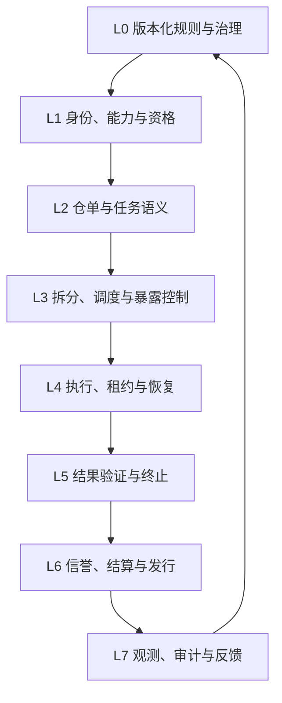
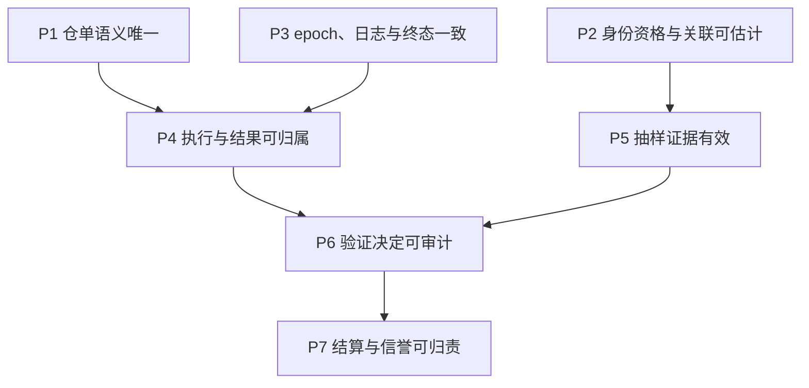

> **SUPERSEDED — 历史归档。** 本文记录项目早期阶段，使用旧名称，不构成现行 ACLt Protocol 规范。当前入口见 [归档说明](../README.md)。

# RUDCP 完整项目思路架构与论证映射 v0.4

> 日期：2026-08-16  
> 状态：内部协作基线／系统架构与可追踪性文件  
> 语言：中文  
> 上游基线：`RUDCP_公开论证链与项目结构_v0.3_中文.md`  
> 对应英文版：`RUDCP_Complete_Project_Architecture_and_Argument_Mapping_v0.4_EN.md`

## 0. 文档目的、范围与状态纪律

本文件回答两个问题：

1. RUDCP 从任务提出、拆分、调度、执行、验证到结算与治理的完整思路架构是什么；
2. v0.3 中每条论证、理论和证明义务具体对应系统的哪个环节，它保护什么性质，又不能证明什么。

本文件是**架构与公开论证的追踪文件**，不是已经完成的实现规格，也不是鲁棒性证明。沿用以下状态标签：

| 标签 | 含义 |
|---|---|
| `DECIDED` | 已接受的首版设计选择 |
| `DERIVED` | 在明示前提成立时可推出的设计结论 |
| `INVARIANT` | 任何正确实现都不得破坏的性质 |
| `ASSUMPTION` | 当前依赖但尚未证明的模型前提 |
| `HYPOTHESIS` | 必须通过仿真或实验检验的经验主张 |
| `OPEN` | 尚未决定或尚未规格化的问题 |
| `REJECTED` | 首版已排除的方案或不允许作出的主张 |

**证据纪律：**“设计已经确定”只说明架构选择已冻结到当前版本，不表示安全性、经济性或性能已经得到证明。任何跨层结论都必须列出其上游前提；任何前提失败，都必须能定位到受影响的系统环节和降级状态。

## 1. 项目总命题与边界

### 1.1 项目总命题

RUDCP 试图构建一个完全开源、面向异构闲置设备的分布式计算协调系统。Requester 可以提交受资源、期限、预算和验证政策约束的计算任务；系统通过 Broker 拆分与分配任务，由 Provider 执行，并以预先声明的验证流程输出可信结果或明确的 `UNRESOLVED`，随后进行有界、可审计且最多一次的结算。

### 1.2 首版目标

| ID | 目标 | 可验收结果 | 状态 |
|---|---|---|---|
| OBJ-01 | 普通 Provider 零初始资金准入 | 加入、拒绝未接受任务不需押金 | `DECIDED` |
| OBJ-02 | 任务义务不可静默改变 | ReceiptID 唯一绑定规范化任务语义 | `INVARIANT` |
| OBJ-03 | 节点退出后有界恢复 | 重租约、递增 epoch、终态截止 | `DECIDED`／`INVARIANT` |
| OBJ-04 | 错误或争议结果进入验证 | 预声明政策、逐轮扩大、可审计证据 | `DECIDED` |
| OBJ-05 | 无法形成可信结果时明确终止 | 达到上限后进入 `UNRESOLVED` | `DECIDED` |
| OBJ-06 | 不重复支付且预算有界 | 最多一次结算、预算与发行上限 | `INVARIANT`／`OPEN` |
| OBJ-07 | 维护权不改变个案结论 | 版本化规则、禁止追溯改权重 | `DECIDED`／`INVARIANT` |

### 1.3 明确不在首版承诺中的内容

- 不承诺对任意通用计算都能廉价判定正确性；
- 不承诺贪心拆单达到全局最优；
- 不把账户数或 Provider 数自动等同于独立控制实体数；
- 不把 `51%` 宣称为已经证明的拜占庭容错阈值；
- 不把“攻击成本较高”当作样本独立性证明；
- 不在首版依赖区块链、可交易代币或完全去中心化控制平面；
- 不允许 Requester 或 Foundation 在个案中追溯改变验证权重。

## 2. 完整系统分层架构

### 2.1 八层模型

| 层 | 主要组件 | 输入 | 输出 | 首要性质 |
|---|---|---|---|---|
| L0 章程与治理层 | Foundation、Maintainers、ADR、发布流程 | 设计提案、披露、审计证据 | 版本化规则与实现 | 最小权限、可追溯、不追溯改规则 |
| L1 身份与能力层 | NodeIdentity、CapabilityProfile、控制关系 | 密钥、设备、资源与历史证据 | 合格身份、能力与风险画像 | 可归责、资格冻结、相关性可见 |
| L2 任务建模层 | ComputeReceipt、程序/输入/环境引用 | Requester 需求与预算 | 不可变仓单 | 语义确定、可寻址、可审计 |
| L3 拆分与调度层 | Broker、Assignment、Scheduler | 仓单、能力、信誉与资源 | 合法任务单元和候选 Provider | 合法、确定、暴露有界、保留探索 |
| L4 执行与恢复层 | Lease、Attempt、Worker、Checkpoint | Assignment 与执行环境 | 结果、证据或失败事件 | epoch 单调、迟到隔离、有界重试 |
| L5 结果验证层 | VerificationPolicy、Sampler、Verifier、Decision | 候选结果与 Provider 快照 | 可信结果或 `UNRESOLVED` | 预声明、无放回、停止规则可审计 |
| L6 信誉与经济层 | ReputationEngine、Settlement、Issuance Ledger | 履约事件、验证决定、预算 | 能力更新、支付与发行记录 | 可归责、最多一次、预算守恒 |
| L7 观测与运营层 | EventLog、Metrics、Audit、Recovery | 全层事件与故障 | 可重放记录、SLO、恢复证据 | 追加式、幂等、RPO/RTO 可测试 |

### 2.2 控制关系

箭头表示规范或证据依赖，不表示所有组件必须由同一服务实现。L7 的反馈只能形成下一版本规则或信誉事件，不能追溯改写已经冻结的仓单、验证政策或结算结果。

## 3. 参与者、权限与信任边界

| 参与者 | 可做 | 不可做 | 主要风险 | 对应控制 |
|---|---|---|---|---|
| Requester | 创建任务、选择已允许政策、提供预算、查看全部结果 | 单方面决定协议验证结果；修改已登记仓单 | 恶意任务、预算欺骗、结果挑选 | Receipt、预付/预算锁定、策略白名单、无审计决定权 |
| Broker | 拆分任务、形成 Assignment、提出分配 | 绕过资源/依赖/预算边界；隐藏分配过程 | 偏置调度、串通、不可复现拆分 | 确定性贪心、公开事件、合法性验证 |
| Provider | 接受租约、执行、提交结果与检查点 | 覆盖新 epoch、重复计票、超额并发 | 放弃、错误结果、占单、Sybil | 租约、epoch、尝试上限、风险额度、验证 |
| Verifying Provider | 按策略验证并提交证据 | 在同一轮系重复计票；改变停止规则 | 串通、敷衍验证、控制关系隐藏 | 资格快照、无放回抽样、证据与相关性折扣 |
| Control Plane | 登记、租约、编排验证、授权结算 | 无版本依据改变规则；静默丢弃事件 | 单点故障、乱序、双付、选择性执行 | 状态机、幂等键、事务边界、事件日志、灾备 |
| Foundation/Maintainers | 维护代码、规范、测试、版本和披露流程 | 为特定报告或结果改变权重 | 权力集中、利益冲突、紧急权滥用 | 最小权限、回避、双人复核、ADR、可复现发布 |

**身份边界：**角色可以兼任，因此“角色不同”不代表“控制实体独立”。系统必须分别建模账户、密钥、设备、Provider 实例、网络/资金/所有权关联和最终控制人；尚未得到的控制关系信息必须被表示为不确定性，而非默认独立。

## 4. 核心对象与所有权

| 对象 | 创建者／权威组件 | 核心内容 | 冻结点 | 被哪些环节引用 |
|---|---|---|---|---|
| `RuleVersion` | Governance/Release | Schema、状态机、验证与经济规则版本 | 发布签名时 | 全系统 |
| `NodeIdentity` | Identity Service | 账户、密钥、设备、控制关系声明 | 资格快照时取版本 | 调度、验证、信誉、结算 |
| `CapabilityProfile` | Capability/Reputation | 资源、任务族能力、均值与不确定度 | 每次调度读取版本 | 拆分、调度、抽样 |
| `ComputeReceipt` | Requester + Registry | 程序、输入、环境、资源、验证、期限、预算、尝试与拆分政策 | 登记生成 ReceiptID | Assignment 至 Settlement |
| `Assignment` | Broker | 合法任务单元、依赖、合并与验证上下文 | 发布时 | Lease、Attempt、Result |
| `Lease` | Scheduler | Provider、epoch、开始/到期、条件收益权 | 接受时 | Attempt、结果、结算 |
| `Attempt` | Execution Control | 单次执行生命周期与原因 | 终止时 | 重试、信誉、审计 |
| `Checkpoint` | Provider/Storage | 可恢复状态、格式、摘要、兼容版本 | 提交时 | 重调度、恢复 |
| `ResultSubmission` | Provider | 结果、摘要、epoch、证据、幂等键 | 接收并校验时 | Verification |
| `EligibilitySnapshot` | Verification Coordinator | 合格 Provider 集合、分层、关联信息与时间 | 验证开始前 | Sampler、Nmax |
| `VerificationPolicy` | Receipt + RuleVersion | 抽样、聚类、轮次、停止、Nmax、预算 | Receipt 登记时 | VerificationDecision |
| `VerificationDecision` | Verification Engine | 可信结果或 `UNRESOLVED`、证据链 | 终态提交时 | Settlement、Reputation |
| `ReputationEvent` | Evidence Adapter | 任务族、难度、归责、结果、时间、证据 | 追加后不可改；更正另加事件 | CapabilityProfile |
| `Settlement` | Settlement Engine | 权利人、金额、来源、唯一键、状态 | Commit 时 | 账务与审计 |
| `ProtocolIssuance` | Issuance Ledger | 验证支出、上限、原因和稀释归属 | Commit 时 | 预算守恒与治理评估 |

## 5. 端到端生命周期

### 5.1 正常路径

| 阶段 | 系统动作 | 成功条件 | 失败／降级出口 | 主要不变量 |
|---|---|---|---|---|
| 1. 规则选择 | 绑定 RuleVersion 与允许的验证/结算政策 | 所有政策可解析且未撤销 | `REJECTED_AT_CREATE` | INV-12 |
| 2. 仓单登记 | 规范化、哈希并登记 ComputeReceipt | ReceiptID 唯一绑定语义 | `REJECTED_AT_CREATE` | INV-01 |
| 3. 拆分 | Broker 产生合法 Assignment DAG | 资源、依赖、预算、合并规则满足 | `FAILED_PLANNING` | INV-01/05 |
| 4. 候选筛选 | 依据能力、信誉、不确定度和风险额度筛选 | 至少有一个合格候选 | 排队或 `EXPIRED` | INV-10 |
| 5. 租约 | 原子签发并接受有限期 Lease | epoch 当前且并发额度可用 | 重试、换 Provider | INV-02/08/10 |
| 6. 执行 | Worker 运行、心跳、检查点、提交结果 | 在有效 epoch 内提交可解析结果 | `FAILED`、`TIMED_OUT`、重租约 | INV-07/08 |
| 7. 验证 | 冻结资格快照，分层无放回逐轮验证 | 达到预声明可信停止条件 | 扩大样本或 `UNRESOLVED` | INV-06/11 |
| 8. 决策 | 写入唯一 VerificationDecision | `TRUSTED` 或 `UNRESOLVED` 终态一致 | 决策事务重试 | INV-03/09 |
| 9. 结算 | 验证后授权执行、验证与相关费用 | 唯一键 Commit，预算/发行不超限 | 可重试或最终失败 | INV-04/05/06 |
| 10. 信誉更新 | 将可归责事件映射到任务族能力与不确定度 | 证据来源和平台故障已区分 | 暂缓更新、申诉更正 | INV-09 |

### 5.2 关键终止语义

| 终态 | 含义 | 是否表示答案正确 | 当前退款政策 | 信誉处理 |
|---|---|---|---|---|
| `SETTLED/TRUSTED` | 结果达到已声明的可信停止条件并完成结算 | 只在政策和模型的适用范围内可信，不是绝对真理 | 不退款 | 按可归责证据更新 |
| `UNRESOLVED` | 验证达到上限仍无可信结果 | 否；必须披露候选结果与证据分布 | 当前决定不退款，但条款与成本模型未闭合 | 不得把分歧自动归责给所有节点 |
| `FAILED` | 执行或系统条件失败且不可继续 | 否 | `OPEN`：须按失败归因细分 | 仅可归责失败才影响 Provider |
| `EXPIRED` | 达到最终期限 | 否 | `OPEN`：须区分无人接单、节点失败、平台故障 | 按责任来源处理 |
| `REJECTED_AT_CREATE` | 任务不满足规则、预算或安全边界 | 不适用 | 不应进入执行结算 | 不影响 Provider |

## 6. 各子系统的详细思路

### 6.1 身份、资格与控制关系

- **已定：**账户、设备、Provider 实例和角色必须分离；验证开始前冻结合格 Provider 快照。
- **候选机制：**密钥签名、设备证明、资源基准、历史履约、控制关系声明、共同网络/资金/所有权相关性信号。
- **严谨边界：**这些信号只能提高 Sybil 成本或估计相关性，不能无条件证明最终控制人独立。
- **待决：**资格最小门槛、隐私边界、吊销、密钥轮换、相关性折扣函数、Nmax 分母。

### 6.2 任务封装与不可变仓单

仓单候选结构为：

\[
C_j=(ID,P,I,E,R,V,S,D,B,A,\Pi,RuleVersion)
\]

其中程序、输入、环境、资源、验证/成功条件、期限、预算、尝试上限、拆分/检查点/合并政策和规则版本都属于语义承诺。实质字段改变必须创建新 ReceiptID；运行时信息只追加为事件。

### 6.3 Broker 拆分与调度

- 首版采用确定性的最简贪心，目标是产生**合法且可复现**的 Assignment，而非求解全局最优；
- 调度读取资源硬约束、任务族能力安全下界、当前并发、风险暴露、期限和探索额度；
- 新节点只接低风险、低并发任务，并通过探索额度获得晋级证据；
- Broker 可以由 Requester 或第三方承担，但产物必须通过独立合法性校验并写入审计事件。

### 6.4 执行、租约、重试与检查点

- Lease 是有限期、带 epoch 的条件收益权，不是永久任务所有权；
- 重新分配时 epoch 严格递增，旧 epoch 结果可以留作证据，但不得覆盖当前状态或取得支付权；
- 心跳帮助作出超时决定，不等于执行正确性证据；
- 检查点必须绑定 ReceiptID、AssignmentID、epoch、环境/格式版本和摘要；
- 活性只在控制面最终恢复、网络最终可达、存在合格执行者且任务未过期时成立。

### 6.5 结果验证

验证分为四种不能混淆的证据来源：

| 类型 | 适用任务 | 优点 | 局限 |
|---|---|---|---|
| 确定性重算/比较 | 可复现、成本可接受的任务 | 语义直接 | 验证成本可能接近执行成本 |
| 属性、证书或抽查 | 可输出可验证证据的任务 | 成本可降低 | 需要任务专用验证器 |
| 多 Provider 冗余与统计聚合 | 无廉价证书但可比较结果的任务 | 通用性较高 | 依赖独立性、分类和相关性模型 |
| 高级可验证计算/TEE | 后续特定任务 | 潜在强保证 | 工程、信任和成本复杂，属 P2 |

当前通用候选流程为：冻结 `EligibilitySnapshot` → 分层无放回抽样 → 结果聚类和证据汇总 → 检查预声明停止条件 → 未满足则扩大 → 达到 `Nmax` 后 `UNRESOLVED`。`Nmax=51%` 当前只是候选流程上限，不是安全定理。

### 6.6 信誉、能力与公平

能力按任务族建模，并保留不确定度：

\[
\mathbf r_i=(r_i^{CPU},r_i^{GPU},r_i^{Memory},r_i^{Reliability},r_i^{Deadline},r_i^{Validation})
\]

\[
p_{ij}=\sigma\left(\frac{r_i-d_j}{\tau}\right),\qquad
r_i'=r_i+K w_j(y_{ij}-p_{ij})
\]

\[
r_i\sim\mathcal N(\mu_i,\sigma_i^2),\qquad r_i^{safe}=\mu_i-z\sigma_i
\]

多维接口、不确定度和探索原则为 `DECIDED`；具体更新公式与参数为 `HYPOTHESIS`。平台故障、任务规格错误、主动放弃、超时和错误结果必须分别归因，不能用一个分数无差别惩罚。

### 6.7 经济、结算与发行

账务至少分离：Requester 任务预算、Provider 执行报酬、验证预算、Broker/平台费、协议验证发行。结算必须依赖唯一 VerificationDecision 和幂等权利键。

当前经济安全只能表述为条件命题：

\[
C_{attack} > G_{protocol}+G_{external}+V_{disruption}-P_{detection}
\]

在成本下界和收益上界可信、攻击者模型适用时，某一具体攻击可能经济上不占优。它不能推出身份独立，也不能覆盖政治、竞争性或纯破坏攻击。

### 6.8 治理、发布与行政

Foundation 首版是职责边界，不预设庞大法人。其任务是维护开源规范、实现、测试、发布签名、ADR 和审计证据；分析发布者或道德披露者不得在同一事项中借维护权改变权重或结论。

行政价值用下式作为候选决策框架：

\[
NV_{gov}=E[L_{without}-L_{with}]+V_{audit}+V_{compliance}+V_{trust}-C_{total}
\]

只有在保守情景下为正、且不存在更低成本的等效自动控制时，才扩张行政层。

## 7. 论证与理论到系统环节的主追踪矩阵

| Map ID | v0.3 论证／理论 | 对应层与组件 | 解决的问题 | 当前能支持的结论 | 仍不能支持／证明义务 | 状态 |
|---|---|---|---|---|---|---|
| MAP-A1 | 拆分与分配必须公开 | L3 Broker、Assignment；L7 EventLog | Broker 偏差与操纵不可见 | 外部可复现和审计分配 | 公开不等于公平或最优；需确定性规范与负例测试 | `DERIVED` |
| MAP-A2 | 最简贪心、不宣称最优 | L3 Planner | 避免不可兑现的优化承诺 | 首版只证明合法性与确定性 | 需定义顺序、平局、依赖和复杂度界 | `DECIDED` |
| MAP-A3 | 角色不等于独立实体 | L1 Identity；L5 Snapshot/Sampler | 多角色兼任和 Sybil | 必须显式建模控制关系 | 仍需可测独立性标准和隐私方案 | `DERIVED/OPEN` |
| MAP-A4/H | Foundation 最小权限 | L0 Governance；L7 Audit | 个案改权重和利益冲突 | 规则版本化、禁止追溯修改 | 需任命、回避、紧急权、密钥与申诉规格 | `DECIDED/OPEN` |
| MAP-B | 不可变计算仓单 | L2 Receipt Registry；全链路引用 | 各方执行/验证对象不一致 | 同一 ReceiptID 绑定同一规范语义 | canonical serialization、哈希范围、迁移和碰撞/等价测试 | `DERIVED/INVARIANT` |
| MAP-C | 零抵押准入 + 未来机会约束 | L1 Admission；L3 Exposure；L6 Reputation | 不收押金仍限制占单和反复失败 | 零资金准入可与历史风险控制共存 | 不能消灭 Sybil；需量化新身份最大损害 | `DECIDED/HYPOTHESIS` |
| MAP-D1 | 多维任务族信誉 | L1 CapabilityProfile；L6 ReputationEngine | 能力错误跨任务迁移 | 调度可按任务族读取能力 | 任务族划分和迁移证据未定 | `DECIDED/OPEN` |
| MAP-D2 | 带不确定度安全下界 | L3 Candidate Filter | 少量或陈旧证据被过度信任 | 可用保守能力下界控制风险 | 分布假设、衰减速度、z 值需校准 | `HYPOTHESIS` |
| MAP-D3 | 探索额度与晋级挑战 | L3 Scheduler | 信誉造成早期垄断 | 新节点保留获取证据路径 | 需用完成率、损失和集中度校准 | `DECIDED/HYPOTHESIS` |
| MAP-E1 | 有限租约与 epoch 单调 | L4 Lease/Attempt | 占单、重分配竞争和迟到结果 | 旧租约不能恢复为当前收益权 | 需事务、时钟、模型检查和分区测试 | `INVARIANT` |
| MAP-E2 | 有界重试与明确终态 | L4 Retry；L5/L6 Terminal State | 永久悬空和无限成本 | 在期限/尝试上限后明确失败或争议 | 活性依赖网络、控制面和可用执行者 | `DECIDED/INVARIANT` |
| MAP-F1 | 分层、无放回抽样 | L5 Snapshot/Sampler | 样本覆盖与重复计票 | 给定有效采样框时可计算抽样证据 | 不证明控制实体独立；需处理相关性 | `DECIDED/ASSUMPTION` |
| MAP-F2 | 逐轮扩大与可信停止 | L5 Verification Engine | 在证据足够时控制验证成本 | 给定预声明规则可提前停止 | 可选停止校正、结果聚类、误差目标未定 | `DECIDED/OPEN` |
| MAP-F3 | `Nmax=51%` | L5 Budget/Termination Policy | 为验证轮次设置硬上限 | 达到上限必须终止，不无限验证 | 51% 尚无安全含义；分母和小样本规则未定 | `DECIDED as process cap` |
| MAP-F4 | `UNRESOLVED` | L5 Decision；L6 Settlement | 无可信多数时避免伪造确定性 | 系统可以诚实输出不可判定状态 | 披露格式、申诉、结算与归责未闭合 | `DECIDED/OPEN` |
| MAP-F5 | 经济信任不等于独立性 | L1 Identity；L5 Statistics；L6 Economics | 将攻击动机误写为统计独立 | 两条证据链必须分别验证 | 需成本下界、收益上界和相关性模型 | `ASSUMPTION/HYPOTHESIS` |
| MAP-G1 | Requester 购买过程性服务 | L2 Contract；L5 Decision；L6 Settlement | `UNRESOLVED` 是否等于未服务 | 若条款预先明示，执行和验证本身可构成交付 | 法律/市场接受、失败归因和服务边界需检验 | `DECIDED/OPEN` |
| MAP-G2 | 两种终止均不退款 | L6 Refund Policy | 验证成本由谁承担 | 当前产品政策一致 | 不能覆盖平台过错；需细分 FAILED/EXPIRED | `DECIDED but incomplete` |
| MAP-G3 | 验证成本由增发承担 | L6 Issuance Ledger | 不向普通 Provider 收初始资金 | 可把验证费用与节点准入分离 | 发行上限、稀释承担者、滥用和会计未定 | `DECIDED/OPEN` |
| MAP-I | 行政净价值框架 | L0 Governance Budget；L7 Metrics | 行政成本是否值得 | 可用反事实损失和总成本作门槛 | 各变量测量和因果归因未完成 | `HYPOTHESIS` |
| MAP-RICE | 通用正确性不可判定边界 | L2 Task Admission；L5 Verifier Registry | 对任意程序承诺通用廉价验证 | 必须按任务族绑定验证方法 | 需任务准入分类与“不支持”语义 | `THEORETICAL LIMIT` |
| MAP-BFT | 拜占庭/共识理论边界 | L5 Decision；L7 Control Plane | 把多数投票误当无条件真理 | 阈值只在明确故障和网络模型下成立 | RUDCP 尚未满足经典阈值的全部前提 | `REFERENCE BOUNDARY` |
| MAP-FLPS | 异步故障下活性边界 | L4/L7 Control Plane | 宣称无条件最终完成 | 活性必须写为条件式 | 需时钟、故障和最终同步假设 | `REFERENCE BOUNDARY` |
| MAP-SYBIL | Sybil 理论边界 | L1 Identity；L5 Sampling | 免费身份破坏多数含义 | 需可信或有成本的外部约束 | 零抵押使身份与暴露控制更关键 | `REFERENCE BOUNDARY` |
| MAP-BANDIT | UCB/探索理论 | L3 Scheduler；L6 Reputation | 新节点探索与利用权衡 | 可提供调度基线与遗憾指标 | 非平稳、对抗和安全约束需另建模 | `REFERENCE/HYPOTHESIS` |
| MAP-GKT | Glicko/Beta 信誉先例 | L6 ReputationEngine | 表达成功率与不确定度 | 支持候选统计表示 | 不直接适配串通、异构任务和平台归责 | `REFERENCE/HYPOTHESIS` |

## 8. 不变量到组件与测试的追踪矩阵

| 不变量 | 主要执行组件 | 持久化证据 | 最小测试 |
|---|---|---|---|
| INV-01 Receipt immutability | Receipt Registry | canonical bytes、hash、RuleVersion | 等价/非等价序列化、字段篡改、迁移测试 |
| INV-02 Epoch monotonicity | Lease Service | Assignment 当前 epoch、租约事件 | 并发签发、领导者切换、旧请求重放 |
| INV-03 Single terminal state | Workflow/Decision Store | 终态唯一键、事务日志 | 并发 TRUSTED/UNRESOLVED/EXPIRED 竞争 |
| INV-04 At-most-once settlement | Settlement Engine | entitlement id、commit record | 重放、超时重试、部分写入恢复 |
| INV-05 Budget conservation | Budget/Issuance Ledger | reserve、commit、release | 并发支付、验证扩轮、上限边界 |
| INV-06 Verify before settle | Decision + Settlement | VerificationDecision 引用 | 无决策、伪造决策、撤销版本请求 |
| INV-07 Late-result isolation | Result Gateway | epoch、接收时间、状态 | 乱序、网络分区、旧 epoch 批量提交 |
| INV-08 Bounded attempts | Retry Controller | 已消耗 attempt counter | 崩溃点、重复创建、跨节点重试 |
| INV-09 Auditable transitions | EventLog | 事件 id、因果引用、签名/摘要 | 缺失、重复、乱序与重放重建 |
| INV-10 Exposure limit | Scheduler/Admission | 当前租约与风险额度 | 并发竞态、额度变化、超时释放 |
| INV-11 Sampling without replacement | Verification Sampler | snapshot id、draw sequence | 多轮重复、并发抽样、快照变化 |
| INV-12 No case-specific mutation | Governance/Policy Loader | policy hash、发布记录 | 旧任务加载新权重、紧急补丁越权 |

## 9. 证明依赖链与失败传播

| 若此前提失败 | 直接受损环节 | 不得继续主张 | 安全降级 |
|---|---|---|---|
| 仓单语义不唯一 | 执行、验证、结算 | 结果对应同一任务 | 拒绝登记或停止任务 |
| 身份/关联未知且未折扣 | 抽样与可信停止 | 票数近似独立 | 提高不确定度、扩大/拒绝背书、`UNRESOLVED` |
| epoch/终态不一致 | 执行恢复与支付 | 不覆盖、不双付 | 冻结结算、重放事件恢复 |
| 验证器或聚类规则不确定 | VerificationDecision | 结果达到可信标准 | 标记验证器故障或 `UNRESOLVED` |
| 预算/发行上限无法证明 | 验证扩轮与结算 | 成本有界 | 停止扩轮或进入资金不足终态 |
| 规则版本无法验证 | 全链路 | 个案未被追溯改规则 | 拒绝执行/结算并进入人工审计 |

## 10. 已确定进度：按系统环节列示

| 环节 | 已确定 | 已形成但未证明 | 尚缺的可交付物 |
|---|---|---|---|
| 项目边界 | 开源、三核心角色、可兼任、首版中心控制面、无链/无代币 | 开源与审计能降低治理风险 | 章程、许可证、贡献和发布政策 |
| 任务建模 | 不可变仓单、变更产生新 ReceiptID | 仓单可作为共同引用对象 | Schema、canonical encoding、版本与内容存储 |
| 拆分 | 最简贪心、只承诺合法性 | 可在基本约束下形成可执行单元 | 确定算法、DAG、合并和失败语义 |
| 准入/调度 | 零抵押、低风险起步、并发/暴露限制、探索 | 可在无罚没下管理部分履约风险 | 风险函数、候选排序、原子额度 |
| 执行/恢复 | Lease、epoch、心跳、检查点、有界重试 | 条件活性和迟到隔离 | 状态机、时钟模型、幂等 API、恢复协议 |
| 验证 | 分层、无放回、逐轮扩大、可信停止、Nmax、UNRESOLVED | 在合格采样框与相关性可控时形成统计证据 | 资格、聚类、置信目标、停止校正、预算 |
| 信誉 | 多任务族、不确定度、探索、休眠扩大不确定度 | Elo/Glicko/Beta/UCB 类模型可作候选基线 | 参数、归责、衰减、申诉、仿真 |
| 经济 | 不退款、验证增发、最多一次、预算有界方向 | 特定攻击可能经济不占优 | 分账、上限、收益/成本边界、FAILED 政策 |
| 治理 | 最小权限、禁止个案改权重、回避与 ADR | 行政可作为风险控制 | 任命、紧急权、密钥、披露和净价值测量 |
| 运维 | 需要事件、故障恢复、RPO/RTO | 可通过模型检查与故障注入验收 | 数据模型、复制、备份、SLO 和演练 |

## 11. 未解决问题：按依赖顺序而非主题堆叠

### P0：必须在编码核心原型前闭合

1. **任务语义：**Receipt 字段、canonical encoding、版本迁移、输入/环境寻址和撤销边界；
2. **身份分母：**Provider 资格、快照时点、Nmax 分母、控制关系与相关性折扣；
3. **验证语义：**任务分类、候选结果聚类、可信目标、逐轮停止校正、验证器失败；
4. **终态与支付：**`UNRESOLVED/FAILED/EXPIRED` 的精确定义、退款例外、各角色报酬和责任归因；
5. **预算与发行：**单任务与全局上限、扩轮停止、验证者费率、稀释承担者和会计守恒；
6. **控制面一致性：**数据库事务、租约时钟、分区权限、幂等键、灾备和规则升级。

### P1：可带显式参数进入仿真

1. 信誉公式、衰减、不确定度与任务族迁移；
2. 探索额度、晋级挑战、集中度上限和公平指标；
3. Rank 获取成本、协议内/外收益、重复攻击和串通模型；
4. 贪心拆分顺序、异构资源归一化和检查点成本；
5. 行政流程的风险降低量、延迟、人员、法律和机会成本。

### P2：不阻塞首版但需保留接口

- 可验证计算、交互式证明、零知识证明与可信执行环境；
- 非确定性任务、机器学习训练和概率输出验证；
- GPU/跨架构/跨区域、大输入与数据本地性；
- 控制平面联邦化、外部公开试点、跨境支付和监管。

## 12. 从架构到工程的阶段门禁

| Gate | 构建范围 | 退出证据 | 不得提前宣称 |
|---|---|---|---|
| G0 规格基线 | 对象、状态机、不变量、威胁模型、政策与 ADR | 所有 P0 选择可机器/测试表达 | 系统已鲁棒 |
| G1 仿真 | 调度、信誉、验证、攻击和成本模型 | 敏感性、误接收、完成率、尾延迟、集中度、损失 | 参数适用于真实网络 |
| G2 单机原型 | Registry、Lease、Result、Decision、Settlement | 并发/重放/崩溃不破坏核心不变量 | 已分布式容错 |
| G3 局域网 MVP | 多节点 Worker、断网、退出、恢复 | 故障注入和初始 SLO | 可安全公网开放 |
| G4 持久化灾备 | 数据库、对象存储、备份和恢复 | RPO/RTO 演练 | 无单点运营风险 |
| G5 对抗验证 | Sybil、串通、刷分、外部收益、治理滥用 | 损失上界或检测率证据 | 经济攻击不可能 |
| G6 异构试点 | 新硬件、任务族和外部参与者 | 不变量保持、信誉不错误迁移 | 通用计算均可验证 |

## 13. G0 推荐产物与责任分工

| 产物 | 主作者 | 对抗审查者 | 验收点 |
|---|---|---|---|
| Charter + Glossary | 项目提出者 | 合作者 | 角色、目标和“不承诺”无歧义 |
| Threat Model | 合作者 | 项目提出者 | 含 Sybil、控制面、外部收益、治理和平台故障 |
| Receipt/Assignment Schema | 一人设计 | 一人写负例 | canonical bytes、版本、DAG 和失败语义 |
| State Machines | 一人建模 | 一人写竞态 | INV-02/03/04/07/08 可模型检查 |
| Verification Policy Spec | 一人写统计流程 | 一人写相关性/Sybil 反例 | 停止、快照、Nmax、UNRESOLVED 可复现 |
| Economic Ledger Spec | 一人写分账 | 一人写攻击和破产场景 | 预算/发行守恒、退款和责任明确 |
| Simulation Plan | 共同确定指标 | 分别实现/复核 | 有基线、参数扫描和反证阈值 |

## 14. ADR 索引与系统落点

| ADR | 决策 | 系统落点 |
|---|---|---|
| ADR-001 | 开源范围、许可证、发布治理 | L0/L7 |
| ADR-002 | 角色兼任与控制实体 | L1/L3/L5 |
| ADR-003 | 最简贪心与合法 Assignment | L3 |
| ADR-004 | 仓单不可变字段与 ReceiptID | L2 |
| ADR-005 | 零抵押、并发和风险额度 | L1/L3/L6 |
| ADR-006 | 多维信誉、不确定度和探索 | L1/L3/L6 |
| ADR-007 | 分层无放回抽样与逐轮扩大 | L5 |
| ADR-008 | 可信停止、Nmax 与 `UNRESOLVED` | L5/L6 |
| ADR-009 | Requester 知情权与无审计决定权 | L2/L5/L0 |
| ADR-010 | 不退款、验证增发与预算上限 | L6 |
| ADR-011 | Foundation 最小权限与回避 | L0/L7 |
| ADR-012 | 行政成本与扩张门槛 | L0/L7 |
| ADR-013（新增） | 任务验证类型注册表与不支持语义 | L2/L5 |
| ADR-014（新增） | 终态、失败归因与退款例外矩阵 | L5/L6 |
| ADR-015（新增） | 事件模型、幂等键与证据保留 | L4/L7 |

## 15. 参考文献与理论使用边界

1. David P. Anderson, [An Incentive System for Volunteer Computing](https://boinc.berkeley.edu/boinc_papers/credit/text.php) — 志愿计算信用与激励先例；不证明 RUDCP 信誉收敛。
2. David P. Anderson, [BOINC: A System for Public-Resource Computing and Storage](https://boinc.berkeley.edu/grid_paper_04.pdf) — 公共资源计算架构先例；不等同于 RUDCP 信任模型。
3. D. P. Anderson et al., [High-Performance Task Distribution for Volunteer Computing](https://boinc.berkeley.edu/boinc_papers/server_perf/server_perf.pdf) — 任务分发工程参考。
4. Mark E. Glickman, [Glicko and Glicko-2 Rating Systems](https://www.glicko.net/glicko.html) — 评分与不确定度表示参考。
5. Roslan Ismail and Audun Jøsang, [The Beta Reputation System](https://aisel.aisnet.org/bled2002/41/) — Beta 信誉模型参考。
6. T. L. Lai and Herbert Robbins, [Asymptotically Efficient Adaptive Allocation Rules](https://doi.org/10.1016/0196-8858(85)90002-8) — 探索/利用理论基础。
7. Peter Auer, Nicolò Cesa-Bianchi and Paul Fischer, [Finite-time Analysis of the Multiarmed Bandit Problem](https://doi.org/10.1023/A:1013689704352) — UCB 基线与有限时间分析。
8. Kevin Jamieson et al., [lil’ UCB](https://proceedings.mlr.press/v35/jamieson14.html) — 序贯停止与最佳臂识别参考；不能直接替代 RUDCP 停止规则证明。
9. H. G. Rice, [Classes of Recursively Enumerable Sets and Their Decision Problems](https://www.jstor.org/stable/1990888) — 通用程序语义判定的理论边界。
10. Open Container Initiative, [OCI Image Format Specification](https://github.com/opencontainers/image-spec) — 执行环境内容寻址与格式参考。
11. Leslie Lamport, Robert Shostak and Marshall Pease, [The Byzantine Generals Problem](https://lamport.azurewebsites.net/pubs/the-byz-generals.pdf) — 拜占庭故障模型边界；不直接证明 51% 规则。
12. Michael J. Fischer, Nancy A. Lynch and Michael S. Paterson, [Impossibility of Distributed Consensus with One Faulty Process](https://dl.acm.org/doi/10.1145/3149.214121) — 异步一致性活性边界。
13. MLCommons, [MLPerf Benchmarks](https://mlcommons.org/benchmarks/) — 异构能力基准参考。
14. Golem Network, [Provider Documentation](https://docs.golem.network/docs/providers/provider-installation) — 分布式计算 Provider 工程先例。
15. John R. Douceur, [The Sybil Attack](https://www.microsoft.com/en-us/research/publication/the-sybil-attack/) — 免费身份与可信外部约束边界。
16. M. Babaioff et al., [On Bitcoin and Red Balloons](https://www.microsoft.com/en-us/research/wp-content/uploads/2012/06/bitcoin.pdf) — 分布式激励与 Sybil 相关机制参考。
17. NIST, [SP 800-30 Rev. 1: Guide for Conducting Risk Assessments](https://csrc.nist.gov/pubs/sp/800/30/r1/final) — 风险识别、可能性与影响分析框架。
18. NIST, [Cybersecurity Framework 2.0](https://nvlpubs.nist.gov/nistpubs/CSWP/NIST.CSWP.29.pdf) — 治理、识别、保护、检测、响应与恢复框架。

这些文献只支持理论边界、候选方法和工程先例。RUDCP 的组合机制——不可变仓单、零抵押风险控制、多维信誉、分层逐轮验证、`Nmax/UNRESOLVED`、验证增发和 Foundation 边界——仍需分别完成形式化、仿真、实现和对抗验证，不能因引用文献而宣称组合系统已经被证明。

## 16. 当前最严格的一句话结论

RUDCP 已经形成一套**可分层、可追踪、可反驳的完整候选架构**：每条核心直觉都能定位到具体组件、对象、不变量和测试门禁；但系统安全仍依赖尚未闭合的身份独立性、统计停止、经济预算、失败归因与控制面一致性证明义务，因此当前正确阶段仍是 G0 规格化，而不是宣布鲁棒性完成或直接进入公网实现。
