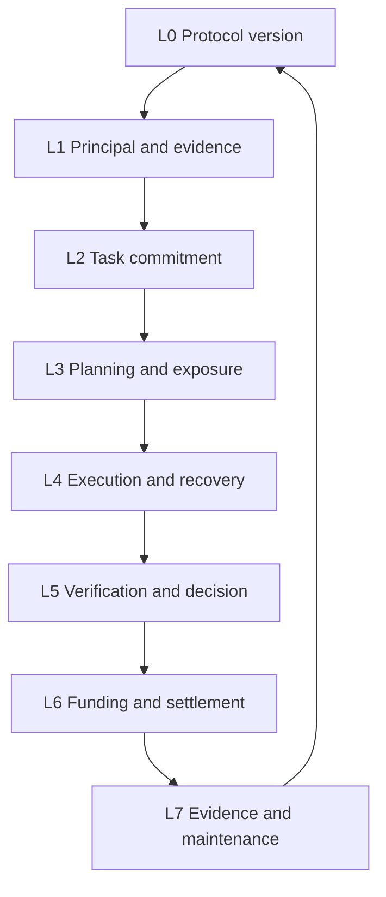
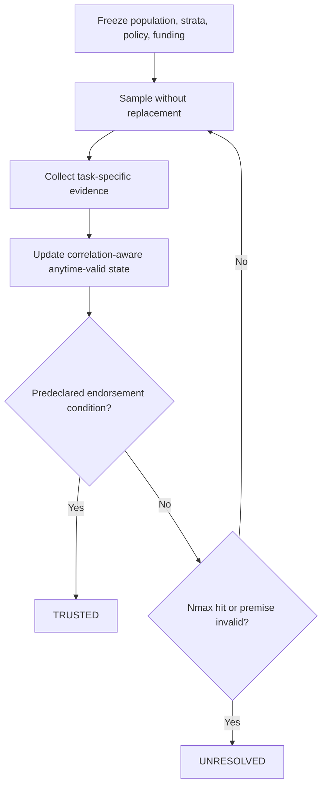

# DCP Complete Project Architecture, Public Argument, and Traceability v0.5

> Date: 2026-08-17  
> Project name: **Decentralized Compute Protocol (DCP)**  
> Historical names: DistributedCompute / RUDCP (retained only for document traceability)  
> Status: Internal collaboration baseline / G0 specification input  
> Chinese counterpart: `DCP_完整项目思路架构与论证映射_v0.5_中文.md`

## 0. Purpose and Evidence Discipline

After a complete review of the v0.1-v0.4 baselines and the cross-conversation decisions made on 2026-08-17, this document restates DCP's complete semantics, architecture, public arguments, proof obligations, system locations, confirmed progress, and open questions. It supersedes v0.4 as the current semantic baseline without erasing the historical value of older files.

The document exposes an auditable “premise-mechanism-conclusion-boundary-falsifier-verification method” chain, not anyone's private chain of thought. Status labels are:

| Label | Meaning |
|---|---|
| `DECIDED` | A project decision accepted by the user |
| `DERIVED` | A design conclusion under explicit premises |
| `INVARIANT` | A property no correct implementation may violate |
| `CANDIDATE` | A selected research direction whose algorithm or parameters are not frozen |
| `ASSUMPTION` | A model premise currently relied upon but not proved |
| `HYPOTHESIS` | An empirical claim requiring simulation or experiment |
| `OPEN` | A question not yet decided or specified |
| `SUPERSEDED` | A former baseline replaced by newer semantics |
| `REJECTED` | An excluded design or prohibited claim |

When sources conflict, precedence is: newer explicit user decision > older user decision > saved project file > assistant proposal > external literature. External literature supports theoretical boundaries, candidate methods, or engineering precedents; it does not prove DCP's combined system.

## 1. The v0.5 Semantic Break

### 1.1 v0.4 to v0.5 Migration Matrix

| Old semantics | v0.5 semantics | Status | Direct impact |
|---|---|---|---|
| Project named RUDCP | Official internal name is Decentralized Compute Protocol (DCP) | `DECIDED` | Terminology, filenames, charter |
| Requester/Broker/Provider are three core roles | Only Requester and Provider remain irreducible Principals | `SUPERSEDED` | Identity, authority, responsibility |
| Broker, Verifier, Scheduler, etc. are participants | They are permissionless functions invocable or performable by any compliant Principal | `DECIDED` | APIs, permissions, audit |
| Protocol/Control Plane is described as a participant | Protocol is rules, objects, state transitions, and invariants; a Control Plane is an implementation | `SUPERSEDED` | Trust boundary, deployment |
| Foundation is a system identity | Only a maintenance boundary remains; a foundation, corporation, or committee is not protocol-required | `SUPERSEDED` | Governance and administration |
| Rank/Reputation is a subsystem, object, or displayed tier | Rank/Reputation as an entity and authority is completely removed; only evidence, capability estimates, and risk decisions remain | `DECIDED` | Object model, UI, scheduling, verification |
| High reputation may raise verification power | Performance evidence may not grant truth authority, verification voting power, or final audit power | `REJECTED` | Verification security |
| `Nmax = 51% x qualified Providers` | Population, budget, and policy jointly constrain Nmax; 51% has no default meaning | `SUPERSEDED` | Verification policy and ADRs |
| Goal is to prove approximate identity independence | Estimate correlation explicitly; when independence cannot be proved, reduce evidence strength and hard-bound worst-case loss | `DECIDED` | Sybil threat model |
| “Attack cost > reward” supports overall security | It is only a supplementary condition for a defined attack and cannot replace hard safety bounds | `SUPERSEDED` | Security claims |
| Verification issuance is a decided mechanism | Issuance is only an optional FundingPolicy; fees, reserves, subsidy, or mixtures are also allowed | `SUPERSEDED` | Funding and accounting |
| Both verification outcomes are universally non-refundable | A process service may choose no refund, but refund is determined by a predeclared SettlementPolicy and fault attribution | `SUPERSEDED` | Contract and terminal semantics |
| A centralized v1 control plane is protocol semantics | v1 may have a centralized reference implementation, while DCP remains neutral to databases, signed logs, or blockchains | `SUPERSEDED` | Protocol/implementation boundary |
| No blockchain in v1 | DCP still has no blockchain dependency, but must preserve future blockchain adapter interfaces | `DECIDED` | Storage, settlement, versioning |

### 1.2 Preserved Spine

This optimization does not remove: fully open source scope; immutable `ComputeReceipt`; zero up-front collateral for ordinary Providers; legal but not globally optimal decomposition; finite Leases, monotonic epochs, late-result isolation, bounded attempts, and explicit terminal states; predeclared verification; `UNRESOLVED`; at-most-once settlement; versioned rules; no case-specific retroactive mutation of weights or outcomes; and the current G0 stage rather than a claim of proved robustness.

## 2. Top-Level Proposition, Name, and Boundary

### 2.1 Project Proposition

DCP is an open protocol for permissionless coordination of heterogeneous distributed compute. It defines how tasks are committed, work is planned and claimed, execution is bounded and recovered, results become evidence and are verified, uncertainty terminates safely, funding settles within limits, and historical evidence becomes future capability and exposure decisions.

DCP does not prescribe one ledger. An ordinary database, append-only signed log, Merkle log, consortium ledger, or future public blockchain may implement the protocol if it preserves the same object semantics, invariants, and verifiable state transitions.

### 2.2 Name Status

`Decentralized Compute Protocol / DCP` is the decided internal name. Fact-checking found unrelated public projects using the same phrase or the DCP acronym. Therefore “name decided” does not mean that trademark, domain, package-name, or public-brand clearance is complete. A separate clearance is required before public release.[21][22]

### 2.3 Claims Allowed and Prohibited

**Allowed:** DCP has an implementation-neutral, auditable, falsifiable candidate protocol architecture. It turns node departure, state consistency, verification uncertainty, Sybil correlation, funding limits, and maintenance authority into explicit objects, invariants, and proof obligations.

**Prohibited:** system robustness is proved; arbitrary computation is cheaply verifiable; Provider count equals independent-controller count; 51% is a safe threshold; Rank represents truth; an uneconomic attack is impossible; issuance makes verification free; a blockchain automatically supplies DCP security; or the centralized reference implementation is already distributed-fault-tolerant.

## 3. Minimal Ontology: Principal, Function, Protocol, Maintenance

### 3.1 Irreducible Principals

| Principal | Why necessary | Core commitments it may sign | Responsibility it may bear |
|---|---|---|---|
| `Requester` | Without a requester there is no task, acceptance requirement, or funding source | Task/Receipt proposal, input references, policy selection, funding commitment | Malicious/unexecutable task, input rights, funding truthfulness |
| `Provider` | Without a provider there is no real performer of compute, verification, or other protocol functions | Capability/resource claims, Lease acceptance, result and evidence submissions | Performance after acceptance, evidence authenticity, keys, concurrency exposure |

A Principal can hold keys, sign messages, incur obligations, and receive rights. One real controller may hold several identifiers, while one identifier may perform different functions over time. Principal count is therefore not independent-controller count.

### 3.2 Permissionless Functions

| Function | Input | Output | Authority boundary |
|---|---|---|---|
| `Plan` (historical Broker) | Receipt, dependency and resource constraints | WorkPlan / Assignment DAG | May only propose; protocol legality validation is required |
| `Admit` | Evidence, capability estimate, current exposure | Eligibility / ExposureDecision | Creates no identity and grants no truth power |
| `Schedule` | Legal Assignment, candidates, policy | Claim order or Lease proposal | Must obey exposure, deadline, and deterministic rules |
| `Execute` | Assignment, environment, Lease | Result / Checkpoint / FailureEvidence | Output binds epoch and content digest |
| `Sample` | Frozen population, strata, randomness commitment | Without-replacement draw sequence | May not alter frame or rule after viewing results |
| `Verify` | Candidate result, task-specific check, evidence | VerificationEvidence | One evidence item is not a final truth ruling |
| `Aggregate` | Samples and verification evidence | ConfidenceState / decision candidate | Applies only predeclared statistical rules |
| `Settle` | Terminal state, entitlement, funding, policy | Settlement commit | At-most-once and within authorized funding |
| `UpdateEvidence` | Attributable execution/verification event | New PerformanceEvidence | Appends evidence and never creates Rank |

“Permissionless” means any Principal may attempt to perform a function, not that its output is automatically valid. The protocol accepts a transition only after checking inputs, signatures, versions, state preconditions, and invariants.

### 3.3 Things That Are Not Identities

`Broker/Planner`, `Verifier`, `Scheduler`, `Sampler`, and `Aggregator` are functions; `Protocol` is rules; `Control Plane` is an implementation; `Foundation` is an optional organizational form; `Maintainer` is a release-boundary responsibility; `Node/Account/Device/Key` are identifiers, execution vessels, or evidence; `Rank/Reputation` is removed; and `ComputeReceipt`, Lease, Result, and Settlement are data objects. A named function must not become a privileged entity merely because it has a noun.

### 3.4 Maintenance Boundary

The maintenance boundary covers specifications, reference implementation, tests, release signatures, compatibility, vulnerability response, and ADRs. It is not the adjudicator of live tasks and may not alter a frozen Receipt, change sampling or weights case by case, override a VerificationDecision, create unauthorized settlement, or treat a maintainer's analysis as higher-authority evidence. A legal foundation, committee, or on-chain governance system is optional and should be introduced only when net governance value is positive.

## 4. Complete Layered Architecture

| Layer | Protocol content | Main objects/functions | Primary property |
|---|---|---|---|
| L0 Protocol and versioning | Specification, types, state machines, invariants, upgrades | ProtocolVersion, ADR, Release | Traceable, no case-specific retroactivity |
| L1 Principal and evidence | Keys, devices, resources, control links, historical events | PrincipalID, PerformanceEvidence | Attribution, explicit correlation, no assumed independence |
| L2 Task commitment | Program, input, environment, verification, deadline, funding | ComputeReceipt, FundingPolicy | Immutable semantics, policy precommitment |
| L3 Planning and exposure | Decomposition, legality, capability estimation, admission, scheduling | Plan, CapabilityEstimate, ExposureDecision | No Rank, bounded exposure, exploration |
| L4 Execution and recovery | Lease, Attempt, epoch, heartbeat, checkpoint | Execute, Lease, Checkpoint, Result | Late-result isolation, bounded retry, conditional liveness |
| L5 Verification and decision | Task checks, finite-population sampling, sequential stopping | Sample, Verify, Aggregate, Decision | Without replacement, auditable stopping, explicit uncertainty |
| L6 Funding and settlement | Budget, fees, reserve, subsidy, optional issuance, refund | FundingPolicy, SettlementPolicy, Settlement | Funding conservation, at-most-once, fault attribution |
| L7 Evidence, operations, maintenance | Events, audit, recovery, observability, release | EventRecord, AuditView, Release | Append-only, replayable, testable RPO/RTO |

Arrows are specification and evidence dependencies; they do not require one service, organization, or ledger to implement all layers. L7 may affect a future ProtocolVersion or append corrective evidence, but it may not rewrite a frozen case.

## 5. Core Objects and Freeze Points

| Object | Content | Creator/proposer | Freeze point | Main consumers |
|---|---|---|---|---|
| `ProtocolVersion` | Schemas, state machines, verification and settlement rules | Maintenance proposal, release procedure confirmation | Release signature/digest | Whole lifecycle |
| `PrincipalRecord` | Public keys, declarations, device/control-link refs | Principal | Version read at use | Lease, evidence, settlement |
| `ComputeReceipt` | Program, input, environment, resources, success/verification, deadline, funding, attempts, policies | Requester | ReceiptID registration | Whole task lifecycle |
| `FundingPolicy` | Requester fee, reserve, subsidy, issuance, or mixture and caps | Requester/allowed policy | Receipt registration | Verification, Settlement |
| `WorkPlan` / `Assignment` | Legal work unit, dependencies, merge and verification context | Any Plan performer | Legality acceptance and publication | Lease, Result |
| `PerformanceEvidence` | Task family, conditions, outcome, attribution, time, source | Protocol-accepted event | Append; no silent mutation | CapabilityEstimate |
| `CapabilityEstimate` | Conditional task-family capability distribution/interval and uncertainty | Any reproducible estimator | Each decision binds evidence version | ExposureDecision |
| `ExposureDecision` | Concurrency, task value, attempts, loss cap, validity period | Admit/Schedule | Before Lease | Lease, audit |
| `Lease` | Assignment, Provider, epoch, deadline, conditional rights | Schedule output plus Provider acceptance | Acceptance | Attempt, Result, Settlement |
| `Attempt` | One execution's state, time, reason | Execute | Termination | Retry, Evidence |
| `Checkpoint` | Recoverable state, digest, environment/format version | Provider | Receipt | Recovery, reassignment |
| `ResultSubmission` | Result, digest, epoch, evidence, idempotency key | Provider | Validated receipt | Verification |
| `EligibilitySnapshot` | Finite verification population, exclusions, strata, correlation data | Determined before Sample | First draw | Sample, Nmax |
| `VerificationEvidence` | Check method, output, source, cost, correlation | Verify performer | Receipt | Aggregate |
| `VerificationDecision` | `TRUSTED` or `UNRESOLVED` and full evidence chain | Aggregate under protocol | Atomic terminal commit | Settlement, Evidence |
| `SettlementPolicy` | Rights, refund, fees, liability, and failure treatment per terminal state | Allowed policy plus Requester choice | Receipt registration | Settlement |
| `Settlement` | Beneficiary, amount, funding source, unique key, state | Settle | Commit | Accounting, audit |
| `EventRecord` | State transition, causal reference, version, signature/digest | Every function | Append | Replay, audit, recovery |

There is no `Rank`, `ReputationState`, `VerifierAuthority`, or `FoundationDecision` object. An internal derived cache must be reproducible from evidence and gains no independent authority.

## 6. End-to-End Lifecycle

| Stage | Action | Success condition | Degraded/terminal exit |
|---|---|---|---|
| 1. Select version and policies | Bind ProtocolVersion, VerificationPolicy, FundingPolicy, SettlementPolicy | All parse and are compatible | `REJECTED_AT_CREATE` |
| 2. Register Receipt | Canonicalize, digest, sign, register | ReceiptID uniquely binds semantics | `REJECTED_AT_CREATE` |
| 3. Plan | Any performer proposes WorkPlan | Deterministic legality validator accepts | `FAILED_PLANNING` |
| 4. Estimate capability | Compute task-family capability and uncertainty from evidence | Complete sources, fixed versions | Conservative estimate or ineligible |
| 5. Decide exposure | Check concurrency, task value, attempts, loss cap | Risk capacity available | Queue, reject, or `EXPIRED` |
| 6. Lease and execute | Provider accepts epoch-bound Lease and executes | Result/checkpoint under current epoch | Re-lease, `FAILED`, `EXPIRED` |
| 7. Verification snapshot | Freeze finite population, strata, correlation, randomness commitment | Auditable snapshot | `UNRESOLVED`/verification unavailable |
| 8. Sequential verification | Sample WoR, verify, aggregate, test anytime-valid condition | Predeclared trust condition met | Expand or hit Nmax |
| 9. Decide | Write one VerificationDecision | `TRUSTED` or `UNRESOLVED` | Transaction retry, never two terminal states |
| 10. Settle | Compute entitlement under terminal, funding, settlement policies | One Commit within cap | `FUNDING_EXHAUSTED` or retryable failure |
| 11. Append evidence | Record attributable execution, verification, platform events | Source and responsibility traceable | Defer capability update rather than guess |

### 6.1 Terminal Semantics

| Terminal state | Strict meaning | Absolute correctness proof? | Refund/fees |
|---|---|---|---|
| `TRUSTED` | Stop condition met under the declared model, evidence, and error target | No | Predeclared SettlementPolicy |
| `UNRESOLVED` | Nmax, funding/policy cap, or invalid verification premise prevents endorsement of one result | No | May be a non-refundable process service or have exceptions; must be predeclared |
| `FAILED` | Execution or system condition failed irrecoverably | No | Attribute Requester/Provider/implementation/external fault |
| `EXPIRED` | Final deadline reached | No | Predeclared responsibility matrix |
| `FUNDING_EXHAUSTED` | Funding cap prevents more verification or settlement | No | May not be bypassed by ad hoc issuance |
| `REJECTED_AT_CREATE` | Creation violates protocol or safety boundary | N/A | No execution service begins |

## 7. Public Argument Chains and System Locations

### 7.1 Chain A: Do Not Add Entities Without Necessity

**Premise:** Planning, verification, scheduling, and similar work can be specified by public rules with verifiable inputs and outputs.  
**Mechanism:** Define them as permissionless functions and retain only Requester/Provider as signers of obligations and rights.  
**Conclusion:** Fewer privileged identities, trust roots, and governance costs.  
**Boundary:** A malicious Principal may still perform a function, so the protocol must validate outputs; permissionless does not mean unchecked.  
**Location:** L0, L1, every function interface.  
**Status:** `DECIDED/DERIVED`.

### 7.2 Chain B: A Protocol Is Not a Blockchain

**Premise:** Task commitment, state transitions, and invariants can be defined independently of the persistence medium.  
**Mechanism:** Objects use stable digests, versions, and event semantics; adapters supply storage, time, randomness, and settlement.  
**Conclusion:** v1 may use a centralized reference implementation and later substitute a signed log, consortium ledger, or public chain without changing the protocol proposition.  
**Falsifier:** If a core semantic property exists only through a specific chain or token, implementation neutrality fails.  
**Location:** L0, L7.  
**Status:** `DECIDED`.

### 7.3 Chain C: Immutable ComputeReceipt

If program, input, environment, verification, deadline, funding, or policy changes silently, parties no longer process the same obligation. All material fields and ProtocolVersion therefore enter canonical semantics, and a change creates a new ReceiptID. Proof obligations include canonical encoding, hash scope, equivalence, migration, and content availability. Location: L2 and all references. Status: `INVARIANT`.[11]

### 7.4 Chain D: Zero Collateral Is Not Zero Constraint

An ordinary Provider posts no initial stake. The protocol limits externality with low initial exposure, concurrency and task-value caps, bounded Leases and attempts, evidence uncertainty, and attributable future admission. The limited conclusion is that stake-free admission can coexist with risk control; Sybil resistance does not follow. Location: L1, L3, L4. Status: `DECIDED/HYPOTHESIS`.

### 7.5 Chain E: Evidence to Capability to Exposure

Old Rank compressed different tasks, times, and uncertainty into an authoritative scalar, encouraging invalid transfer and hierarchy/truth power. v0.5 permits only:

\[
E_{i,t} \longrightarrow \widehat{C}_{i,f,t}\pm U_{i,f,t}
\longrightarrow X_{i,j,t}
\]

`E` is auditable evidence, `C` a conditional capability estimate for task family `f`, `U` uncertainty, and `X` the concurrency, value, and risk exposure for task `j`. Capability formula, distribution, and parameters remain `CANDIDATE/HYPOTHESIS`; the interface and prohibition on Rank authority are `DECIDED`. Glicko, Beta reputation, and bandit work provide only candidate statistical representations or exploration baselines.[4][5][6][7]

### 7.6 Chain F: Finite Lease, Epoch, and Bounded Recovery

Providers leave or disconnect, so a claim is a finite conditional entitlement, not permanent task ownership. Reassignment strictly increments epoch; old-epoch outputs remain possible evidence but may not overwrite current state or earn settlement. Liveness is conditional on eventual implementation recovery, eventual connectivity, a qualified Provider, funding, and verification. Location: L4, L7. Status: `INVARIANT/ASSUMPTION`.

### 7.7 Chain G: Finite-Population, Without-Replacement, Anytime-Valid Verification

The verification population is frozen before sampling and then sampled sequentially without replacement under predeclared strata. Each round may inspect a simultaneously valid confidence sequence or equivalent e-process without applying an ordinary fixed-sample interval after optional stopping. Waudby-Smith and Ramdas directly study finite-population without-replacement confidence sequences; Howard et al. provide broader time-uniform tools. Neither solves DCP result clustering, adversarial dependence, or task semantics.[8][9][19]

Location: L5. The exact statistic, error target, stratum weights, and correlation treatment remain `CANDIDATE/OPEN`, not a completed security proof.

### 7.8 Chain H: Sybil Safety as Correlation-Aware Bounded Loss

Douceur shows that one entity can create several identities and undermine redundancy; signatures identify a key, not an independent controller.[14] DCP therefore does not require proving every identity independent before operation and never assumes independence by default. It must record or estimate common control/funding/network/resource origin, reduce effective evidence when unknown, cap exposure by new Principal and correlated cluster, cap Receipt and window exposure, cap attempts, verification spend and settlement, and return `UNRESOLVED` when evidence is insufficient.

This supports “worst protocol-internal loss is bounded under explicit parameters,” not “Sybil is eliminated” or “majority is true.” Hard caps are `DECIDED/INVARIANT`; correlation estimation is `OPEN`.

### 7.9 Chain I: Performance Capability Is Separate from Truth Power

Past completion can inform future execution capability but cannot directly increase the truth of a current result. Verification weight must arise from task-specific evidence, sampling design, and correlation treatment, not Provider Rank. Otherwise historical performance becomes unchallengeable authority and magnifies collusion. Location: L3, L5. Status: `DECIDED/INVARIANT`.

### 7.10 Chain J: Funding Source Is Policy, Not a Security Theorem

Zero collateral constrains Provider admission, not who pays for verification. Every Receipt selects an allowed FundingPolicy: Requester fee, protocol reserve, third-party subsidy, optional issuance, or a mixture. Every source has per-task, window, and global caps; budget exhaustion may not trigger ad hoc issuance to preserve “trust.” Issuance changes cost incidence and does not erase real cost. Location: L2, L6. Status: source choice `OPEN/POLICY`; conservation and caps `INVARIANT`.

### 7.11 Chain K: Maintenance Is Not Adjudication

Maintainers may publish a future version, repair an implementation, and revoke a defective release, but may not change a frozen case's inputs, sampling, evidence, or settlement. Human recusal, two-person review, or a legal entity is added only when automation cannot provide an equivalent control and net governance value is positive. Location: L0, L7. Status: least privilege `DECIDED`; organization `OPEN`.

## 8. DCP Verification Model v0.5

### 8.1 Admission Classification

Every task family must select a registered verification semantic in the Receipt:

1. `V0 Deterministic`: direct recomputation/comparison;
2. `V1 Certificate`: task-specific certificate or checkable property;
3. `V2 Replicated finite-population`: clusterable results with finite-population sequential evidence;
4. `V3 Hybrid`: certificate, spot checks, and redundancy combined;
5. `UNSUPPORTED`: no explicit error semantics or cost cap, so no endorsable Receipt may be created.

Rice's theorem supports the boundary that there is no universal decider for all nontrivial semantic properties of arbitrary programs; it does not mean every specific task is unverifiable.[10]

### 8.2 Finite Population and Nmax

For Receipt `j`, freeze the population before verification:

\[
\mathcal U_j=\{p: Eligible(p,j,t_0)=1\},\qquad N_j=|\mathcal U_j|
\]

The process cap is:

\[
N_{max,j}=\min\{N_j,\;N_{budget,j},\;N_{policy,j}\}
\]

- `N_j`: physical cap of the frozen population;
- `N_budget,j`: maximum draws funded under worst-case marginal verification cost;
- `N_policy,j`: predeclared cap from task value, deadline, privacy, concentration, and permitted loss.

The structure is `DECIDED`; calculations of the three terms are `OPEN`. There is no default 51%. A future strategy using 51% must supply its own risk justification rather than borrow majority intuition.

### 8.3 Sequential Flow

Every step records `SnapshotID`, randomness commitment, draw order, strata, correlation clusters, evidence digest, cumulative cost, and stop reason. Population, clustering tolerance, error target, and FundingPolicy may not be changed after observing results.

### 8.4 Correlation and Effective Evidence

Raw Provider count `n` is not effective independent sample size. v0.5 requires common control, ownership, funding, network, hardware image, software stack, and coordinated behavior to be treated as correlation evidence. Candidate treatments include one count per cluster, weight caps, design-effect/effective-sample-size discount, and worst-case sensitivity analysis. The method is not frozen; unknown correlation may not be filled in as zero.

### 8.5 Trust Condition

`TRUSTED` means only that the predeclared endorsement condition holds under the Receipt's task semantics, verification method, error target, correlation model, and FundingPolicy. It is not metaphysical proof. A defective task verifier, falsified correlation information, or manipulated snapshot must cause refusal or `UNRESOLVED`, not manual “vote correction” by maintainers.

## 9. Capability, Scheduling, and Exposure

### 9.1 PerformanceEvidence

Evidence includes task family, hardware/environment, resource conditions, difficulty description, acceptance time, outcome, deadline performance, verification evidence, failure source, and causal references. Declining an unaccepted task creates no negative evidence. Platform, task-specification, or verifier faults may not be attributed automatically to a Provider.

### 9.2 CapabilityEstimate

Capability is a conditional estimate with uncertainty, not an asset, identity, tier, or governance vote. Cross-family transfer is off by default; dormancy, hardware changes, and concept drift increase uncertainty. Candidate models may compare Beta/Bayesian, Glicko-like, calibrated classifier, or conservative confidence-bound approaches, but v0.5 freezes no formula.

### 9.3 ExposureDecision

Admission for a specific task depends at least on hard resource constraints, task-family capability lower bound, uncertainty, current concurrency, task value, worst permitted loss, correlated-cluster concentration, consumed attempts, deadline, and exploration quota. New Providers retain an evidence-acquisition path, but exploration remains inside hard loss caps.

## 10. Funding, Settlement, and Economic Security

### 10.1 Funding Layers

Accounting separates execution budget, verification budget, planning/transmission/storage costs, protocol/platform fees, refund reserve, subsidy/reserve, and optional issuance. Funding buckets may not borrow implicitly merely for implementation convenience.

### 10.2 Funding Conservation

For each Receipt and global window:

\[
Committed + Settled + RefundReserved \le AuthorizedFundingCap
\]

Settlement binds a unique entitlement key and remains at-most-once after replay, concurrency, timeout, or implementation migration. `FUNDING_EXHAUSTED` is a legitimate safe terminal state and may not be covered with undeclared funding.

### 10.3 Economic-Attack Boundary

A candidate condition remains:

\[
C_{attack}>G_{protocol}+G_{external}+V_{disruption}-P_{detection}
\]

It applies only to a defined attack, credible cost/benefit bounds, and a stated time window. Exposure, attempt, funding, verification, and settlement caps first bound worst loss; economic deterrence is a second control. Identity rental, collusion subsidies, external positions, competitive sabotage, political, and purely destructive motives remain adversarial tests.

## 11. Security Invariants

| ID | Invariant | Minimum acceptance method |
|---|---|---|
| INV-01 | Canonical semantics are immutable under one ReceiptID | Serialization equivalence, tampering, migration tests |
| INV-02 | Every live object binds an explicit ProtocolVersion | Version mismatch and revocation tests |
| INV-03 | New Lease epoch strictly increases | Concurrent issue, replay, leader-change tests |
| INV-04 | Each task has one protocol terminal state | Terminal-race model checking |
| INV-05 | One settlement entitlement commits at most once | Replay, timeout, partial-write recovery |
| INV-06 | Commitment, settlement, and refund stay within authorized cap | Concurrent funding property tests |
| INV-07 | Successful settlement requires a valid VerificationDecision | Missing/forged decision tests |
| INV-08 | Old-epoch results cannot overwrite current state or rights | Reordering and partition tests |
| INV-09 | Attempts, deadlines, and verification draws are hard bounded | Boundary and crash-recovery tests |
| INV-10 | Exposure is bounded by Provider, correlated cluster, Receipt, and time window | Atomic quota and concentration tests |
| INV-11 | Sampling is without replacement inside one Snapshot | Concurrent multi-round draw tests |
| INV-12 | Stop rule, population, strata, tolerance, and funding cannot change after observation | Precommitment digest checks |
| INV-13 | PerformanceEvidence is append-only; correction is a new event | Audit and replay tests |
| INV-14 | Capability evidence cannot directly grant verification/truth power | Authority and data-flow tests |
| INV-15 | Maintainers cannot alter case result, weight, or settlement | Privilege-abuse and replay tests |
| INV-16 | Replacing the storage/ledger implementation preserves observable protocol semantics | Adapter conformance suite |

## 12. Argument-to-System Traceability Matrix

| Map ID | Argument/theory | System location | Currently supports | Still to prove |
|---|---|---|---|---|
| MAP-A | Minimal Principals / permissionless functions | L0/L1/all functions | Smaller privileged identity set | Output validation, responsibility, collusion |
| MAP-B | Protocol is not blockchain | L0/L7 | Implementation neutrality, future adapter | Adapter semantic equivalence |
| MAP-C | Immutable Receipt | L2/all references | Common task reference | Canonical encoding, availability |
| MAP-D | Zero collateral plus exposure caps | L1/L3/L4 | Bounded performance externality candidate | Maximum delay/loss simulation |
| MAP-E | Evidence to capability to exposure | L1/L3/L7 | Removes Rank authority | Calibration, fairness, drift |
| MAP-F | Lease/epoch/retry | L4/L7 | Late isolation and bounded recovery | Clock, partition, transaction model |
| MAP-G | Finite-population anytime-valid verification | L5 | Candidate statistical-error control under optional stopping | DCP-specific theorem and implementation |
| MAP-H | Correlation-aware Sybil boundary | L1/L3/L5/L6 | No assumed independence, hard loss limits | Correlation signals, privacy, discount |
| MAP-I | Capability separate from truth power | L3/L5 | Prevents history-based verification monopoly | Task-specific evidence weighting |
| MAP-J | FundingPolicy | L2/L6 | Decouples funding source from security mechanism | Caps, rates, insolvency, refund |
| MAP-K | Maintenance is not adjudication | L0/L7 | No case-specific retroactivity | Release, revocation, keys, appeal |
| MAP-RICE | General semantic-decision boundary | L2/L5 | Verification must be task-family specific | Registry and unsupported semantics |
| MAP-SYBIL | Cheap identities undermine redundancy | L1/L5 | Identity count is not independent evidence | DCP loss bounds and detection |
| MAP-BFT | Byzantine thresholds require a defined model | L5/L7 | 51% cannot be borrowed unconditionally | DCP fault/network model |
| MAP-FLP | Unconditional liveness is unavailable under asynchronous fault | L4/L7 | Liveness must be conditional | Eventual synchrony, clocks, recovery |
| MAP-BOINC | Volunteer-compute task/validation precedent | L3/L4/L5 | Engineering feasibility of distribution, retry, redundancy | Does not prove DCP Sybil/statistics |
| MAP-OCI | Digest/content-addressing precedent | L2/L4 | Immutable content references | DCP Receipt semantics remain original |
| MAP-CS | Without-replacement confidence sequences | L5 | Candidate method for sequential finite populations | Malicious dependence, clustering, strata adaptation |

## 13. Confirmed Progress and Missing Deliverables

| Stage | Decided | Formed but unproved | Missing deliverable |
|---|---|---|---|
| Project nature | DCP is a protocol, not blockchain; future-chain compatible | Neutrality can reduce lock-in | Charter, adapter contract, external name clearance |
| Ontology | Two Principals, functions, Protocol, maintenance | Minimal entities can shrink trust surface | Glossary, authority matrix, signature responsibility |
| Task | Immutable Receipt, version binding | Receipt as common reference | Schema, canonical encoding, examples/negative cases |
| Planning | Permissionless Plan; legality/determinism only | Reproducible decomposition | DAG, ties, merge, failure semantics |
| Admission | No Rank; evidence to capability to exposure; zero collateral | Conservative estimates may control risk | Model interface, calibration, atomic exposure quota |
| Execution | Lease, epoch, checkpoint, bounded attempts | Conditional liveness and late isolation | State machine, clock, recovery, sandbox |
| Verification | Task classes, sequential WoR, Nmax, UNRESOLVED | Finite-population CS is an adaptation direction | Statistical spec, correlation, clustering, randomness |
| Sybil | No assumed independence, hard caps first | Correlation discount may reduce false evidence | Correlation graph, privacy, attack simulation, loss bound |
| Funding | Multiple-source FundingPolicy; issuance optional | Separate accounts reveal real cost | Ledger, rates, caps, refund, insolvency |
| Settlement | At-most-once, terminal prerequisite, attribution | Idempotency is engineer-testable | Transactions, unique keys, replay tests |
| Maintenance | Least privilege, no case discretion | Automation can reduce administrative cost | Release/revocation/key/disclosure process |
| Operations | Events, audit, measurable RPO/RTO | Fault injection can create evidence | Data model, replication, backup, SLO |

## 14. Open Questions

### P0: Must Close Before the Core Prototype

1. DCP Charter, glossary, and machine-expressible Principal/function/Protocol/maintenance boundaries;
2. canonical schemas for ProtocolVersion, ComputeReceipt, FundingPolicy, SettlementPolicy;
3. WorkPlan/Assignment legality, dependencies, merge and failure semantics;
4. Lease, Attempt, Result, VerificationDecision, and Settlement state machines and races;
5. V0-V3 verification registry, result equivalence/clustering, and `UNSUPPORTED` semantics;
6. finite-population definition, sampling randomness, anytime-valid target, strata, and Nbudget/Npolicy algorithms;
7. control/correlation evidence, safe treatment of unknown dependence, and cluster exposure caps;
8. maximum attempts, value, verification spending, and accepted loss by Provider/Receipt/window;
9. FundingPolicy, refund/fees, fault attribution, insolvency, and global funding conservation;
10. reference-implementation consistency, partition authority, clocks, idempotency, disaster recovery, adapter conformance;
11. release, revocation, upgrade, keys, and vulnerability response;
12. DCP public name, domains, package names, and trademark clearance.

### P1: May Enter Simulation with Explicit Parameters

1. CapabilityEstimate model, calibration, decay, drift, and cross-family transfer;
2. exploration quota, new-Provider promotion time, completion, loss, and concentration;
3. correlation signals, discount/clustering method, privacy cost, false linkage;
4. internal/external attacker gains, repeated attacks, identity rental, collusion;
5. heterogeneous-hardware/task normalization, checkpoint and transfer costs;
6. net risk reduction, delay, legal, and opportunity cost of maintenance/human process.

### P2: Preserve Interfaces but Do Not Block v1

- verifiable computation, interactive proofs, zero knowledge, TEE;
- nondeterministic work, ML training, probabilistic output;
- GPU, cross-architecture/region, large input, data locality;
- public blockchain, consortium ledger, decentralized storage, on-chain settlement adapters;
- cross-border payments, regulation, public network, formal governance organization.

## 15. Engineering Gates

| Gate | Build scope | Exit evidence | Claim still prohibited |
|---|---|---|---|
| G0 Specification | Charter, ontology, objects, state machines, invariants, threat, statistical and funding policy | Every P0 decision is machine/test expressible | System is robust |
| G1 Simulation | Capability, scheduling, verification, correlation, attacks, funding, administration | Sensitivity, false endorsement, completion, tail latency, concentration, maximum loss | Parameters work on real networks |
| G2 Single-host reference | Registry, Plan, Lease, Result, Verify, Settle, Event | Concurrency/replay/crash preserve INV-01-16 | Distributed fault tolerance achieved |
| G3 LAN MVP | Multiple Providers, disconnect, departure, recovery, sandbox | Fault injection and initial SLO | Safe for public Internet |
| G4 Persistence/DR | Database/log adapters, object store, backup, recovery | RPO/RTO drill and adapter conformance | No operational single point of failure |
| G5 Adversarial validation | Sybil, collusion, hidden links, evidence farming, budget exhaustion, maintenance abuse | Loss bound or detection rate and residual risk | Attacks are impossible |
| G6 Heterogeneous/external pilot | New hardware, task families, external participants, optional ledger adapter | Invariants hold; evidence does not mis-transfer | All general compute is verifiable |

## 16. ADR Index

1. `ADR-001`: DCP name, scope, open source, external name clearance;
2. `ADR-002`: minimal Requester/Provider Principal set;
3. `ADR-003`: permissionless functions and output legality;
4. `ADR-004`: Protocol/Control Plane/maintenance boundary;
5. `ADR-005`: ProtocolVersion and immutable ComputeReceipt;
6. `ADR-006`: legal but non-optimal WorkPlan/Assignment;
7. `ADR-007`: zero collateral, capability estimation, exploration, exposure caps;
8. `ADR-008`: removal of Rank/Reputation entity and truth power;
9. `ADR-009`: Lease, epoch, checkpoint, bounded attempts;
10. `ADR-010`: verification-type registry and unsupported semantics;
11. `ADR-011`: finite population, strata, without replacement, anytime-valid stopping;
12. `ADR-012`: Nmax = min(population, budget, policy);
13. `ADR-013`: Sybil correlation, clusters, maximum loss;
14. `ADR-014`: TRUSTED/UNRESOLVED/FAILED/EXPIRED/FUNDING_EXHAUSTED;
15. `ADR-015`: FundingPolicy, optional issuance, funding conservation;
16. `ADR-016`: SettlementPolicy, refund, attribution, at-most-once;
17. `ADR-017`: events, evidence, correction, retention, replay;
18. `ADR-018`: maintenance least privilege, release, revocation, keys, recusal;
19. `ADR-019`: implementation neutrality and database/log/blockchain adapters;
20. `ADR-020`: administrative cost and governance-expansion gate.

## 17. References and Their Limits

1. David P. Anderson, [An Incentive System for Volunteer Computing](https://boinc.berkeley.edu/boinc_papers/credit/text.php) — volunteer-credit precedent; no support for Rank truth power.
2. David P. Anderson, [BOINC: A System for Public-Resource Computing and Storage](https://boinc.berkeley.edu/grid_paper_04.pdf) — public-resource architecture precedent.
3. D. P. Anderson et al., [High-Performance Task Distribution for Volunteer Computing](https://boinc.berkeley.edu/boinc_papers/server_perf/server_perf.pdf) — scheduling, validation, retry precedent; no controller-independence proof.
4. Mark E. Glickman, [Glicko and Glicko-2 Rating Systems](https://www.glicko.net/glicko.html) — candidate uncertainty representation, not a DCP authority model.
5. Roslan Ismail and Audun Jøsang, [The Beta Reputation System](https://aisel.aisnet.org/bled2002/41/) — candidate performance-probability representation.
6. T. L. Lai and Herbert Robbins, [Asymptotically Efficient Adaptive Allocation Rules](https://doi.org/10.1016/0196-8858(85)90002-8) — exploration/exploitation foundation.
7. Peter Auer, Nicolò Cesa-Bianchi and Paul Fischer, [Finite-time Analysis of the Multiarmed Bandit Problem](https://doi.org/10.1023/A:1013689704352) — UCB baseline, not direct adversarial safety.
8. Ian Waudby-Smith and Aaditya Ramdas, [Confidence Sequences for Sampling Without Replacement](https://proceedings.neurips.cc/paper/2020/hash/e96c7de8f6390b1e6c71556e4e0a4959-Abstract.html) — direct statistical reference for finite populations, WoR, and time-uniform confidence sequences.
9. Steven R. Howard et al., [Time-uniform Chernoff Bounds via Nonnegative Supermartingales](https://projecteuclid.org/journals/probability-surveys/volume-17/issue-none/Time-uniform-Chernoff-bounds-via-nonnegative-supermartingales/10.1214/18-PS321.pdf) — time-uniform tools, not a complete DCP verification proof.
10. H. G. Rice, [Classes of Recursively Enumerable Sets and Their Decision Problems](https://www.jstor.org/stable/1990888) — general program-semantic decision boundary.
11. Open Container Initiative, [OCI Image Specification](https://specs.opencontainers.org/image-spec/) — engineering reference for content digests and addressing.
12. Leslie Lamport, Robert Shostak and Marshall Pease, [The Byzantine Generals Problem](https://lamport.azurewebsites.net/pubs/the-byz-generals.pdf) — threshold dependence on fault model; no DCP 51% rule.
13. Michael J. Fischer, Nancy A. Lynch and Michael S. Paterson, [Impossibility of Distributed Consensus with One Faulty Process](https://dl.acm.org/doi/10.1145/3149.214121) — asynchronous consensus/liveness boundary.
14. John R. Douceur, [The Sybil Attack](https://www.microsoft.com/en-us/research/publication/the-sybil-attack/) — boundary on redundancy under multiple identities.
15. MLCommons, [MLPerf Benchmarks](https://mlcommons.org/benchmarks/) — heterogeneous task-family measurement reference.
16. NIST, [SP 800-30 Rev. 1](https://csrc.nist.gov/pubs/sp/800/30/r1/final) — risk, likelihood, impact analysis.
17. NIST, [Cybersecurity Framework 2.0](https://nvlpubs.nist.gov/nistpubs/CSWP/NIST.CSWP.29.pdf) — govern, identify, protect, detect, respond, recover.
18. Golem Network, [Provider Documentation](https://docs.golem.network/docs/providers/provider-installation) — distributed-compute Provider precedent, not adoption of its economics.
19. Aaditya Ramdas et al., [Game-Theoretic Statistics and Safe Anytime-Valid Inference](https://projecteuclid.org/journals/statistical-science/volume-38/issue-4/Game-Theoretic-Statistics-and-Safe-Anytime-Valid-Inference/10.1214/23-STS894.pdf) — anytime-valid inference survey and theoretical background.
20. David P. Anderson et al., [Designing a Runtime System for Volunteer Computing](https://boinc.berkeley.edu/boinc_papers/api/text.pdf) — volunteer-compute runtime engineering experience.
21. Nebula AI, [Roadmap](https://docs.nebulanetwork.ai/overview/roadmap) — public use of the exact phrase “Decentralized Compute Protocol (DCP),” cited only for name clearance.
22. [DCP Agent](https://dcpagent.com/) — unrelated public use of the DCP brand, cited only to show acronym non-uniqueness.

## 18. Strict Current Conclusion

DCP v0.5 compresses the project into “two Principals + permissionless functions + a non-actor Protocol + a minimal maintenance boundary” and removes old Rank, 51%, and default issuance from the security core. The supportable claim is now an implementation-neutral, evidence-driven, correlation-aware complete candidate protocol that prioritizes hard worst-loss bounds; finite-population anytime-valid verification, correlation discount, funding/refund semantics, control-plane consistency, and parameterized loss bounds remain open, so the project is still at G0 specification.
