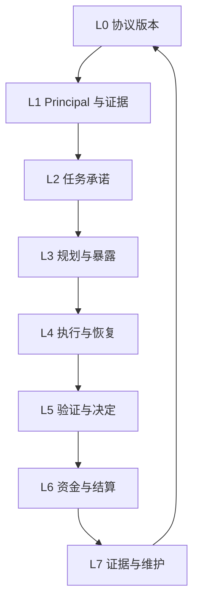
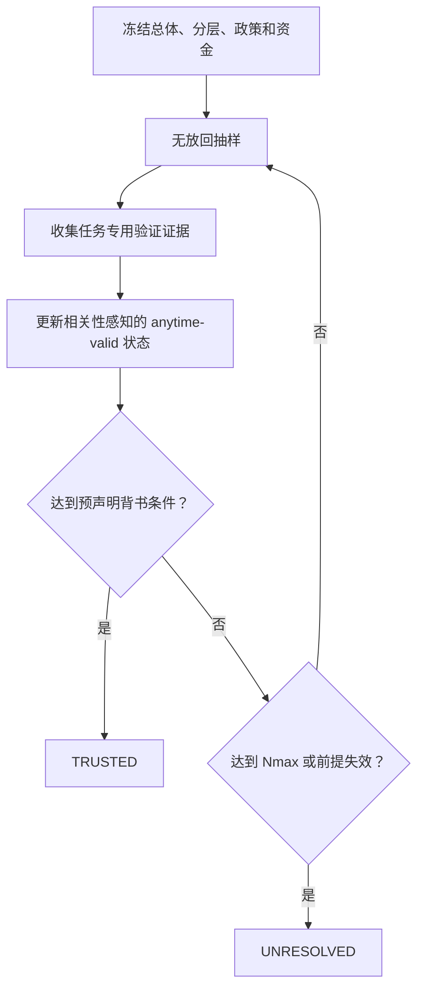

# DCP 完整项目思路架构、公开论证与系统映射 v0.5

> 日期：2026-08-17  
> 项目名称：**Decentralized Compute Protocol（DCP）**  
> 历史名称：DistributedCompute / RUDCP（仅用于追踪旧文档）  
> 状态：内部协作基线／G0 规格化输入  
> 对应英文版：`DCP_Complete_Project_Architecture_Argument_and_Traceability_v0.5_EN.md`

## 0. 文档目的与证据纪律

本文件在完整读取 v0.1—v0.4 项目基线及 2026-08-17 后续跨会话决定后，重新给出 DCP 的完整语义、架构、公开论证、证明义务、系统落点、已完成进度与未决问题。它替代 v0.4 作为当前最高语义基线，但不删除旧文件的历史价值。

本文件公开的是可审计的“前提—机制—结论—边界—反证条件—验证方法”，不是任何人的私密思维链。状态标签如下：

| 标签 | 含义 |
|---|---|
| `DECIDED` | 用户已接受的项目决定 |
| `DERIVED` | 在明示前提下可推出的设计结论 |
| `INVARIANT` | 正确实现不得破坏的性质 |
| `CANDIDATE` | 已选研究方向，但算法或参数尚未冻结 |
| `ASSUMPTION` | 当前模型依赖、但尚未证明的前提 |
| `HYPOTHESIS` | 必须用仿真或实验检验的经验主张 |
| `OPEN` | 尚未决定或尚未规格化 |
| `SUPERSEDED` | 曾在旧版采用，但已被新语义取代 |
| `REJECTED` | 明确排除的设计或不允许作出的主张 |

发生冲突时，证据优先级为：较新的用户明确决定 > 较旧的用户决定 > 已保存项目文件 > 助手建议 > 外部文献。外部文献只支持理论边界、方法候选或工程先例，不能替 DCP 证明组合系统。

## 1. v0.5 的语义断代

### 1.1 v0.4 → v0.5 迁移矩阵

| 旧语义 | v0.5 语义 | 状态 | 直接影响 |
|---|---|---|---|
| 项目称 RUDCP | 正式内部名称为 Decentralized Compute Protocol（DCP） | `DECIDED` | 全部术语、文件名、章程 |
| Requester/Broker/Provider 为三个核心角色 | 只保留 Requester、Provider 两类不可再约减 Principal | `SUPERSEDED` | 身份、授权、责任模型 |
| Broker、Verifier、Scheduler 等被列为参与者 | 它们是 permissionless functions，可由任意合规 Principal 调用或执行 | `DECIDED` | API、权限与审计 |
| Protocol/Control Plane 被写成参与者 | Protocol 只是规则、对象、状态转换和不变量；Control Plane 只是实现 | `SUPERSEDED` | 信任边界、部署架构 |
| Foundation 是系统身份 | 只保留 maintenance boundary；法人、基金会或委员会不是协议必需实体 | `SUPERSEDED` | 治理与行政成本 |
| Rank/Reputation 是子系统、对象或展示段位 | 彻底取消 Rank/Reputation 实体与权威；只保留证据、能力估计和风险决策 | `DECIDED` | 对象模型、UI、调度、验证 |
| 高信誉可提高验证权 | 履约能力证据不得授予真理权、验证票权或最终审计权 | `REJECTED` | 验证安全 |
| `Nmax = 51% × 合格 Provider` | `Nmax` 由总体、预算和政策共同约束；51% 不再有默认含义 | `SUPERSEDED` | 验证政策与 ADR |
| 目标是证明身份近似独立 | 显式估计相关性；无法证明独立时降低证据强度并硬性限制最坏损失 | `DECIDED` | Sybil 威胁模型 |
| “攻击成本 > 回报”支撑整体安全 | 只可作为特定攻击的补充经济条件，不能替代硬安全边界 | `SUPERSEDED` | 安全主张 |
| 验证增发为已定机制 | 增发降级为可选 FundingPolicy；还可使用费用、储备、补贴或混合来源 | `SUPERSEDED` | 资金与会计 |
| 两种验证终态一律不退款 | 过程服务可采用不退款政策，但退款必须由预声明 SettlementPolicy 和失败归因决定 | `SUPERSEDED` | 合约与终态 |
| 首版中心化控制平面是协议语义 | 首版可有中心化参考实现，但 DCP 本身对数据库、签名日志或区块链保持中立 | `SUPERSEDED` | 协议/实现边界 |
| 首版不使用区块链 | 当前仍不依赖区块链，但必须保留未来区块链适配接口 | `DECIDED` | 存储、结算与版本接口 |

### 1.2 保留的主干

以下内容未被本轮优化推翻：全系统开源；不可变 `ComputeReceipt`；普通 Provider 零前置抵押；合法但不承诺最优的拆分；有限 Lease、单调 epoch、迟到结果隔离、有界尝试与明确终态；预声明验证；`UNRESOLVED`；最多一次结算；版本化规则；不可按个案追溯改权重或结论；当前阶段仍为 G0，而非鲁棒性已经证明。

## 2. 顶层命题、名称与边界

### 2.1 项目命题

DCP 是一套面向异构、无许可分布式计算协调的开放协议。它定义：任务如何被承诺，工作如何被规划和领取，执行如何受限并恢复，结果如何形成证据并被验证，无法确定时如何安全终止，资金如何受预算约束地结算，以及历史证据如何转化为未来的能力与暴露决策。

DCP 不规定必须使用哪一种账本。普通数据库、追加式签名日志、Merkle 日志、联盟账本或未来公共区块链都可以实现协议，只要保持相同的对象语义、不变量和可验证状态转换。

### 2.2 名称状态

`Decentralized Compute Protocol / DCP` 是内部已定名称。事实核查发现，公开网络上已有无关项目使用相同短语或 DCP 缩写，因此“名称已决定”不等于“商标、域名、包名和公共品牌已完成清查”。外部发布前必须单独完成命名冲突与法律清查。[21][22]

### 2.3 当前允许和禁止的主张

**允许主张：** DCP 已形成一套实现中立、可审计、可反驳的候选协议架构；已把节点退出、状态一致性、验证不确定性、Sybil 相关性、资金上限和维护权边界转化为显式对象、不变量及证明义务。

**禁止主张：** 系统鲁棒性已证明；任意计算都可廉价验证；Provider 数量等于独立控制实体数量；51% 是安全阈值；Rank 能代表真理；攻击不划算等于攻击不可能；增发使验证免费；使用区块链会自动获得 DCP 安全性；中心化参考实现已经分布式容错。

## 3. 最小本体：Principal、Function、Protocol、Maintenance

### 3.1 不可再约减的 Principal

| Principal | 必要性 | 可签署的核心承诺 | 可承担的责任 |
|---|---|---|---|
| `Requester` | 没有请求方就没有任务、验收要求或预算来源 | Task/Receipt 提案、输入引用、政策选择、预算承诺 | 恶意/不可执行任务、输入权利、预算真实性 |
| `Provider` | 没有提供方就没有计算、验证或其他协议函数的实际执行者 | 能力/资源声明、Lease 接受、结果与证据提交 | 接受后的履约、证据真实性、密钥与并发暴露 |

Principal 是能持有密钥、签署消息、承担义务和接收权利的主体。一个现实控制实体可持有多个标识；一个标识也可在不同时间执行不同函数。因此 Principal 数量不是独立控制实体数量。

### 3.2 Permissionless functions

| Function | 输入 | 输出 | 权威边界 |
|---|---|---|---|
| `Plan`（历史 Broker） | Receipt、依赖与资源约束 | WorkPlan / Assignment DAG | 只能提出计划；必须通过协议合法性检查 |
| `Admit` | 证据、能力估计、当前暴露 | Eligibility / ExposureDecision | 不产生身份，不授予真理权 |
| `Schedule` | 合法 Assignment、候选与政策 | 可领取顺序或 Lease 提案 | 必须满足暴露、期限和确定性规则 |
| `Execute` | Assignment、环境与 Lease | Result / Checkpoint / FailureEvidence | 输出必须绑定 epoch 与内容摘要 |
| `Sample` | 冻结总体、分层与随机性承诺 | 不放回抽样序列 | 不得观察结果后改采样框或规则 |
| `Verify` | 候选结果、任务专用检查与证据 | VerificationEvidence | 单次证据不是最终真理裁决 |
| `Aggregate` | 抽样与验证证据 | ConfidenceState / Decision candidate | 只能应用预声明统计规则 |
| `Settle` | 终态、权利、预算与 FundingPolicy | Settlement commit | 最多一次、不得越过预算 |
| `UpdateEvidence` | 可归责执行/验证事件 | 新的 PerformanceEvidence | 只追加证据，不生成 Rank |

“Permissionless”表示任何 Principal 都可以尝试执行函数，不表示其输出自动有效。协议验证输入、签名、版本、状态前置条件和不变量后，才接受状态转换。

### 3.3 不是身份的对象

`Broker/Planner`、`Verifier`、`Scheduler`、`Sampler`、`Aggregator` 是函数；`Protocol` 是规则；`Control Plane` 是实现；`Foundation` 是可选组织形式；`Maintainer` 是发布边界中的责任；`Node/Account/Device/Key` 是标识、执行载体或证据；`Rank/Reputation` 已取消；`ComputeReceipt`、Lease、Result 和 Settlement 是数据对象。不得因为名词有名称就为其新增特权实体。

### 3.4 Maintenance boundary

维护边界负责规范、参考实现、测试、发布签名、兼容性、漏洞响应和 ADR。它不是运行中任务的裁判，不得：修改已冻结 Receipt；按个案改变抽样或权重；覆盖 VerificationDecision；制造未授权结算；把维护者的分析当作更高权证据。法人基金会、委员会或链上治理都属于可选实现，只有在净治理价值为正时才引入。

## 4. 完整分层架构

| 层 | 协议内容 | 主要对象/函数 | 首要性质 |
|---|---|---|---|
| L0 协议与版本 | 规范、类型、状态机、不变量、升级 | ProtocolVersion、ADR、Release | 可追溯、不可按个案追溯变更 |
| L1 Principal 与证据 | 密钥、设备、资源、控制关联、历史事件 | PrincipalID、PerformanceEvidence | 可归责、相关性显式、不假定独立 |
| L2 任务承诺 | 程序、输入、环境、验证、期限、预算 | ComputeReceipt、FundingPolicy | 语义不可变、政策预声明 |
| L3 规划与暴露 | 拆分、合法性、能力估计、准入、调度 | Plan、CapabilityEstimate、ExposureDecision | 无 Rank、暴露有界、保留探索 |
| L4 执行与恢复 | Lease、Attempt、epoch、心跳、检查点 | Execute、Lease、Checkpoint、Result | 迟到隔离、有界重试、条件活性 |
| L5 验证与决定 | 任务专用验证、有限总体抽样、序贯停止 | Sample、Verify、Aggregate、Decision | 无放回、可审计停止、显式不确定 |
| L6 资金与结算 | 预算、费用、储备、补贴、可选增发、退款 | FundingPolicy、SettlementPolicy、Settlement | 资金守恒、最多一次、失败归因 |
| L7 证据、运维与维护 | 事件、审计、恢复、观测、发布 | EventRecord、AuditView、Release | 追加式、可重放、RPO/RTO 可测 |

箭头是规范和证据依赖，不要求所有层由同一服务、组织或账本实现。L7 只能影响未来 ProtocolVersion 或追加更正证据，不能改写已冻结个案。

## 5. 核心对象与冻结点

| 对象 | 内容 | 创建/提出者 | 冻结点 | 主要引用者 |
|---|---|---|---|---|
| `ProtocolVersion` | Schema、状态机、验证与结算规则 | Maintenance 提议、发布程序确认 | 发布签名/摘要 | 全链路 |
| `PrincipalRecord` | 公钥、声明、设备/控制关联引用 | Principal | 生效版本读取时 | Lease、证据、结算 |
| `ComputeReceipt` | 程序、输入、环境、资源、成功/验证、期限、预算、尝试、策略 | Requester | ReceiptID 登记 | 全任务生命周期 |
| `FundingPolicy` | Requester fee、reserve、subsidy、issuance 或混合；各自上限 | Requester/允许政策 | Receipt 登记 | Verification、Settlement |
| `WorkPlan` / `Assignment` | 合法工作单元、依赖、合并与验证上下文 | 任意 Plan 执行者 | 通过合法性检查并发布 | Lease、Result |
| `PerformanceEvidence` | 任务族、条件、结果、归责、时间、来源 | 协议接受事件 | 追加后不可静默修改 | CapabilityEstimate |
| `CapabilityEstimate` | 给定任务族和条件下的能力分布/区间与不确定度 | 任意可复算估计函数 | 每次决策绑定输入证据版本 | ExposureDecision |
| `ExposureDecision` | 并发、任务价值、尝试、损失上限与有效期 | Admit/Schedule | Lease 前 | Lease、审计 |
| `Lease` | Assignment、Provider、epoch、期限、条件权利 | Schedule 输出 + Provider 接受 | 接受时 | Attempt、Result、Settlement |
| `Attempt` | 一次执行的状态、时间和原因 | Execute | 终止时 | Retry、Evidence |
| `Checkpoint` | 可恢复状态、摘要、环境/格式版本 | Provider | 接收时 | 恢复、重分配 |
| `ResultSubmission` | 结果、摘要、epoch、证据、幂等键 | Provider | 校验接收时 | Verification |
| `EligibilitySnapshot` | 本次验证的有限总体、排除项、分层、相关性信息 | Sample 前确定 | 第一抽前 | Sample、Nmax |
| `VerificationEvidence` | 检查方法、输出、来源、成本与关联 | Verify 执行者 | 接收时 | Aggregate |
| `VerificationDecision` | `TRUSTED` 或 `UNRESOLVED` 及完整证据链 | Aggregate 按协议生成 | 原子终态提交 | Settlement、Evidence |
| `SettlementPolicy` | 各终态的权利、退款、费用、责任与失败处理 | 允许政策 + Requester 选择 | Receipt 登记 | Settlement |
| `Settlement` | 权利人、金额、资金来源、唯一键、状态 | Settle | Commit | 账务、审计 |
| `EventRecord` | 状态变化、因果引用、版本、签名/摘要 | 各函数 | 追加时 | 重放、审计、恢复 |

没有 `Rank`、`ReputationState`、`VerifierAuthority` 或 `FoundationDecision` 对象。若实现为了缓存而产生内部派生值，它必须能由证据重算，且不得获得独立权限。

## 6. 端到端生命周期

| 阶段 | 动作 | 成功条件 | 降级/终态 |
|---|---|---|---|
| 1. 选择版本与政策 | 绑定 ProtocolVersion、VerificationPolicy、FundingPolicy、SettlementPolicy | 全部可解析且兼容 | `REJECTED_AT_CREATE` |
| 2. 登记 Receipt | 规范化、摘要、签署并登记 | ReceiptID 唯一绑定语义 | `REJECTED_AT_CREATE` |
| 3. 规划 | 任意执行者提出 WorkPlan | 通过确定性合法性检查 | `FAILED_PLANNING` |
| 4. 估计能力 | 从证据计算任务族能力与不确定度 | 来源完整、版本确定 | 保守估计或无资格 |
| 5. 暴露决策 | 检查并发、任务价值、尝试和损失上限 | 风险额度可用 | 排队、拒绝或 `EXPIRED` |
| 6. Lease 与执行 | Provider 接受 epoch-bound Lease 并执行 | 有效 epoch 内提交结果/检查点 | 重租约、`FAILED`、`EXPIRED` |
| 7. 验证快照 | 冻结有限总体、分层、关联信息和随机承诺 | 快照可审计 | `UNRESOLVED`/验证不可用 |
| 8. 序贯验证 | 无放回抽样、验证、聚合、检查 anytime-valid 条件 | 达到预声明可信条件 | 扩样或达到 Nmax |
| 9. 决策 | 写入唯一 VerificationDecision | `TRUSTED` 或 `UNRESOLVED` | 事务重试，不得双终态 |
| 10. 结算 | 按终态、资金和结算政策计算权利 | 预算内唯一 Commit | `FUNDING_EXHAUSTED` 或可重试失败 |
| 11. 追加证据 | 记录可归责的执行、验证和平台事件 | 来源及责任可追踪 | 暂缓能力更新而非猜测 |

### 6.1 终态语义

| 终态 | 严格含义 | 是否证明绝对正确 | 退款/费用 |
|---|---|---|---|
| `TRUSTED` | 在已声明模型、证据和误差目标下满足停止条件 | 否 | 按预声明 SettlementPolicy |
| `UNRESOLVED` | 达到 Nmax、预算/政策上限或验证条件失效，仍不能背书单一结果 | 否 | 可为过程服务不退款，也可有例外；必须预声明 |
| `FAILED` | 可执行或系统条件失败且无法继续 | 否 | 必须按 Requester/Provider/implementation/外部故障归因 |
| `EXPIRED` | 最终期限到达 | 否 | 由预声明责任矩阵决定 |
| `FUNDING_EXHAUSTED` | 资金上限阻止继续验证或结算 | 否 | 不得以临时增发绕过 |
| `REJECTED_AT_CREATE` | 创建时不满足协议或安全边界 | 不适用 | 不进入执行服务 |

## 7. 公开论证链与系统落点

### 7.1 链 A：如无必要勿增实体

**前提：** Planner、Verifier、Scheduler 等工作可由公开规则描述，并可验证输入输出。  
**机制：** 将其定义为 permissionless functions，只保留必须签署承诺和承担责任的 Requester/Provider。  
**结论：** 减少特权身份、信任根和治理成本。  
**边界：** 函数仍可能由恶意 Principal 执行，协议必须验证输出；“无许可”不等于“无验证”。  
**系统落点：** L0、L1、全部函数接口。  
**状态：** `DECIDED/DERIVED`。

### 7.2 链 B：协议不是区块链

**前提：** 任务承诺、状态转换和安全不变量可独立于持久化介质定义。  
**机制：** 对象使用稳定摘要、版本和事件语义；实现通过 adapter 提供存储、时间、随机性和结算能力。  
**结论：** 首版可用中心化参考实现，未来可替换为签名日志、联盟账本或公共链，而不改变协议命题。  
**反证条件：** 若某项核心语义只有依赖特定链或代币才成立，则实现中立性失败。  
**系统落点：** L0、L7。  
**状态：** `DECIDED`。

### 7.3 链 C：不可变 ComputeReceipt

若程序、输入、环境、验证、期限、预算或政策被静默改变，各方不再处理同一义务。因此所有实质字段及 ProtocolVersion 必须进入规范化语义；变化生成新 ReceiptID。证明义务是 canonical encoding、哈希范围、等价性、版本迁移和内容可用性。系统落点为 L2 及全链路引用。状态：`INVARIANT`。[11]

### 7.4 链 D：零抵押不等于零约束

普通 Provider 不交初始押金。协议通过低初始暴露、并发上限、单任务价值上限、有界 Lease、尝试上限、证据不确定度和可归责的未来准入限制外部性。有限结论是零抵押可与风险控制共存；不能推出 Sybil 消失。系统落点为 L1、L3、L4。状态：`DECIDED/HYPOTHESIS`。

### 7.5 链 E：证据 → 能力估计 → 暴露决策

旧 Rank 把不同任务、时间和不确定度压成权威标量，容易错误迁移能力并产生阶层或真理权。v0.5 只允许：

\[
E_{i,t} \longrightarrow \widehat{C}_{i,f,t}\pm U_{i,f,t}
\longrightarrow X_{i,j,t}
\]

其中 `E` 是可审计证据，`C` 是任务族 `f` 下的条件能力估计，`U` 是不确定度，`X` 是对具体任务 `j` 的并发、价值和风险暴露决定。能力公式、分布和参数均是 `CANDIDATE/HYPOTHESIS`；接口与禁止 Rank 权威是 `DECIDED`。Glicko、Beta reputation 和 bandit 文献只能提供候选统计表示或探索基线。[4][5][6][7]

### 7.6 链 F：有限 Lease、epoch 与有界恢复

Provider 会退出或断网，因此领取的不是永久任务所有权，而是有限期条件权利。重分配使 epoch 严格递增；旧 epoch 可留作证据，不得覆盖当前状态或取得结算。活性只在控制面最终恢复、网络最终可达、有合格 Provider、资金和验证可用时成立。系统落点为 L4、L7。状态：`INVARIANT/ASSUMPTION`。

### 7.7 链 G：有限总体、无放回、anytime-valid 验证

验证总体在开始前冻结，随后按预声明分层无放回抽样。每轮均可检查同时有效的置信序列或等价 e-process，而不把普通固定样本区间错误用于可选停止。Waudby-Smith 与 Ramdas 直接研究有限总体无放回 confidence sequences；Howard 等人的时间一致界提供更一般的工具，但两者都不能替 DCP 解决结果聚类、恶意相关性或任务语义。[8][9][19]

系统落点为 L5；具体统计量、误差目标、分层权重和相关性处理仍是 `CANDIDATE/OPEN`，不得写成完成的安全证明。

### 7.8 链 H：Sybil 安全改为相关性感知的有界损失

Douceur 说明，单一实体可制造多个身份并破坏基于冗余的假定；签名只能证明消息来自某个密钥，不能证明密钥背后控制者独立。[14] DCP 因此不把“证明所有身份独立”作为上线前提，也不默认独立。它必须：记录或估计共同控制/资金/网络/资源来源；在未知时降低有效样本量；限制每个新 Principal、关联簇、Receipt 和时间窗口的暴露；限制尝试、验证支出和结算；无法形成足够证据时输出 `UNRESOLVED`。

这允许声称“在明确参数下最坏协议内损失有界”，不允许声称“Sybil 已消除”或“多数必真”。状态：硬上限为 `DECIDED/INVARIANT`；相关性估计方法为 `OPEN`。

### 7.9 链 I：履约能力与真理权分离

过去完成任务可以支持未来执行能力估计，但不能直接增加某次结果的真值。验证证据的权重必须来自任务专用证据模型、抽样设计和相关性处理，而不是 Provider 的 Rank。否则历史表现会形成不可反驳权威并放大串通。系统落点为 L3 与 L5。状态：`DECIDED/INVARIANT`。

### 7.10 链 J：资金来源是政策，不是安全定理

零抵押只约束 Provider 准入，不决定谁支付验证。每张 Receipt 必须选择允许的 FundingPolicy：Requester fee、protocol reserve、第三方 subsidy、可选 issuance 或混合。任何来源都有任务级、时间窗和全局上限；不能在预算耗尽后临时增发来维持“可信”。增发改变成本承担者，不消除真实成本。系统落点为 L2、L6。状态：来源选择 `OPEN/POLICY`，守恒与上限为 `INVARIANT`。

### 7.11 链 K：维护不是裁判

维护者可发布下一版本、修复实现和撤销有缺陷版本，但不能改变已冻结个案的输入、抽样、证据或结算。必要的人工回避、双人复核或法人结构只在自动化无法提供等效控制且净治理价值为正时引入。系统落点为 L0、L7。状态：最小权限 `DECIDED`，组织形式 `OPEN`。

## 8. DCP 验证模型 v0.5

### 8.1 前置分类

每类任务必须在 Receipt 中选择一种已注册验证语义：

1. `V0 Deterministic`：可直接重算/比较；
2. `V1 Certificate`：结果附任务专用证书或可检查性质；
3. `V2 Replicated finite-population`：结果可聚类，以有限总体序贯抽样形成证据；
4. `V3 Hybrid`：证书、抽查和冗余组合；
5. `UNSUPPORTED`：当前无法给出明确错误语义或成本上限，不得创建可背书 Receipt。

Rice 定理支持“不存在对任意程序全部非平凡语义性质的通用判定器”这一边界，但不表示具体任务均不可验证。[10]

### 8.2 有限总体与 Nmax

对 Receipt `j`，验证开始前冻结有限总体：

\[
\mathcal U_j=\{p: Eligible(p,j,t_0)=1\},\qquad N_j=|\mathcal U_j|
\]

流程上限定义为：

\[
N_{max,j}=\min\{N_j,\;N_{budget,j},\;N_{policy,j}\}
\]

- `N_j`：冻结总体的物理上限；
- `N_budget,j`：在最坏边际验证成本下，已承诺资金可承担的最大抽取数；
- `N_policy,j`：按任务价值、时限、隐私、集中度和允许损失预声明的政策上限。

该公式是 `DECIDED` 的结构，三个量的具体计算是 `OPEN`。不存在默认 51%；若未来某策略使用 51%，必须给出独立的风险理由，不能借用“多数”直觉。

### 8.3 序贯流程

每一步必须记录 `SnapshotID`、抽样随机性承诺、抽取顺序、分层、关联簇、证据摘要、累计成本和停止原因。观察数据后不得改变总体、聚类容差、误差目标或 FundingPolicy。

### 8.4 相关性与有效证据

原始 Provider 数 `n` 不等于有效独立样本量。v0.5 要求把共同控制、所有权、资金、网络、硬件映像、软件栈和协调行为作为相关性证据。允许的候选处理包括：关联簇只计一次、权重上限、设计效应/有效样本量折扣、最坏情景敏感性分析。方法尚未冻结；未知相关性不得被填成零。

### 8.5 可信条件

`TRUSTED` 只表示：在 Receipt 绑定的任务语义、验证方法、错误目标、相关性模型和 FundingPolicy 内，预声明的背书条件成立。它不是形而上的真理证明。若任务专用验证器被发现有缺陷、相关性信息失真或快照被操纵，应拒绝背书或输出 `UNRESOLVED`，不能由维护者人工“纠正票数”。

## 9. 能力、调度与暴露

### 9.1 PerformanceEvidence

证据至少包含：任务族、硬件/环境、资源条件、难度描述、接受时间、结果、期限履约、验证证据、失败来源和因果引用。拒绝尚未接受的任务不形成负面履约证据；平台、任务规格或验证器故障不得自动归责给 Provider。

### 9.2 CapabilityEstimate

能力是带条件和不确定度的估计，不是资产、身份、段位或治理票。跨任务族默认不迁移；休眠、硬件改变或概念漂移应扩大不确定度。候选模型可比较 Beta/Bayesian、Glicko-like、校准分类器或保守置信界，但 v0.5 不冻结公式。

### 9.3 ExposureDecision

具体任务的准入至少依赖：硬资源约束、任务族能力下界、估计不确定度、当前并发、任务价值、最坏可损失、关联簇集中度、尝试消耗、期限和探索额度。新 Provider 仍有探索路径，但任何探索都必须落在硬损失上限内。

## 10. 资金、结算与经济安全

### 10.1 资金分层

账务至少分开：执行预算、验证预算、规划/传输/存储费用、协议/平台费用、退款准备、补贴/储备、可选发行。不同资金桶不得因实现方便而隐式互相透支。

### 10.2 资金守恒

对每张 Receipt 和全局时间窗必须满足：

\[
Committed + Settled + RefundReserved \le AuthorizedFundingCap
\]

结算必须绑定唯一 entitlement key；重放、并发、超时或实现迁移后仍最多一次。`FUNDING_EXHAUSTED` 是合法安全终态，不能用未声明资金覆盖。

### 10.3 经济攻击边界

候选条件仍可写为：

\[
C_{attack}>G_{protocol}+G_{external}+V_{disruption}-P_{detection}
\]

但它只适用于已定义攻击、已可信估计的成本/收益和相应时间窗。首先由暴露、尝试、预算、验证与结算上限限制最坏损失；经济不激励只是第二道控制。身份租赁、串通补贴、外部头寸、竞争破坏、政治或纯破坏目标仍需压力测试。

## 11. 安全不变量

| ID | 不变量 | 最小验收方式 |
|---|---|---|
| INV-01 | 同一 ReceiptID 的规范语义不可变 | 序列化等价/篡改/迁移测试 |
| INV-02 | 每个运行对象绑定明确 ProtocolVersion | 版本不一致和撤销测试 |
| INV-03 | 新 Lease epoch 严格递增 | 并发签发、重放、领导切换 |
| INV-04 | 每个任务只有一个协议终态 | 终态竞态模型检查 |
| INV-05 | 同一结算权利最多 Commit 一次 | 重放、超时、部分写入恢复 |
| INV-06 | 承诺、结算与退款不超过授权资金上限 | 并发预算属性测试 |
| INV-07 | 没有有效 VerificationDecision 不得按成功结算 | 缺失/伪造决定测试 |
| INV-08 | 旧 epoch 结果不得覆盖当前状态或获得权利 | 乱序与分区测试 |
| INV-09 | 尝试、期限和验证抽取均有硬上限 | 边界与崩溃恢复测试 |
| INV-10 | Provider、关联簇、Receipt 和时间窗暴露有界 | 原子额度与集中度测试 |
| INV-11 | 同一 Snapshot 内抽样不放回 | 多轮并发抽样测试 |
| INV-12 | 停止规则、总体、分层、容差和资金政策不可观察后改写 | 预承诺摘要校验 |
| INV-13 | PerformanceEvidence 只追加；更正形成新事件 | 审计与重放测试 |
| INV-14 | 能力证据不得直接授予验证/真理权 | 权限与数据流测试 |
| INV-15 | 维护者不得按个案改变结果、权重或结算 | 越权与回放测试 |
| INV-16 | 替换存储/账本实现不得改变协议可观察语义 | adapter conformance suite |

## 12. 论证—系统环节追踪矩阵

| Map ID | 论证/理论 | 系统落点 | 当前支持 | 尚需证明 |
|---|---|---|---|---|
| MAP-A | 最小 Principal / permissionless functions | L0/L1/全函数 | 减少特权身份 | 输出验证、责任和抗串通 |
| MAP-B | 协议不等于区块链 | L0/L7 | 实现中立、未来可适配 | adapter 语义一致性 |
| MAP-C | 不可变 Receipt | L2/全链路 | 共同任务引用 | canonical encoding 与可用性 |
| MAP-D | 零抵押 + 暴露上限 | L1/L3/L4 | 可限制部分履约外部性 | 最大延误/损失仿真 |
| MAP-E | 证据→能力→暴露 | L1/L3/L7 | 移除 Rank 权威 | 校准、公平、漂移 |
| MAP-F | Lease/epoch/重试 | L4/L7 | 迟到隔离和有界恢复 | 时钟、分区、事务模型 |
| MAP-G | 有限总体 anytime-valid 验证 | L5 | 可在可选停止下控制统计错误的候选方向 | DCP 专用统计定理与实现 |
| MAP-H | 相关性感知 Sybil 边界 | L1/L3/L5/L6 | 不默认独立、可硬限损失 | 关联信号、隐私、折扣函数 |
| MAP-I | 能力与真理权分离 | L3/L5 | 防止历史表现垄断验证 | 任务专用证据权重 |
| MAP-J | FundingPolicy | L2/L6 | 资金来源与安全机制解耦 | 上限、费率、破产与退款 |
| MAP-K | 维护不是裁判 | L0/L7 | 禁止个案追溯权 | 发布、撤销、密钥、申诉 |
| MAP-RICE | 通用语义判定边界 | L2/L5 | 必须按任务族定义验证 | 验证注册表和 unsupported 语义 |
| MAP-SYBIL | 免费身份破坏冗余 | L1/L5 | 不能以身份数代替独立证据 | DCP 最大损失与检测率 |
| MAP-BFT | 拜占庭阈值依赖明确模型 | L5/L7 | 51% 不能无条件借用 | DCP 故障/网络模型 |
| MAP-FLP | 异步故障下无条件活性不可主张 | L4/L7 | 活性必须条件化 | 最终同步、时钟和恢复假设 |
| MAP-BOINC | 志愿计算任务/验证工程先例 | L3/L4/L5 | 任务分发、重试和冗余可工程化 | 不证明 DCP 的 Sybil/统计模型 |
| MAP-OCI | 内容摘要和寻址先例 | L2/L4 | 支持不可变内容引用 | DCP Receipt 自有语义 |
| MAP-CS | 无放回 confidence sequences | L5 | 支持有限总体可随时检查的候选方法 | 恶意依赖、聚类和分层适配 |

## 13. 已确定进度与缺失产物

| 环节 | 已确定 | 形成但未证明 | 尚缺产物 |
|---|---|---|---|
| 项目本质 | DCP 是协议，不是区块链；未来链兼容 | 实现中立可减少锁定 | Charter、adapter contract、外部命名清查 |
| 本体 | 两类 Principal、functions、Protocol、maintenance | 最小实体可减少信任面 | 术语表、权限矩阵、签名责任 |
| 任务 | 不可变 Receipt、版本绑定 | Receipt 可作共同引用 | Schema、canonical encoding、示例/负例 |
| 规划 | permissionless Plan、只承诺合法确定 | 可复现拆分 | DAG、平局、合并与失败语义 |
| 准入 | 无 Rank；证据→能力→暴露；零抵押 | 可用保守估计控制部分风险 | 模型接口、校准、原子暴露额度 |
| 执行 | Lease、epoch、检查点、有界尝试 | 条件活性与迟到隔离 | 状态机、时钟、恢复、sandbox |
| 验证 | 任务分类、无放回序贯、Nmax、UNRESOLVED | finite-population CS 是适配方向 | 统计规格、关联模型、聚类、随机性 |
| Sybil | 不默认独立、硬上限优先 | 相关性折扣可减少伪证据 | 关联图、隐私、攻击仿真、损失界 |
| 资金 | FundingPolicy 多来源；发行可选 | 分账可揭示真实成本 | 账本、费率、上限、退款与破产语义 |
| 结算 | 最多一次、终态前置、失败归因 | 幂等可被工程验证 | 事务、唯一键、重放测试 |
| 维护 | 最小权限、无个案裁量 | 自动控制可降低行政成本 | Release/撤销/密钥/披露流程 |
| 运维 | 事件、审计、RPO/RTO 必须可测 | 故障注入可形成证据 | 数据模型、复制、备份、SLO |

## 14. 未解决问题

### P0：进入核心原型前必须闭合

1. DCP Charter、术语及 Principal/function/Protocol/maintenance 的机器可表达边界；
2. ProtocolVersion、ComputeReceipt、FundingPolicy、SettlementPolicy 的 canonical schema；
3. WorkPlan/Assignment 合法性、依赖、合并和失败语义；
4. Lease、Attempt、Result、VerificationDecision、Settlement 状态机及竞态；
5. V0—V3 验证注册表、结果等价/聚类和 `UNSUPPORTED` 语义；
6. 有限总体定义、抽样随机性、anytime-valid 目标、分层和 Nbudget/Npolicy 算法；
7. 控制/关联证据、未知相关性的安全处理和关联簇暴露上限；
8. Provider/Receipt/时间窗的最大尝试、价值、验证支出和可接受损失；
9. FundingPolicy、退款/费用、失败归因、破产和全局资金守恒；
10. 参考实现的一致性、分区权限、时钟、幂等、灾备和 adapter conformance；
11. 发布、撤销、升级、密钥与漏洞响应；
12. DCP 公共名称、域名、包名与商标清查。

### P1：可带显式参数进入仿真

1. CapabilityEstimate 模型、校准、衰减、漂移和跨任务族迁移；
2. 探索额度、新 Provider 晋级时间、完成率、损失和集中度权衡；
3. 相关性信号、折扣/聚簇方法、隐私成本和误判；
4. 攻击者协议内/外收益、重复攻击、身份租赁和串通；
5. 异构硬件与任务难度归一化、检查点和传输成本；
6. 维护/人工流程的净风险降低、延迟、法律与机会成本。

### P2：保留接口但不阻塞首版

- 可验证计算、交互式证明、零知识与 TEE；
- 非确定性任务、机器学习训练与概率输出；
- GPU、跨架构/区域、大输入和数据本地性；
- 公共区块链、联盟账本、去中心化存储和链上结算 adapter；
- 跨境支付、监管、外部公开网络与正式治理组织。

## 15. 工程门禁

| Gate | 构建范围 | 退出证据 | 仍禁止的主张 |
|---|---|---|---|
| G0 规格 | Charter、本体、对象、状态机、不变量、威胁模型、统计与资金政策 | 所有 P0 决定可机器/测试表达 | 系统已鲁棒 |
| G1 仿真 | 能力、调度、验证、相关性、攻击、资金和行政成本 | 敏感性、误背书、完成率、尾延迟、集中度、最大损失 | 参数适合真实网络 |
| G2 单机参考实现 | Registry、Plan、Lease、Result、Verify、Settle、Event | 并发/重放/崩溃保持 INV-01—16 | 已分布式容错 |
| G3 局域网 MVP | 多 Provider、断网、退出、恢复、受限执行 | 故障注入与初始 SLO | 可安全公网开放 |
| G4 持久化/灾备 | 数据库/日志 adapter、对象存储、备份、恢复 | RPO/RTO 演练、adapter conformance | 无运营单点风险 |
| G5 对抗验证 | Sybil、串通、关联隐藏、刷证据、预算耗尽、维护越权 | 损失上界或检测率及残余风险 | 攻击不可能 |
| G6 异构/外部试点 | 新硬件、任务族、外部参与者和可选账本 adapter | 不变量保持、证据不错误迁移 | 所有通用计算均可验证 |

## 16. ADR 索引

1. `ADR-001`：DCP 名称、范围、开源和外部命名清查；
2. `ADR-002`：Requester/Provider 最小 Principal 集合；
3. `ADR-003`：permissionless functions 与输出合法性；
4. `ADR-004`：Protocol/Control Plane/maintenance 边界；
5. `ADR-005`：ProtocolVersion 与不可变 ComputeReceipt；
6. `ADR-006`：合法但非最优的 WorkPlan/Assignment；
7. `ADR-007`：零抵押、能力估计、探索与暴露上限；
8. `ADR-008`：取消 Rank/Reputation 实体与真理权；
9. `ADR-009`：Lease、epoch、检查点和有界尝试；
10. `ADR-010`：验证类型注册表与 unsupported 语义；
11. `ADR-011`：有限总体、分层、无放回和 anytime-valid 停止；
12. `ADR-012`：Nmax = min(population, budget, policy)；
13. `ADR-013`：Sybil 相关性、关联簇和最大损失；
14. `ADR-014`：TRUSTED/UNRESOLVED/FAILED/EXPIRED/FUNDING_EXHAUSTED；
15. `ADR-015`：FundingPolicy、可选 issuance 与资金守恒；
16. `ADR-016`：SettlementPolicy、退款、失败归因和最多一次；
17. `ADR-017`：事件、证据、更正、保留和可重放；
18. `ADR-018`：维护最小权限、发布、撤销、密钥和回避；
19. `ADR-019`：实现中立与数据库/日志/区块链 adapter；
20. `ADR-020`：行政成本与治理扩张门槛。

## 17. 参考文献与使用边界

1. David P. Anderson, [An Incentive System for Volunteer Computing](https://boinc.berkeley.edu/boinc_papers/credit/text.php) — 志愿计算信用先例；不支持 Rank 真理权。
2. David P. Anderson, [BOINC: A System for Public-Resource Computing and Storage](https://boinc.berkeley.edu/grid_paper_04.pdf) — 公共资源计算架构先例。
3. D. P. Anderson et al., [High-Performance Task Distribution for Volunteer Computing](https://boinc.berkeley.edu/boinc_papers/server_perf/server_perf.pdf) — 调度、验证和重试的工程先例；不证明身份独立。
4. Mark E. Glickman, [Glicko and Glicko-2 Rating Systems](https://www.glicko.net/glicko.html) — 带不确定度估计的候选表示；不是 DCP 权威模型。
5. Roslan Ismail and Audun Jøsang, [The Beta Reputation System](https://aisel.aisnet.org/bled2002/41/) — 履约概率表示候选。
6. T. L. Lai and Herbert Robbins, [Asymptotically Efficient Adaptive Allocation Rules](https://doi.org/10.1016/0196-8858(85)90002-8) — 探索/利用基础。
7. Peter Auer, Nicolò Cesa-Bianchi and Paul Fischer, [Finite-time Analysis of the Multiarmed Bandit Problem](https://doi.org/10.1023/A:1013689704352) — UCB 基线；不直接覆盖对抗安全。
8. Ian Waudby-Smith and Aaditya Ramdas, [Confidence Sequences for Sampling Without Replacement](https://proceedings.neurips.cc/paper/2020/hash/e96c7de8f6390b1e6c71556e4e0a4959-Abstract.html) — 有限总体、无放回、时间一致置信序列的直接统计参考。
9. Steven R. Howard et al., [Time-uniform Chernoff Bounds via Nonnegative Supermartingales](https://projecteuclid.org/journals/probability-surveys/volume-17/issue-none/Time-uniform-Chernoff-bounds-via-nonnegative-supermartingales/10.1214/18-PS321.pdf) — 时间一致界工具；不是 DCP 完整验证证明。
10. H. G. Rice, [Classes of Recursively Enumerable Sets and Their Decision Problems](https://www.jstor.org/stable/1990888) — 通用程序语义判定边界。
11. Open Container Initiative, [OCI Image Specification](https://specs.opencontainers.org/image-spec/) — 内容摘要和寻址的工程参考。
12. Leslie Lamport, Robert Shostak and Marshall Pease, [The Byzantine Generals Problem](https://lamport.azurewebsites.net/pubs/the-byz-generals.pdf) — 阈值依赖故障模型；不支持 DCP 51% 规则。
13. Michael J. Fischer, Nancy A. Lynch and Michael S. Paterson, [Impossibility of Distributed Consensus with One Faulty Process](https://dl.acm.org/doi/10.1145/3149.214121) — 异步一致性/活性边界。
14. John R. Douceur, [The Sybil Attack](https://www.microsoft.com/en-us/research/publication/the-sybil-attack/) — 多身份破坏冗余的边界。
15. MLCommons, [MLPerf Benchmarks](https://mlcommons.org/benchmarks/) — 异构任务族性能测量参考。
16. NIST, [SP 800-30 Rev. 1](https://csrc.nist.gov/pubs/sp/800/30/r1/final) — 风险、可能性与影响分析。
17. NIST, [Cybersecurity Framework 2.0](https://nvlpubs.nist.gov/nistpubs/CSWP/NIST.CSWP.29.pdf) — 治理、识别、保护、检测、响应和恢复框架。
18. Golem Network, [Provider Documentation](https://docs.golem.network/docs/providers/provider-installation) — 分布式计算 Provider 工程参照，不代表采用其经济模型。
19. Aaditya Ramdas et al., [Game-Theoretic Statistics and Safe Anytime-Valid Inference](https://projecteuclid.org/journals/statistical-science/volume-38/issue-4/Game-Theoretic-Statistics-and-Safe-Anytime-Valid-Inference/10.1214/23-STS894.pdf) — anytime-valid 推断综述和理论背景。
20. David P. Anderson et al., [Designing a Runtime System for Volunteer Computing](https://boinc.berkeley.edu/boinc_papers/api/text.pdf) — 志愿计算运行时工程经验。
21. Nebula AI, [Roadmap](https://docs.nebulanetwork.ai/overview/roadmap) — 公开使用 “Decentralized Compute Protocol (DCP)” 的同名实例；只用于命名清查。
22. [DCP Agent](https://dcpagent.com/) — 公开使用 DCP 品牌的无关项目；只用于说明缩写不唯一。

## 18. 当前最严格结论

DCP v0.5 已把项目压缩为“两类 Principal + 无许可函数 + 非参与者 Protocol + 最小维护边界”，并将旧 Rank、51% 和默认增发从安全核心中移除；当前可主张的是一套实现中立、证据驱动、相关性感知且以硬损失上限优先的完整候选协议，但 finite-population anytime-valid 验证、相关性折扣、资金/退款语义、控制面一致性和参数损失界仍未闭合，因此项目仍处于 G0 规格化阶段。
